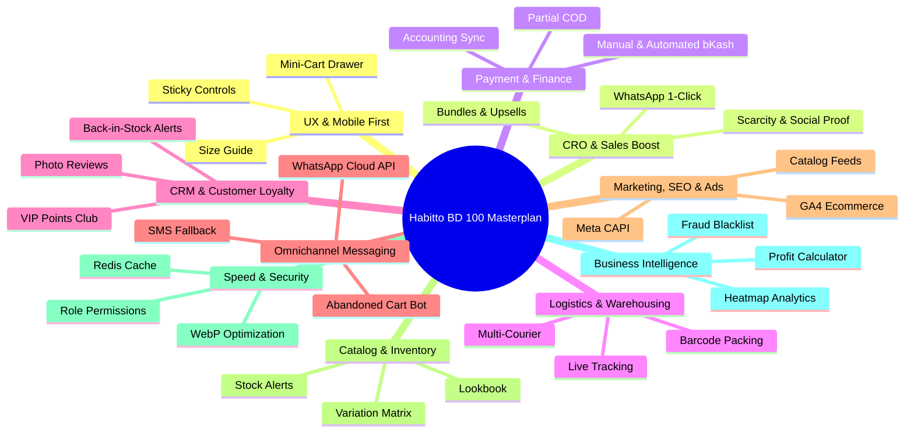

# 🌟 Habitto BD — ১০০টি কাজের পূর্ণাঙ্গ মেগাপ্ল্যান ও রোডম্যাপ (100 E-Commerce Scaling Tasks)

> **ব্র্যান্ড:** Habitto BD — Premium Streetwear & Lifestyle  
> **প্রস্তুত তারিখ:** নভেম্বর ২০২৬  
> **লক্ষ্য:** বাংলাদেশের শীর্ষস্থানীয় ও আন্তর্জাতিক মানের ডিটুসি (D2C) প্রিমিয়াম ফ্যাশন ব্র্যান্ড হিসেবে Habitto BD-কে প্রতিষ্ঠিত করা।

---

## 📊 সেক্টর ওভারভিউ (Sectors Breakdown)

---

## 📱 সেক্টর ১: ইউজার এক্সপেরিয়েন্স ও মোবাইল অপ্টিমাইজেশন (UX & Mobile First)
> বাংলাদেশের ৮০%+ ই-কমার্স ট্রাফিক আসে মোবাইল ডিভাইস থেকে। মোবাইল ইউএক্স যত সহজ হবে, বিক্রয় তত বৃদ্ধি পাবে।

| # | কাজের শিরোনাম | বিস্তারিত বিবরণ ও বিজনেস বেনিফিট | অগ্রাধিকার |
| :-: | :--- | :--- | :-: |
| **১** | **মোবাইল বটম নেভিগেশন বার** | মোবাইলে স্ক্রিনের নিচে ফিক্সড বার (Home, Shop, Cart with Badge, Account, WhatsApp)। কাস্টমার এক ক্লিকে যেকোনো পেজে যেতে পারবে। | 🔴 High |
| **২** | **স্টিকি 'Buy Now' ও 'Add to Cart' বাটন** | প্রোডাক্ট পেজে নিচে স্ক্রোল করার সময় "এখনই কিনুন" বাটন স্ক্রিনে আটকে থাকবে, যা ইনস্ট্যান্ট পারচেজ বাড়াবে। | 🔴 High |
| **৩** | **ইন্টারেক্টিভ সাইজ গাইড মডাল (Size Chart)** | প্রতিটি পণ্যের নিচে বুকে ইঞ্চি, লম্বা ইঞ্চি, ফিটিংস টাইপ (Oversized / Regular) এর স্পষ্ট টেবিল। এটি কাপড় রিটার্ন রেট ৬০% কমাবে। | 🔴 High |
| **৪** | **স্লাইড-ওভার মিনি কার্ট ড্রয়ার (Mini Cart)** | 'Add to Cart' চাপলে পেজ রিলোড না হয়ে ডানপাশ থেকে কার্ট ড্রয়ার স্লাইড করে আসবে। | 🟠 Medium |
| **৫** | **ফ্রি ডেলিভারি প্রগ্রেস বার** | কার্ট ড্রয়ারে লাইভ বার: *"আর মাত্র ৳৩১০ টাকার পণ্য যোগ করলেই ফ্রি ডেলিভারি!"*—এটি কার্ট ভ্যালু (AOV) বাড়াবে। | 🟠 Medium |
| **৬** | **কালার সোয়াচ ও সাইজ পিল বাটন** | সাধারণ ড্রপডাউনের বদলে কালার বৃত্ত এবং আধুনিক সাইজ বাটন (S, M, L, XL) সিলেক্টর। | 🟢 Normal |
| **৭** | **ইনস্ট্যান্ট লাইভ সার্চ উইজেট** | সার্চ বক্সে ২টি অক্ষর লিখলেই প্রোডাক্টের ছবি, সাইজ ও মূল্যসহ ড্রপডাউন চলে আসবে। | 🟠 Medium |
| **৮** | **রিসেন্টলি ভিউড প্রোডাক্টস ক্যারোসেল** | কাস্টমার অতীতে কোন কোন টি-শার্ট দেখেছেন তা পেজের নিচে সেভ থাকবে, ফলে সহজে খুঁজে পাবেন। | 🟢 Normal |
| **৯** | **স্কেলিটন লোডিং ও স্মুথ ইমেজ ট্রানজিশন** | পেজ লোড হওয়ার সময় কনটেন্ট লাফানো বন্ধ করতে প্রিমিয়াম ধূসর স্কেলিটন লোডার যুক্ত করা। | 🟢 Normal |
| **১০**| **১-ক্লিক ইমেজ জুম ও সোয়াইপ গ্যালারি** | মোবাইলে টাচ জেসচারে সহজে প্রোডাক্টের ফেব্রিক ও সেলাই স্পষ্ট জুম করে দেখার সুবিধা। | 🟠 Medium |

---

## 📈 সেক্টর ২: কনভার্সন অপ্টিমাইজেশন ও বিক্রয় বৃদ্ধি (CRO & Sales Boost)
> সাধারণ ভিজিটরকে ক্রেতায় রূপান্তর করা এবং প্রতি অর্ডারে গড় বিক্রয় মূল্য (AOV) বৃদ্ধি করা।

| # | কাজের শিরোনাম | বিস্তারিত বিবরণ ও বিজনেস বেনিফিট | অগ্রাধিকার |
| :-: | :--- | :--- | :-: |
| **১১**| **হোয়াটসঅ্যাপ ১-ক্লিক ডিরেক্ট অর্ডার** | চেকআউট পূরণ না করতে চাওয়া কাস্টমারদের জন্য "WhatsApp-এ অর্ডার করুন" বাটন। প্রডাক্টের নাম, সাইজ ও ছবি অটোমেটিক চ্যাটে যাবে। | 🔴 High |
| **১২**| **কম্বো অফার ও বান্ডেল সেলস (Frequently Bought Together)** | "টি-শার্ট + কার্গো প্যান্ট একসাথে কিনলে ২০০ টাকা ছাড়"—এক ক্লিকে পুরো বান্ডেল কার্টে যোগ। | 🔴 High |
| **১৩**| **কোয়ান্টিটি টিয়ার ডিসকাউন্ট** | "১টি কিনলে ৳৫৯০, ২টি কিনলে ৳১,১০০, ৩টি কিনলে ফ্রি ডেলিভারি"—কাস্টমারকে বেশি পণ্য কিনতে উৎসাহিত করবে। | 🔴 High |
| **১৪**| **রিয়েল-টাইম সোশ্যাল প্রুফ পপআপ** | সাইটের কোণায় রিয়েল-টাইম নোটিফিকেশন: *"মিরপুর থেকে আকাশ ২ মিনিট আগে একটি Acid Wash T-Shirt কিনেছেন!"* | 🟠 Medium |
| **১৫**| **লিমিটেড ড্রপ কাউন্টডাউন টাইমার** | লিমিটেড এডিশন কালেকশন রিলিজের জন্য পেজে আর্জেন্ট কাউন্টডাউন টাইমার ("ড্রপ শেষ হতে বাকি ৩ ঘণ্টা")। | 🟠 Medium |
| **১৬**| **লো স্টক স্কেয়ারসিটি অ্যালার্ট** | স্টকে ৩ বা কম পণ্য থাকলে লাল ব্যাজ দেখানো: *"মাত্র ২টি সাইজ L স্টকে অবশিষ্ট আছে!"* | 🟠 Medium |
| **১৭**| **ফ্রি গিফট রুল ইঞ্জিন (Gift with Purchase)** | নির্দিষ্ট টাকার কেনাকাটায় স্বয়ংক্রিয় গিফট কার্টে যুক্ত হওয়া (যেমন: ৳২,৫০০+ অর্ডারে ফ্রি প্রিমিয়াম মোজা বা কী-রিং)। | 🟢 Normal |
| **১৮**| **এক্সিট-ইনটেন্ট ডিসকাউন্ট পপআপ** | কাস্টমার সাইট ছেড়ে চলে যাওয়ার সময় বিশেষ এককালীন কুপন কোডের আকর্ষণীয় পপআপ। | 🟢 Normal |
| **১৯**| **পোস্ট-পারচেজ ১-ক্লিক আপসেল** | অর্ডার সফল হওয়ার থ্যাঙ্ক-ইউ পেজে বিশেষ ডিসকাউন্টে অ্যাক্সেসরিজ (ক্যাপ, মোজা) যোগ করার সুযোগ। | 🟠 Medium |
| **২০**| **ফোন নাম্বার অটো-কমপ্লিট ও গেস্ট চেকআউট** | কোনো একাউন্ট খোলা ছাড়াই শুধু নাম, ফোন ও ঠিকানা দিয়ে ১০ সেকেন্ডে দ্রুততম চেকআউট। | 🔴 High |

---

## 💳 সেক্টর ৩: পেমেন্ট ও ফিন্যান্সিয়াল অটোমেশন (Payment & Financials)
> গ্রাহকের পেমেন্ট অভিজ্ঞতা সহজ করা এবং আর্থিক হিসাব-নিকাশ নিখুঁত রাখা।

| # | কাজের শিরোনাম | বিস্তারিত বিবরণ ও বিজনেস বেনিফিট | অগ্রাধিকার |
| :-: | :--- | :--- | :-: |
| **২১**| **ম্যানুয়াল বিকাশ ও নগদ পেমেন্ট** | পার্সোনাল/মার্চেন্ট নম্বরে সেন্ড-মানি করে TrxID ও প্রেরকের শেষ ৪ ডিজিট দিয়ে চেকআউট করার অপশন। | 🔴 High |
| **২২**| **অটোমেটেড বিকাশ পেমেন্ট গেটওয়ে (bKash PGW)** | বিকাশ মার্চেন্ট অ্যাকাউন্ট ইন্টিগ্রেশন (সরাসরি সাইটেই ওটিপি/পিন দিয়ে ইনস্ট্যান্ট পেমেন্ট ও ভেরিফিকেশন)। | 🔴 High |
| **২৩**| **নগদ ডিরেক্ট পেমেন্ট গেটওয়ে** | নগদের অফিশিয়াল এপিআই ইন্টিগ্রেশন। | 🟠 Medium |
| **২৪**| **SSLCommerz / SurjoPay গেটওয়ে** | ভিসা, মাস্টারকার্ড, অ্যামেক্স এবং সকল ব্যাংক কার্ডে পেমেন্ট গ্রহণের জন্য অল-ইন-ওয়ান গেটওয়ে। | 🟠 Medium |
| **২৫**| **পার্শিয়াল অ্যাডভান্স পেমেন্ট সিস্টেম** | ফেক অর্ডার রোধে কুরিয়ার চার্জ (৳১৩০) অনলাইনে অগ্রিম নিয়ে বাকি টাকা ক্যাশ অন ডেলিভারিতে নেওয়ার সিস্টেম। | 🔴 High |
| **২৬**| **ডিজিটাল ওয়ালেট / স্টোর ক্রেডিট** | রিফান্ড বা এক্সচেঞ্জের ক্ষেত্রে কাস্টমারের ওয়ালেটে ব্যালেন্স জমা থাকা, যা পরবর্তী কেনাকাটায় ব্যবহার করা যাবে। | 🟢 Normal |
| **২৭**| **স্বয়ংক্রিয় রিফান্ড রিকোয়েস্ট পোর্টাল** | কাস্টমার প্যানেল থেকে রিফান্ডের আবেদন এবং অ্যাডমিন থেকে সরাসরি ব্যাংক/বিকাশে রিফান্ড ট্র্যাক। | 🟢 Normal |
| **২৮**| **কুরিয়ার COD সেটেলমেন্ট রিকনসিলিয়েশন** | স্টিডফাস্ট কুরিয়ার থেকে প্রাপ্ত পেমেন্ট সিটের সাথে সিস্টেমের অর্ডার স্ট্যাটাস অটোমেটিক মেলানো। | 🟠 Medium |
| **২৯**| **মাল্টি-কারেন্সি ও প্রবাসী অর্ডার সাপোর্ট** | বিডিটি (৳) ছাড়াও ইউএস ডলার ($) প্রদর্শন যাতে প্রবাসী বাংলাদেশিরা দেশে গিফট অর্ডার করতে পারেন। | 🟢 Normal |
| **৩০**| **মুশকের ভ্যাট ইনভয়েস অটোমেশন** | এনবিআর স্ট্যান্ডার্ড চালানের ফরম্যাটে স্বয়ংক্রিয় ভ্যাট ক্যালকুলেশন ও প্রিন্ট। | 🟢 Normal |

---

## 🚚 সেক্টর ৪: কুরিয়ার, লজিস্টিকস ও ওয়্যারহাউস অটোমেশন (Logistics & Fulfillment)
> দ্রুততম সময়ে পণ্য প্যাকিং, নির্ভুল কুরিয়ার বুকিং এবং পার্সেল ডেলিভারি নিশ্চিতকরণ।

| # | কাজের শিরোনাম | বিস্তারিত বিবরণ ও বিজনেস বেনিফিট | অগ্রাধিকার |
| :-: | :--- | :--- | :-: |
| **৩১**| **মাল্টি-কুরিয়ার অটোমেশন (Pathao & RedX)** | বর্তমান Steadfast-এর পাশাপাশি পাঠাও এবং রেডএক্স কুরিয়ার ইন্টিগ্রেশন (ব্যাকআপ হিসেবে)। | 🟠 Medium |
| **৩২**| **পাবলিক লাইভ ট্র্যাকিং পেজ (`/track-order`)** | কাস্টমার ওয়েবসাইটে ফোন নম্বর বা অর্ডার কোড লিখে সরাসরি ম্যাপ ও পার্সেলের লাইভ স্ট্যাটাস দেখতে পাবেন। | 🔴 High |
| **৩৩**| **বাল্ক কুরিয়ার বুকিং (Bulk 1-Click Booking)** | অ্যাডমিন প্যানেলে একসাথে ২০টি অর্ডার সিলেক্ট করে ১-ক্লিকে সবগুলোর কুরিয়ার বুকিং সম্পন্ন করা। | 🔴 High |
| **৩৪**| **ব্যাচ থার্মাল লেবেল প্রিন্টার (Batch Slip Print)** | দিনে ৫০টি পার্সেলের চালান একসাথে থার্মাল রোল বা A4 শিটে এক ক্লিকে প্রিন্ট করা। | 🔴 High |
| **৩৫**| **ফেক অর্ডার ও রিটার্ন রিস্ক ডিটেক্টর** | অতীতে কোনো কাস্টমার পার্সেল রিসিভ না করে ফেরত পাঠালে অর্ডারের পাশে লাল "High Return Risk" ওয়ার্নিং দেখানো। | 🔴 High |
| **৩৬**| **ওয়্যারহাউস বিন ও বারকোড স্ক্যানিং** | পার্সেল ব্যাগে ভরার আগে বারকোড স্ক্যানার দিয়ে স্ক্যান করা, যাতে ভুল সাইজের টি-শার্ট কোনোভাবেই প্যাকেটে না যায়। | 🟠 Medium |
| **৩৭**| **অটোমেটিক ডেলিভারি স্ট্যাটাস ওয়েবহুক** | কুরিয়ার ডেলিভারি সম্পন্ন করলে স্বয়ংক্রিয়ভাবে ওয়েবসাইটের অর্ডারের স্ট্যাটাস 'Delivered' হয়ে যাওয়া। | 🟠 Medium |
| **৩৮**| **রিটার্ন ও ড্যামেজড প্রোডাক্ট ম্যানেজমেন্ট** | কুরিয়ার থেকে ফেরত আসা পণ্য স্টক সিস্টেমে স্বয়ংক্রিয়ভাবে ইনভেন্টরিতে ফিরিয়ে নেওয়া। | 🟠 Medium |
| **৩৯**| **লোকেশন-ভিত্তিক স্মার্ট কুরিয়ার রাউটিং** | ঢাকার ভেতরের অর্ডার স্বয়ংক্রিয়ভাবে পাঠাও এবং ঢাকার বাইরের অর্ডার স্টিডফাস্টে অ্যাসাইন হওয়া। | 🟢 Normal |
| **৪০**| **ঢাকা সিটি সেইম-ডে এক্সপ্রেস ডেলিভারি স্লট** | চেকআউটে অপশন: *"আজকের মধ্যেই ডেলিভারি চান? (অতিরিক্ত ৳৫০)"*—৩ ঘণ্টার মধ্যে আর্জেন্ট ডেলিভারি। | 🟠 Medium |

---

## 🤝 সেক্টর ৫: কাস্টমার রিলেশনশিপ ও রিটেনশন (CRM & Loyalty)
> একজন ক্রেতাকে আজীবনের জন্য লয়াল ব্র্যান্ড অ্যাম্বাসেডরে পরিণত করা।

| # | কাজের শিরোনাম | বিস্তারিত বিবরণ ও বিজনেস বেনিফিট | অগ্রাধিকার |
| :-: | :--- | :--- | :-: |
| **৪১**| **Habitto VIP ক্লায়েন্ট লয়ালটি পয়েন্ট** | প্রতি ৳১০০ কেনাকাটায় ৫ পয়েন্ট। পয়েন্ট জমিয়ে পরবর্তী কেনাকাটায় ক্যাশ ডিসকাউন্ট রিডিম। | 🟠 Medium |
| **৪২**| **গ্রাহকদের ছবির রিভিউ ও স্টার রেটিং** | কাস্টমার পণ্য পরে তোলা ছবি আপলোড করতে পারবেন এবং রিভিউয়ের নিচে "Verified Buyer" ব্যাজ থাকবে। | 🔴 High |
| **৪৩**| **স্বয়ংক্রিয় রিভিউ রিকোয়েস্ট SMS/WhatsApp** | পার্সেল ডেলিভারি হওয়ার ৩ দিন পর কাস্টমারের মোবাইলে রিকোয়েস্ট: *"আপনার টি-শার্টটি কেমন লেগেছে? ছবি দিয়ে রিভিউ দিলে পাবেন ৫০ টাকা ক্যাশব্যাক!"* | 🔴 High |
| **৪৪**| **কাস্টমার লাইফটাইম স্পেন্ড ও VIP ব্যাজ** | কাস্টমার প্রোফাইলে ব্যাজ: Bronze, Silver, Gold, Black VIP (যাঁরা ৫,০০০+ টাকার পণ্য কিনেছেন)। | 🟢 Normal |
| **৪৫**| **অটোমেটেড বার্থডে সারপ্রাইজ কুপন** | কাস্টমারের জন্মদিনের সকালে স্বয়ংক্রিয় জন্মদিনের শুভেচ্ছা ও বিশেষ ১৫% ছাড়ের কুপন এসএমএস। | 🟢 Normal |
| **৪৬**| **ব্যাক-ইন-স্টক নোটিফিকেশন অ্যালার্ট** | কোনো সাইজ স্টকে না থাকলে কাস্টমার "Notify Me" বাটন চাপবেন; স্টক আসলে সাথে সাথে অটো এসএমএস যাবে। | 🟠 Medium |
| **৪৭**| **কাস্টমার সেলফ-সার্ভিস অর্ডার এডিট** | অর্ডার কনফার্মের পর ওয়্যারহাউস প্যাক করার আগ পর্যন্ত কাস্টমার নিজের ঠিকানা বা সাইজ পরিবর্তনের আবেদন করতে পারবেন। | 🟢 Normal |
| **৪৮**| **কাস্টমার ড্যাশবোর্ডে সাপোর্ট টিকিট** | কাস্টমার প্রোফাইল থেকেই যেকোনো সমস্যার জন্য সরাসরি টিকিট ওপেন করতে পারবেন। | 🟢 Normal |
| **৪৯**| **স্মার্ট কাস্টমার ট্যাগিং** | অ্যাডমিন থেকে কাস্টমারকে ট্যাগ করা: "Regular Buyer", "Streetwear Enthusiast", "High Spender"। | 🟢 Normal |
| **৫০**| **রেফারাল অ্যান্ড আর্ন প্রোগ্রাম** | "বন্ধুকে রেফার করলে বন্ধু পাবে ৳১০০ ডিসকাউন্ট, আর আপনি পাবেন ৳১০০ শপিং পয়েন্ট"। | 🟠 Medium |

---

## 💬 সেক্টর ৬: নোটিফিকেশন ও যোগাযোগ অটোমেশন (Omnichannel Messaging)
> কাস্টমারের সাথে তাৎক্ষণিক, পেশাদার ও স্বয়ংক্রিয় যোগাযোগ চ্যানেল তৈরি।

| # | কাজের শিরোনাম | বিস্তারিত বিবরণ ও বিজনেস বেনিফিট | অগ্রাধিকার |
| :-: | :--- | :--- | :-: |
| **৫১**| **এসএমএস গেটওয়ে অটো-ফেলওভার (Fallback)** | প্রাইমারি এসএমএস গেটওয়ে কোনো কারণে ডাউন থাকলে অটোমেটিক ব্যাকআপ গেটওয়ে দিয়ে এসএমএস চলে যাবে। | 🔴 High |
| **৫২**| **হোয়াটসঅ্যাপ বিজনেস ক্লাউড এপিআই** | এসএমএস-এর পাশাপাশি হোয়াটসঅ্যাপে অফিসিয়াল গ্রিন টিক ব্র্যান্ড প্রোফাইল থেকে অর্ডার সামারি ও ট্র্যাকিং পাঠানো। | 🔴 High |
| **৫৩**| **অ্যাব্যান্ডনড কার্ট রিকভারি অটোমেশন** | কাস্টমার কার্টে পণ্য রেখে চলে যাওয়ার ৩০ মিনিট পর অটো রিমাইন্ডার: *"আপনার কার্টটি কি ভুলে ফেলে গেছেন? আজ অর্ডার করলেই ফ্রি ডেলিভারি!"* | 🔴 High |
| **৫৪**| **ইন্টারেক্টিভ WhatsApp অর্ডার কনফার্মেশন** | অর্ডারের পর হোয়াটসঅ্যাপে বট মেসেজ যাবে দুটি বাটনসহ: `[ অর্ডার কনফার্ম করুন ]` ও `[ বাতিল করুন ]`—যা ফেক অর্ডার ৯৫% কমাবে। | 🔴 High |
| **৫৫**| **লাইভ চ্যাট উইজেট ইন্টিগ্রেশন** | সাইটের কোণায় WhatsApp বা Crisp লাইভ চ্যাট বাটন, যাতে কেনার আগেই কাস্টমার দ্রুত সাইজ নিয়ে কথা বলতে পারেন। | 🔴 High |
| **৫৬**| **ওয়েব পুশ নোটিফিকেশন** | নতুন প্রোডাক্ট ড্রপ হলে ব্রাউজার নোটিফিকেশনের মাধ্যমে মোবাইল ও ডেস্কটপ স্ক্রিনে তাৎক্ষণিক ড্রপ অ্যালার্ট। | 🟠 Medium |
| **৫৭**| **অটোমেটেড প্রিমিয়াম HTML ইমেইল ইনভয়েস** | বিশ্বমানের ব্রান্ডেড ইমেইল ডিজাইন (লোগো, ট্র্যাকিং ম্যাপ, সোশাল মিডিয়া লিঙ্কসহ)। | 🟢 Normal |
| **৫৮**| **স্টোর ওনারের নাইটলি সেলস সামারি** | প্রতিদিন রাত ১১:৫৯ মিনিটে স্টোর মালিকের ফোনে দিনের মোট সেলস, মোট অর্ডার ও কালেকশনের রিপোর্ট এসএমএস। | 🟢 Normal |
| **৫৯**| **ভিআইপি ড্রপ প্রাইভেট নোটিফিকেশন** | নতুন কালেকশন সাধারণ কাস্টমারদের জন্য ওপেন হওয়ার ১ দিন আগে ভিআইপি মেম্বারদের কাছে এক্সক্লুসিভ লিঙ্ক পাঠানো। | 🟢 Normal |
| **৬০**| **অর্ডার রিটার্ন ও এক্সচেঞ্জ আপডেট অ্যালার্ট** | এক্সচেঞ্জের পার্সেল অফিসে পৌঁছালে এবং নতুন পার্সেল বের হলে স্বয়ংক্রিয় নোটিফিকেশন। | 🟢 Normal |

---

## 🎯 সেক্টর ৭: ডিজিটাল মার্কেটিং, এসইও ও গ্রোথ ট্র্যাকিং (SEO, Ads & Growth)
> ফেসবুক ও গুগলে বিজ্ঞাপনের রিটার্ন অন অ্যাড স্পেন্ড (ROAS) সর্বোচ্চ করা এবং অরগানিক গুগল ট্রাফিক আনা।

| # | কাজের শিরোনাম | বিস্তারিত বিবরণ ও বিজনেস বেনিফিট | অগ্রাধিকার |
| :-: | :--- | :--- | :-: |
| **৬১**| **মেটা কনভার্সন এপিআই (Meta CAPI - Server Side)** | ব্রাউজারের অ্যাড-ব্লকার বা iOS রেস্ট্রিকশন বাইপাস করে ১০০% নির্ভুল পারচেজ ডাটা সরাসরি সার্ভার থেকে ফেসবুকে পাঠানো। | 🔴 High |
| **৬২**| **গুগল অ্যানালিটিক্স ৪ (GA4 Enhanced Ecommerce)** | গুগল ট্যাগ ম্যানেজারের মাধ্যমে ViewItem, AddToCart, BeginCheckout এবং Purchase ইভেন্ট ট্র্যাক। | 🔴 High |
| **৬৩**| **ফেসবুক ডায়নামিক প্রোডাক্ট ক্যাটালগ অটো-ফিড** | ওয়েবসাইটে নতুন প্রোডাক্ট যোগ করলে বা স্টক শেষ হলে স্বয়ংক্রিয়ভাবে ফেসবুক ও ইনস্টাগ্রাম শপে সিঙ্ক হওয়া। | 🔴 High |
| **৬৪**| **গুগল মার্চেন্ট সেন্টার অটো-ফিড** | গুগলে সার্চ করলে প্রোডাক্টের ছবি, মূল্য ও স্টক স্ট্যাটাস গুগল শপিংয়ে ফ্রিতে দেখানো। | 🟠 Medium |
| **৬৫**| **প্রোগ্রাম্যাটিক Schema.org JSON-LD** | গুগলে প্রোডাক্টের রিভিউ স্টার, প্রাইস ও "In Stock" ব্যাজ দেখানোর জন্য নিখুঁত স্ট্রাকচার্ড ডাটা। | 🟠 Medium |
| **৬৬**| **ডায়নামিক ওপেনগ্রাফ (OG) প্রিভিউ ইমেজ** | ফেসবুকে যেকোনো প্রোডাক্টের লিঙ্ক শেয়ার করলে ছবির ওপর স্বয়ংক্রিয়ভাবে সুন্দর ফ্রেম ও প্রাইস ব্যাজ তৈরি হওয়া। | 🟢 Normal |
| **৬৭**| **লোকাল এসইও ও কিওয়ার্ড অপ্টিমাইজেশন** | "premium oversized t-shirt price in bangladesh", "streetwear brand bd" ইত্যাদি কীওয়ার্ডে গুগল র্যাঙ্কিং অপ্টিমাইজেশন। | 🟠 Medium |
| **৬৮**| **ইউটিএম ট্র্যাকার ও অ্যাডস অ্যাট্রিবিউশন** | অ্যাডমিনের প্রতিটি অর্ডারের পাশে দেখা যাবে—অর্ডারটি ফেসবুকের কোন নির্দিষ্ট বিজ্ঞাপন বা ক্যাম্পেইন থেকে এসেছে। | 🔴 High |
| **৬৯**| **ইনফ্লুয়েন্সার ও অ্যাফিলিয়েট ট্র্যাকিং** | ফ্যাশন ইনফ্লুয়েন্সারদের জন্য ইউনিক প্রোমোকোড বা রেফারাল লিঙ্ক এবং তাদের সেলসের কমিশন ড্যাশবোর্ড। | 🟠 Medium |
| **৭০**| **টিকটক পিক্সেল ও ইভেন্ট ইন্টিগ্রেশন** | বাংলাদেশে ইয়ুথ অডিয়েন্স টার্গেট করার জন্য টিকটক অ্যাড পিক্সেল ও সার্ভার ইভেন্ট ট্র্যাকিং। | 🟢 Normal |

---

## 👕 সেক্টর ৮: ইনভেন্টরি, সাইজিং ও প্রোডাক্ট ক্যাটালগ (Catalog & Inventory)
> প্রোডাক্টের উপস্থাপনা আকর্ষণীয় করা এবং ওয়্যারহাউস ইনভেন্টরি ১০০% নির্ভুল রাখা।

| # | কাজের শিরোনাম | বিস্তারিত বিবরণ ও বিজনেস বেনিফিট | অগ্রাধিকার |
| :-: | :--- | :--- | :-: |
| **৭১**| **মাল্টি-ভ্যারিয়েশন ম্যাট্রিক্স (Size × Color)** | সাইজ (S, M, L, XL, XXL) এবং কালার (Acid Charcoal, Washed Black, Mocha Brown) এর নিখুঁত স্টক সমন্বয়। | 🔴 High |
| **৭২**| **লো স্টক অটোমেটিক অ্যাডমিন অ্যালার্ট** | কোনো সাইজের স্টক ৩টির নিচে নেমে গেলে অ্যাডমিনের ফোনে বা ইমেইলে সতর্কবার্তা পাঠানো। | 🔴 High |
| **৭৩**| **প্রি-অর্ডার ও ব্যাক-অর্ডার ইঞ্জিন** | নতুন ড্রপের কাপড় তৈরি হওয়ার আগেই অগ্রিম পেমেন্টে প্রি-অর্ডার নেওয়ার অপশন ("Pre-order now, delivers in 7 days")। | 🟠 Medium |
| **৭৪**| **প্রোডাক্ট কস্ট ও নিট প্রফিট ক্যালকুলেটর** | প্রডাক্ট এন্ট্রি করার সময় ক্রয়মূল্য/মেকিং খরচ লিখে রাখলে প্রতিটি সেলসে স্বয়ংক্রিয় প্রফিট ক্যালকুলেশন। | 🟠 Medium |
| **৭৫**| **বাল্ক প্রাইস ও স্টক কুইক এডিটর** | একটি এক্সেল শিটের মতো টেবিল থেকে একসাথে ৩০টি পণ্যের স্টক ও দাম ১ মিনিটে আপডেট করা। | 🟠 Medium |
| **৭৬**| **ইন্টারেক্টিভ সাইজ রিকমেন্ডেশন কুইজ** | কাস্টমার তার উচ্চতা (উদা: ৫ ফুট ৮ ইঞ্চি) এবং ওজন (উদা: ৭০ কেজি) দিলেই সাইট স্বয়ংক্রিয়ভাবে সঠিক সাইজ সাজেস্ট করবে। | 🟠 Medium |
| **৭৭**| **ফেব্রিক কেয়ার ও ওয়াশিং ইন্সট্রাকশন ট্যাব** | ড্রপ-শোল্ডার টি-শার্টের কাপড়ের মান, জিএসএম (GSM) এবং ওয়াশ কেয়ারের নির্দেশনাসংবলিত প্রিমিয়াম ট্যাব। | 🟢 Normal |
| **৭৮**| **লুকবুক ও শপ দ্য লুক (Shop the Look)** | মডেলের পরা পুরো আউটফিট (টি-শার্ট + প্যান্ট + ক্যাপ) এক ক্লিকে একসাথে কার্টে অ্যাড করার ফ্যাশন ফিচার। | 🟠 Medium |
| **৭৯**| **৩৬০-ডিগ্রি বা মাল্টি-অ্যাঙ্গেল ভিডিও প্লেয়ার** | প্রোডাক্ট পেজে মডেলের হাঁটার ছোট্ট ভিডিও ক্লিপ যাতে কাপড়ের ড্রপ এবং ফিটিংস জীবন্ত মনে হয়। | 🟢 Normal |
| **৮০**| **সিজনাল ও কালেকশন-ভিত্তিক ক্যাটাগরাইজেশন** | Summer Drops, Winter Hoodies, Streetwear Caps, Cyberpunk Edition ইত্যাদি কিউরেটেড কালেকশন পেজ। | 🟢 Normal |

---

## ⚡ সেক্টর ৯: স্পিড, পারফরম্যান্স ও সিকিউরিটি (Infrastructure & Security)
> ওয়েবসাইট যেন কোনো অবস্থায় ডাউন না হয়, ক্ষিপ্রগতিতে লোড হয় এবং ডাটা সুরক্ষিত থাকে।

| # | কাজের শিরোনাম | বিস্তারিত বিবরণ ও বিজনেস বেনিফিট | অগ্রাধিকার |
| :-: | :--- | :--- | :-: |
| **৮১**| **রেডিস (Redis) অবজেক্ট ও সেশন ক্যাশিং** | ডাটাবেজ কুয়েরি রেডিস ইন-মেমোরি ক্যাশে রেখে সাইটের স্পিড ১০০ মিলিসেকেন্ডের নিচে নিয়ে আসা। | 🔴 High |
| **৮২**| **নেক্সট-জেন ইমেজ অপ্টিমাইজেশন (WebP / AVIF)** | ইমেজ আপলোড করার সাথে সাথে স্বয়ংক্রিয়ভাবে কম সাইজের আধুনিক WebP ফরম্যাটে রূপান্তর। | 🔴 High |
| **৮৩**| **ক্লাউডফ্লেয়ার (Cloudflare) সিডিএন ও ডিডস প্রটেকশন** | গ্লোবাল ক্লাউডফ্লেয়ার এজ ক্যাশিং যুক্ত করে সাইবার আক্রমণ থেকে রক্ষা এবং সুপারফাস্ট কন্টেন্ট ডেলিভারি। | 🔴 High |
| **৮৪**| **স্বয়ংক্রিয় ক্লাউড ব্যাকআপ (Google Drive / S3)** | প্রতিদিন রাত ২টায় সম্পূর্ণ ডাটাবেজ ও প্রোডাক্ট ইমেজের ব্যাকআপ স্বয়ংক্রিয়ভাবে গুগল ড্রাইভে সেভ হওয়া। | 🔴 High |
| **৮৫**| **টু-ফ্যাক্টর অথেনটিকেশন (2FA) ফর অ্যাডমিন** | অ্যাডমিন প্যানেল হ্যাকিং থেকে রক্ষা করতে গুগল অথেনটিকেটর ওটিপি বা এসএমএস লগইন নিরাপত্তা। | 🔴 High |
| **৮৬**| **রোল-বেসড অ্যাক্সেস কন্ট্রোল (RBAC)** | বিভিন্ন কর্মীদের জন্য আলাদা একাউন্ট: "Order Manager" শুধু অর্ডার দেখবেন, "Accountant" শুধু রিপোর্ট দেখবেন। | 🟠 Medium |
| **৮৭**| **বট ও ফেক ট্রাফিক প্রটেকশন (Cloudflare Turnstile)** | কোনো বিরক্তিকর ক্যাপচা ছাড়াই ব্যাকগ্রাউন্ডে ক্ষতিকর স্ক্র্যাপার ও বট স্বয়ংক্রিয় ব্লক করা। | 🟠 Medium |
| **৮৮**| **রেট লিমিটিং ও ব্রুট-ফোর্স প্রটেকশন** | চেকআউট এবং লগইন পেজে প্রতি মিনিটে অতিরিক্ত রিকোয়েস্ট আটকে দেওয়া। | 🟠 Medium |
| **৮৯**| **ডাটাবেজ অটো-ক্লিনআপ ক্রন জব** | ৩০ দিনের পুরনো পরিত্যক্ত কার্ট ও সাময়িক ডাটা স্বয়ংক্রিয় ডিলিট করে ডাটাবেজ সবসময় ফাস্ট রাখা। | 🟢 Normal |
| **৯০**| **জিরো-ডাউনটাইম গিট ডেপ্লয়মেন্ট** | সাইট লাইভ থাকা অবস্থাতেই কোনো ডাউনটাইম ছাড়া আপডেট বা নতুন কোড পুশ করার ব্যবস্থা। | 🟢 Normal |

---

## 📊 সেক্টর ১০: বিজনেস ইন্টেলিজেন্স ও অ্যাডমিন অটোমেশন (BI & Management)
> ডেটা দেখে সঠিক ব্যবসায়িক সিদ্ধান্ত গ্রহণ এবং লাভ-ক্ষতির নিখুঁত হিসাব জানা।

| # | কাজের শিরোনাম | বিস্তারিত বিবরণ ও বিজনেস বেনিফিট | অগ্রাধিকার |
| :-: | :--- | :--- | :-: |
| **৯১**| **রিয়েল-টাইম সেলস ও নিট প্রফিট ড্যাশবোর্ড** | অ্যাডমিনে আজকের নিট লাভ, গ্রস রেভিনিউ, গড় অর্ডার ভ্যালু (AOV) এর চার্ট ও গ্রাফ। | 🔴 High |
| **৯২**| **কাস্টমার লাইফটাইম ভ্যালু (LTV) অ্যানালিটিক্স** | একজন কাস্টমার গড়ে কত টাকার কেনাকাটা করছেন এবং কত শতাংশ কাস্টমার পুনরায় অর্ডার করছেন (Repeat Rate)। | 🟠 Medium |
| **৯৩**| **প্রোডাক্ট পারফরম্যান্স ম্যাট্রিক্স (Slow vs Best)** | কোন টি-শার্টটি সবচেয়ে বেশি বিক্রি হচ্ছে এবং কোন মডেলটির স্টক দীর্ঘদিন ধরে জমে আছে তা চিহ্নিত করা। | 🔴 High |
| **৯৪**| **কুরিয়ার পারফরম্যান্স অ্যানালিটিক্স** | কোন কুরিয়ার দ্রুততম ডেলিভারি দিচ্ছে এবং কোন কুরিয়ারের রিটার্ন রেট কম তার তুলনামূলক চার্ট। | 🟠 Medium |
| **৯৫**| **বাংলাদেশ জেলা ও বিভাগভিত্তিক সেলস হিটম্যাপ** | বাংলাদেশের কোন জেলা (যেমন: ঢাকা, চট্টগ্রাম, সিলেট, টাঙ্গাইল) থেকে সবচেয়ে বেশি অর্ডার আসছে তা মানচিত্রে দেখা। | 🟠 Medium |
| **৯৬**| **ডেইলি/মান্থলি অ্যাকাউন্টস এক্সেল ও পিডিএফ এক্সপোর্ট** | এক ক্লিকে ব্যাংক ও ট্যাক্স অডিটের জন্য সম্পূর্ণ সেলস ও খরচের লেজার এক্সপোর্ট। | 🟠 Medium |
| **৯৭**| **কাস্টম এক্সপেন্স ট্র্যাকার (বিজ্ঞাপন ও অন্যান্য খরচ)** | ফেসবুক অ্যাড খরচ, প্যাকেজিং পলি খরচ এবং অফিসের বিবিধ খরচ লিখে রাখলে স্বয়ংক্রিয় নিট প্রফিট বের হওয়া। | 🔴 High |
| **৯৮**| **কাস্টমার ফ্রড ব্লকলিস্ট ম্যানেজার** | অতীতে প্রতারণা করা ফোন নম্বর বা ইমেইল ব্লকলিস্টে রেখে দিলে তারা আর কখনো অর্ডার করতে পারবে না। | 🔴 High |
| **৯৯**| **সাপ্লায়ার ও সোর্সিং অর্ডার ট্র্যাকার** | গার্মেন্টস ফ্যাক্টরি বা প্রিন্টিং সাপ্লায়ারকে দেওয়া কাপড়ের লট ও কাঁচামাল সোর্সিং ট্র্যাকিং। | 🟢 Normal |
| **১০০**| **স্বয়ংক্রিয় রি-অর্ডার পয়েন্ট নোটিফিকেশন** | কাপড় শেষ হওয়ার ১৫ দিন আগেই কাপড় তৈরির সময় অনুযায়ী স্বয়ংক্রিয়ভাবে রি-অর্ডারের তাগিদ দেওয়া। | 🟢 Normal |

---

## 🏆 বাস্তবায়নের সেরা ৫টি অগ্রাধিকার (Top 5 Immediate Next Steps):

1. **টাস্ক ১১:** প্রোডাক্ট পেজে **WhatsApp Direct 1-Click Order** বাটন (তাৎক্ষণিক বিক্রয় বৃদ্ধি)।
2. **টাস্ক ২১ & ২৫:** চেকআউটে **ম্যানুয়াল বিকাশ ও নগদ পেমেন্ট** এবং **পার্শিয়াল অ্যাডভান্স ডেলিভারি চার্জ** অপশন।
3. **টাস্ক ৩:** ইন্টারেক্টিভ **সাইজ চার্ট ও মেজারমেন্ট গাইড মডাল** (সাইজ কনফিউশন দূর ও রিটার্ন কমানো)।
4. **টাস্ক ৩২:** গ্রাহকদের জন্য পাবলিক **লাইভ পার্সেল ট্র্যাকিং পেজ (`/track-order`)**।
5. **টাস্ক ৩৫ & ৯৮:** **ফেক অর্ডার ব্লকলিস্ট ও রিটার্ন রিস্ক ডিটেক্টর** (কুরিয়ার লস প্রতিরোধ)।
