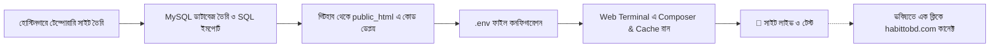

# Habitto E-Commerce: হোস্টিনগারে (Hostinger) লাইভ করার পূর্ণাঙ্গ গাইডলাইন

> **প্রকল্প:** Habitto Streetwear E-Commerce  
> **প্রযুক্তি:** Laravel 12 / PHP 8.2 / Botble CMS (Ninico Theme) / MySQL  
> **গিটহাব রিপোজিটরি:** [https://github.com/shafayetahmed80-eng/Habitto](https://github.com/shafayetahmed80-eng/Habitto)  
> **ডাটাবেজ ফাইল:** `database/habitto_backup.sql`

---

## 📌 ওভারভিউ ও কর্মপরিকল্পনা

বর্তমানে মূল ডোমেইনের ডিএনএস জটিলতা এড়াতে হোস্টিনগারের ফ্রি **টেম্পোরারি (Preview) ডোমেইন** ব্যবহার করে সাইটটি পুরোপুরি লাইভ ও টেস্ট করা হবে। সাইট শতভাগ সক্রিয় ও কার্যকর হওয়ার পর যেকোনো সময় মাত্র ৫ মিনিটে মূল ডোমেইনে (`habittobd.com`) মাইগ্রেট করে ফেলা যাবে।



---

## ধাপ ১: হোস্টিনগারে টেম্পোরারি সাইট তৈরি

1. হোস্টিনগার hPanel-এর সেটআপ স্ক্রিনের উপরে ডানদিকের **`Set up manually`** বা **`Start over`**-এ ক্লিক করুন।
2. ওয়েবসাইট টাইপ হিসেবে **PHP/HTML website** সিলেক্ট করুন।
3. ডোমেইন নির্ধারণের পেজে আসলে নিচে থাকা অপশনটি বেছে নিন:  
   👉 **`Use a temporary domain`** (অথবা **`Choose a domain later`**)।
4. হোস্টিনগার আপনাকে একটি প্রিভিউ লিংক দেবে (যেমন: `something.hostingersite.com`)।
5. সেটআপ শেষ করে **hPanel Dashboard**-এ প্রবেশ করুন।

---

## ধাপ ২: MySQL ডাটাবেজ তৈরি ও ব্যাকআপ ইমপোর্ট

1. হোস্টিনগার hPanel-এর বাম পাশের মেনু থেকে যান: **Databases** ➔ **MySQL Databases**।
2. একটি নতুন ডাটাবেজ তৈরি করুন:
   - **Database Name:** যেমন `habitto_db` (পুরো নাম হতে পারে `u123456_habitto_db`)
   - **Username:** যেমন `habitto_user`
   - **Password:** একটি শক্তিশালী পাসওয়ার্ড দিন এবং তথ্যগুলো নোটপ্যাডে লিখে রাখুন।
3. নিচে ডাটাবেজ তালিকার পাশে থাকা **Enter phpMyAdmin** বাটনে ক্লিক করুন।
4. phpMyAdmin ওপেন হলে উপরের মেনু থেকে **Import** ট্যাবে যান।
5. **Choose File**-এ ক্লিক করে আপনার কম্পিউটারের নিচের ফাইলটি সিলেক্ট করুন:  
   📂 `C:\Habitto\database\habitto_backup.sql`  
   *(অথবা গিটহাব রিপোজিটরি থেকে ডাউনলোড করা `habitto_backup.sql` ফাইল)*
6. পেজের একদম নিচে গিয়ে **Go** বা **Import** বাটনে ক্লিক করুন।  
> সফলভাবে ইমপোর্ট হলে সব পণ্য, ফটোশুট ইমেজ, ক্যাটাগরি এবং সেটিংস ডাটাবেজে লোড হয়ে যাবে।

---

## ধাপ ৩: গিটহাব থেকে সরাসরি কোড ডেপ্লয় (Git Deploy)

1. hPanel-এর সার্চবারে লিখুন **Git** অথবা যান **Advanced** ➔ **Git**।
2. নিচের তথ্যগুলো দিয়ে ফর্মটি পূরণ করুন:
   - **Repository:** `https://github.com/shafayetahmed80-eng/Habitto.git`
   - **Branch:** `main`
   - **Install Directory:** এটি ফাঁকা রাখুন (অথবা `public_html` লিখুন)।
3. **Create** বাটনে ক্লিক করুন।
4. রিপোজিটরি যুক্ত হলে পাশে থাকা **Deploy** বাটনে ক্লিক করুন।  
> এটি স্বয়ংক্রিয়ভাবে গিটহাব থেকে সমস্ত ফাইল, Ninico থিম, CSS, JS ও প্রোডাক্ট ফটোগুলো `public_html`-এ ডাউনলোড করে দেবে।

---

## ধাপ ৪: এনভায়রনমেন্ট কনফিগারেশন (`.env` ফাইল)

1. hPanel থেকে যান **Files** ➔ **File Manager** ➔ **public_html** ফোল্ডারে প্রবেশ করুন।
2. সেখানে `.env.example` নামের একটি ফাইল পাবেন। সেটিকে **Rename** করে নাম দিন **`.env`**।
3. `.env` ফাইলে ডাবল ক্লিক করে এডিটরে ওপেন করুন এবং নিচের অংশগুলো পরিবর্তন করুন:

```env
APP_NAME="Habitto"
APP_ENV=production
APP_DEBUG=false
APP_URL=https://আপনার-টেম্পোরারি-ডোমেইন.hostingersite.com

DB_CONNECTION=mysql
DB_HOST=127.0.0.1
DB_PORT=3306
DB_DATABASE=আপনার_তৈরি_করা_ডাটাবেজ_নাম
DB_USERNAME=আপনার_তৈরি_করা_ডাটাবেজ_ইউজার
DB_PASSWORD=আপনার_ডাটাবেজের_পাসওয়ার্ড
```
4. উপরে থাকা **Save** বাটনে ক্লিক করে ফাইলটি সংরক্ষণ করুন।

---

## ধাপ ৫: ওয়েব টার্মিনালে ডিপেন্ডেন্সি ও ক্যাশ অপটিমাইজেশন

1. hPanel-এর বাম পাশের মেনু থেকে যান: **Advanced** ➔ **SSH / Terminal**।
2. পেজের নিচের দিকে থাকা **Web Terminal** ওপেন করুন।
3. টার্মিনালে ক্রমান্বয়ে নিচের কমান্ডগুলো টাইপ করে **Enter** চাপুন:

```bash
# ১. প্রজেক্ট ফোল্ডারে প্রবেশ
cd public_html

# ২. প্রোডাকশন লাইব্রেরি ইনস্টলেশন
composer install --no-dev --optimize-autoloader

# ৩. অ্যাপ্লিকেশন সিকিউরিটি কি তৈরি
php artisan key:generate

# ৪. আগের ক্যাশে পরিষ্কার ও অপটিমাইজেশন
php artisan optimize:clear
php artisan config:cache
php artisan route:cache
php artisan view:cache
```

---

## ধাপ ৬: লাইভ সাইট যাচাই ও টেস্টিং

এখন আপনার ব্রাউজারে হোস্টিনগারের দেওয়া **Temporary Domain** লিংকটি ওপেন করুন:
- **হোমপেজ:** ফুল-ব্লিড ফটোশুট ব্যানার, ক্যাটাগরি এবং ক্যাশ অন ডেলিভারি ব্যাজ সঠিকভাবে লোড হচ্ছে কি না দেখুন।
- **প্রোডাক্ট ও কার্ট:** যেকোনো প্রোডাক্ট কার্টে অ্যাড করে চেকআউট পেজে গিয়ে ক্যাশ অন ডেলিভারি মেথড যাচাই করুন।
- **অ্যাডমিন প্যানেল:** `https://আপনার-টেম্পোরারি-ডোমেইন.hostingersite.com/admin` লিংকে গিয়ে আপনার এডমিন ইউজারনেম ও পাসওয়ার্ড দিয়ে লগইন করুন।

---

## 🔄 ধাপ ৭: পরবর্তীতে মূল ডোমেইনে (`habittobd.com`) রূপান্তর

যখনই সাইটের সব ফিচার যাচাই করে সন্তুষ্ট হবেন, তখন নিচের ৩টি ধাপে সাইটটি মূল ডোমেইনে নিয়ে যাবেন:

1. **হোস্টিনগারে ডোমেইন পরিবর্তন:**
   - hPanel ড্যাশবোর্ডে টেম্পোরারি ডোমেইনের পাশে থাকা **Change Domain** বা **Connect Domain**-এ ক্লিক করে লিখবেন `habittobd.com`।
2. **আইটি নাটে নেমসার্ভার আপডেট:**
   - আইটি নাট ক্লায়েন্ট এরিয়ায় লগইন করে আপনার ডোমেইনের Nameserver অপশনে গিয়ে হোস্টিনগারের নেমসার্ভার বসিয়ে সেভ করবেন:
     - `ns1.dns-parking.com`
     - `ns2.dns-parking.com`
3. **`.env` ফাইল আপডেট ও ক্যাশ ক্লিয়ার:**
   - ফাইল ম্যানেজারে `.env` ফাইলে শুধুমাত্র ডোমেইন ইউআরএলটি পরিবর্তন করুন:
     ```env
     APP_URL=https://habittobd.com
     ```
   - অ্যাডমিন প্যানেলের **Administration ➔ Cache management** থেকে **Clear all caches** চাপুন।

---

## 🛠 সাধারণ সমস্যা ও তার তাৎক্ষণিক সমাধান (Troubleshooting)

| সমস্যা | সম্ভাব্য কারণ | তাৎক্ষণিক সমাধান |
| :--- | :--- | :--- |
| **500 Server Error** | `.env` ফাইলে ডাটাবেজ তথ্যে ভুল অথবা `APP_KEY` জেনারেট না হওয়া | `.env` ফাইলে ডাটাবেজ পাসওয়ার্ড চেক করুন এবং টার্মিনালে `php artisan key:generate` চালান। |
| **স্টাইল বা সিএসএস না পাওয়া** | ব্রাউজারে ক্যাশ আটকে থাকা | কীবোর্ডে `Ctrl + F5` দিয়ে হার্ড রিফ্রেশ করুন এবং টার্মিনালে `php artisan optimize:clear` চালান। |
| **ইমেজ ৪MD বা ব্রোকেন দেখায়** | ফাইল পারমিশন ইস্যু | ফাইল ম্যানেজারে `public/storage` ফোল্ডারের পারমিশন `755` বা `775` নিশ্চিত করুন। |
