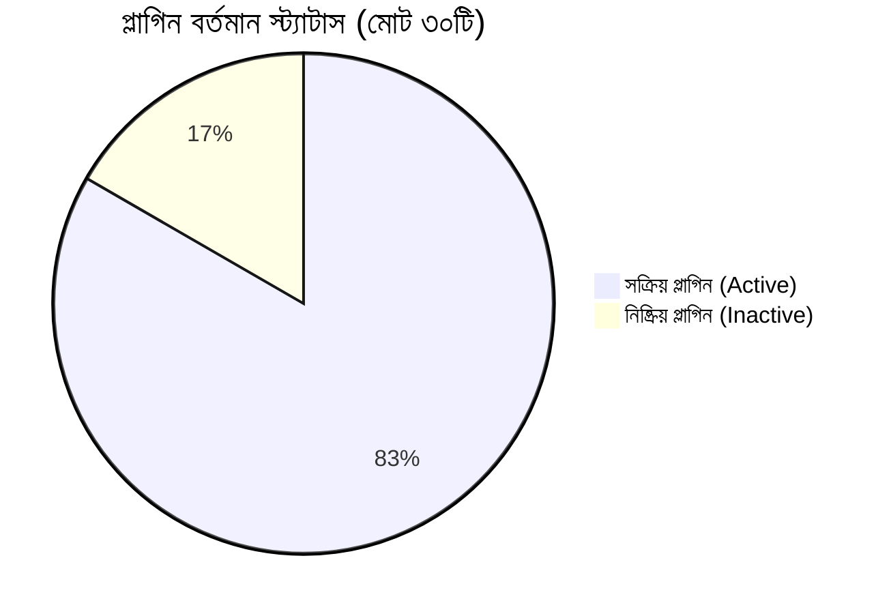

# Habitto BD: ইন্সটল্ড প্লাগিনসমূহের পূর্ণাঙ্গ টেকনিক্যাল ও ফাংশনাল ডকুমেন্টেশন

> **তারিখ:** ০১ নভেম্বর, ২০২৬  
> **প্রজেক্ট:** Habitto BD (Botble CMS / Ninico Fashion E-commerce)  
> **এনভায়রনমেন্ট:** Laravel 12.34.0 / PHP 8.2 / MySQL  
> **মোট প্লাগিন সংখ্যা:** ৩০টি (সক্রিয়: ২৫টি, নিষ্ক্রিয়: ৫টি)

---

## ১. এক্সিকিউটিভ সামারি (Executive Summary)

Habitto BD ই-কমার্স প্ল্যাটফর্মে মোট **৩০টি প্লাগিন** ইন্সটল করা রয়েছে। এই প্লাগিনগুলো অনলাইন স্টোরের পণ্য প্রদর্শন, ইনভেন্টরি, অর্ডার প্রসেসিং, পেমেন্ট চ্যানেল, কনভার্সন অপটিমাইজেশন, এসইও (SEO), সিকিউরিটি এবং মাল্টি-ল্যাঙ্গুয়েজ সাপোর্ট পরিচালনা করে।

### স্ট্যাটাস ওভারভিউ
- **সক্রিয় প্লাগিন (Active):** ২৫টি (দেশীয় ই-কমার্সের জন্য সম্পূর্ণ প্রয়োজনীয়)
- **নিষ্ক্রিয় প্লাগিন (Inactive):** ৫টি (`mollie`, `paystack`, `razorpay`, `shippo`, `sale-popup`)
- **প্রধান ই-কমার্স ব্যাকবোন:** `ecommerce` (যার অধীনে ৯১টি ডাটাবেজ টেবিল এবং ৪৪৮টি রাউট কাজ করছে)

---

## ২. প্লাগিন ক্যাটাগরিভিত্তিক গভীর বিশ্লেষণ (Deep Dive Analysis)

---

### ক্যাটাগরি ১: কোর ই-কমার্স ইঞ্জিন (Core E-commerce Engine)

#### ১. Ecommerce (`botble/ecommerce`)
* **ভার্সন:** `v3.10.11` | **লেখক:** Botble Technologies | **স্ট্যাটাস:** ACTIVE [সক্রিয়]
* **মূল ভূমিকা:** সম্পূর্ণ ওয়েবসাইটের হৃৎপিণ্ড। পণ্য তালিকা, ভ্যারিয়েশন (Size/Color), ইনভেন্টরি স্টক, অর্ডার প্রসেসিং, ইনভয়েস জেনারেশন, ডিসকাউন্ট কুপন, ট্যাক্স রুলস, উইশলিস্ট এবং গ্রাহক অ্যাকাউন্ট পরিচালনা করে।
* **ডাটাবেজ ইমপ্যাক্ট:** ৯১টি টেবিল (যেমন: `ec_products`, `ec_orders`, `ec_customers`, `ec_product_variations`, `ec_flash_sales` ইত্যাদি)।
* **এডমিন লোকেশন:** এডমিন মেনুর **Ecommerce** (Orders, Products, Categories, Flash Sales, Discounts, Customers, Invoices)।
* **হাবিত্তো বিডি-র জন্য সুপারিশ:** **অপরিহার্য (CRITICAL)**। এটি বন্ধ করলে সমগ্র অনলাইন স্টোর অচল হয়ে যাবে।

---

### ক্যাটাগরি ২: পেমেন্ট গেটওয়ে সমূহ (Payment Gateways)

#### ২. Payment Core (`botble/payment`)
* **ভার্সন:** `v1.1.3` | **লেখক:** Botble Technologies | **স্ট্যাটাস:** ACTIVE [সক্রিয়]
* **মূল ভূমিকা:** প্ল্যাটফর্মের সব পেমেন্ট গেটওয়ের মূল কানেক্টিভিটি ফ্রেমওয়ার্ক। লেনদেনের লগ, পেমেন্ট স্ট্যাটাস (Pending, Completed, Refunded) সংরক্ষণ করে।
* **ডাটাবেজ টেবিল:** `payments`, `payment_logs`
* **এডমিন লোকেশন:** **Settings ➔ Payment methods**
* **হাবিত্তো বিডি-র জন্য সুপারিশ:** **অপরিহার্য (CRITICAL)**।

#### ৩. SSLCommerz Payment Gateway (`botble/sslcommerz`)
* **ভার্সন:** `v1.0.3` | **লেখক:** Botble Technologies | **স্ট্যাটাস:** ACTIVE [সক্রিয়]
* **মূল ভূমিকা:** বাংলাদেশের শীর্ষস্থানীয় স্থানীয় পেমেন্ট গেটওয়ে। বিকাশ (bKash), নগদ (Nagad), রকেট (Rocket), উপায়, এবং বাংলাদেশি ভিসা/মাস্টারকার্ডের মাধ্যমে অনলাইন প্রি-পেমেন্ট গ্রহণ করার গেটওয়ে।
* **এডমিন লোকেশন:** **Settings ➔ Payment methods ➔ SslCommerz**
* **হাবিত্তো বিডি-র জন্য সুপারিশ:** **অতি প্রয়োজনীয় (HIGH)**। বাংলাদেশি কাস্টমারদের কাছ থেকে অনলাইন পেমেন্ট নেওয়ার জন্য এটিই মূল মাধ্যম।

#### ৪. Stripe Payment Gateway (`botble/stripe`)
* **ভার্সন:** `v1.0.3` | **লেখক:** Botble Technologies | **স্ট্যাটাস:** ACTIVE [সক্রিয়]
* **মূল ভূমিকা:** আন্তর্জাতিক ক্রেডিট/ডেবিট কার্ড (Visa, Mastercard, Amex) প্রসেসিং।
* **এডমিন লোকেশন:** **Settings ➔ Payment methods ➔ Stripe**
* **হাবিত্তো বিডি-র জন্য সুপারিশ:** প্রবাসী বা আন্তর্জাতিক ক্রেতাদের অর্ডার নেওয়ার পরিকল্পনা থাকলে অন রাখুন; অন্যথায় নিষ্ক্রিয় রাখতে পারেন।

#### ৫. PayPal Payment Gateway (`botble/paypal`)
* **ভার্সন:** `v1.0.3` | **লেখক:** Botble Technologies | **স্ট্যাটাস:** ACTIVE [সক্রিয়]
* **মূল ভূমিকা:** গ্লোবাল পেপাল অ্যাকাউন্ট ও পেপাল ক্রেডিট দিয়ে পেমেন্ট নেওয়ার সুবিধা।
* **এডমিন লোকেশন:** **Settings ➔ Payment methods ➔ PayPal**
* **হাবিত্তো বিডি-র জন্য সুপারিশ:** শুধু লোকাল বাংলাদেশে ক্যাশ অন ডেলিভারিতে বিক্রি করলে এটি আন-কনফিগার বা অফ রাখা যায়।

#### ৬. Razorpay (`botble/razorpay`), ৭. Mollie (`botble/mollie`), ৮. Paystack (`botble/paystack`)
* **ভার্সন:** `v1.0.3` / `v1.0.4` | **স্ট্যাটাস:** ACTIVE [সক্রিয়]
* **মূল ভূমিকা:** 
  - **Razorpay:** ভারত (India)-এর জন্য নির্দিষ্ট।
  - **Mollie:** ইউরোপ (Netherlands, Belgium, Germany)-এর জন্য নির্দিষ্ট।
  - **Paystack:** আফ্রিকা (Nigeria, Ghana, Kenya)-এর জন্য নির্দিষ্ট।
* **হাবিত্তো বিডি-র জন্য সুপারিশ:** **ঐচ্ছিক / নিষ্ক্রিয়যোগ্য (REDUNDANT)**। যেহেতু হাবিত্তো বিডি মূলত বাংলাদেশের লোকাল মার্কেটকেন্দ্রিক, তাই এই ৩টি আন্তর্জাতিক গেটওয়ে বন্ধ করে রাখলে ব্যাকএন্ডের বুট টাইম আরও হালকা ও দ্রুত হবে।

---

### ক্যাটাগরি ৩: মার্কেটিং ও কনভার্সন অপ্টিমাইজেশন (Marketing & Conversion)

#### ৯. Newsletter (`botble/newsletter`)
* **ভার্সন:** `v2.0.7` | **লেখক:** Botble Technologies | **স্ট্যাটাস:** ACTIVE [সক্রিয়]
* **মূল ভূমিকা:** ফুটার সাবস্ক্রিপশন বক্স এবং হোমপেইজ ওপেন হওয়ার পর ১০% ডিসকাউন্ট প্রমো পপআপ প্রদর্শন করে ইমেইল লিড সংগ্রহ করা।
* **ডাটাবেজ টেবিল:** `newsletters`
* **এডমিন লোকেশন:** **Newsletters** মেনু এবং **Appearance ➔ Theme Options ➔ Newsletter Popup**
* **হাবিত্তো বিডি-র জন্য সুপারিশ:** **প্রস্তাবিত (RECOMMENDED)**। কাস্টমারদের সাথে রি-টার্গেটিং বা প্রমোশনাল ইমেইল ক্যাম্পেইন পাঠাতে অত্যন্ত কার্যকর।

#### ১০. Announcement (`archielite/announcement`)
* **ভার্সন:** `v1.0.3` | **লেখক:** Archi Elite | **স্ট্যাটাস:** ACTIVE [সক্রিয়]
* **মূল ভূমিকা:** ওয়েবসাইটের টপ-বারে গুরুত্বপূর্ণ অফার, নোটিশ বা ফ্রি ডেলিভারি ব্যানার রানিং টেক্সট হিসেবে প্রদর্শন করা (যেমন: *"সারা দেশে ফ্রি হোম ডেলিভারি | কোড: HABITTO"* )।
* **ডাটাবেজ টেবিল:** `announcements`, `announcements_translations`
* **এডমিন লোকেশন:** এডমিন মেনুর **Announcements**
* **হাবিত্তো বিডি-র জন্য সুপারিশ:** **প্রস্তাবিত (HIGH)**। ফ্ল্যাশ সেল বা বিশেষ অফার চলাকালীন কাস্টমারের দ্রুত নজরে আনার জন্য বেস্ট টুল।

#### ১১. Ads Manager (`botble/ads`)
* **ভার্সন:** `v1.1.3` | **লেখক:** Botble Technologies | **স্ট্যাটাস:** ACTIVE [সক্রিয়]
* **মূল ভূমিকা:** হোমপেইজের বিভিন্ন সেকশনের ব্যানার এবং প্রমোশনাল গ্রাফিক্স ম্যানেজ করা।
* **ডাটাবেজ টেবিল:** `ads`, `ads_translations`
* **এডমিন লোকেশন:** **Ads** মেনু
* **হাবিত্তো বিডি-র জন্য সুপারিশ:** **অপরিহার্য (HIGH)**। হোমপেইজের হিরো স্লাইডারের পাশের ব্যানার কার্ডগুলো এই প্লাগিনের মাধ্যমেই প্রদর্শিত হচ্ছে।

#### ১২. Sale Popup (`botble/sale-popup`)
* **ভার্সন:** `v1.0.3` | **লেখক:** Botble Technologies | **স্ট্যাটাস:** INACTIVE [নিষ্ক্রিয়]
* **মূল ভূমিকা:** স্ক্রিনের বাম পাশে ভেসে ওঠা সাম্প্রতিক অর্ডারের সোশ্যাল প্রুফ নোটিফিকেশন।
* **এডমিন লোকেশন:** **Settings ➔ E-commerce ➔ Sale Popup** (অথবা Plugins মেনু)
* **হাবিত্তো বিডি-র জন্য সুপারিশ:** বাংলাদেশি নাম (`রাকিব (ঢাকা)`, `তানভীর (চট্টগ্রাম)`) দিয়ে কনফিগার করলে কার্যকর; নয়তো বন্ধ রাখাই শ্রেয়।

#### ১৩. Testimonial (`botble/testimonial`)
* **ভার্সন:** `v2.1.1` | **লেখক:** Botble Technologies | **স্ট্যাটাস:** ACTIVE [সক্রিয়]
* **মূল ভূমিকা:** গ্রাহকদের সন্তুষ্টির রিভিউ, রেটিং ও প্রশংসাপত্র সুন্দর কার্ড আকারে ওয়েবসাইটে প্রদর্শন করা।
* **ডাটাবেজ টেবিল:** `testimonials`, `testimonials_translations`
* **এডমিন লোকেশন:** **Testimonials** মেনু
* **হাবিত্তো বিডি-র জন্য সুপারিশ:** **প্রস্তাবিত (MEDIUM)**। কাস্টমার ট্রাস্ট বাড়াতে সাহায্য করে।

---

### ক্যাটাগরি ৪: কন্টেন্ট ও ওয়েবসাইট প্রেজেন্টেশন (Content & Layout)

#### ১৪. Blog (`botble/blog`)
* **ভার্সন:** `v2.0.7` | **লেখক:** Botble Technologies | **স্ট্যাটাস:** ACTIVE [সক্রিয়]
* **মূল ভূমিকা:** ফ্যাশন টিপস, ফেব্রিক গাইড, সাইজিং টিপস এবং আর্টিকেলের মাধ্যমে অর্গানিক গুগল এসইও (SEO) ট্রাফিক আকর্ষণ করা।
* **ডাটাবেজ টেবিল:** `posts`, `categories`, `tags`, `post_categories` ইত্যাদি।
* **এডমিন লোকেশন:** **Blog ➔ Posts / Categories / Tags**
* **হাবিত্তো বিডি-র জন্য সুপারিশ:** **অপরিহার্য (HIGH)**। গুগলে ফ্রি ট্রাফিক এবং ব্র্র্যান্ড অথরিটি বাড়ানোর মূল হাতিয়ার।

#### ১৫. Simple Slider (`botble/simple-slider`)
* **ভার্সন:** `v2.0.8` | **লেখক:** Botble Technologies | **স্ট্যাটাস:** ACTIVE [সক্রিয়]
* **মূল ভূমিকা:** হোমপেইজের মেইন হিরো ব্যানার স্লাইডার নিয়ন্ত্রণ করা।
* **ডাটাবেজ টেবিল:** `simple_sliders`, `simple_slider_items`
* **এডমিন লোকেশন:** **Simple Sliders** মেনু
* **হাবিত্তো বিডি-র জন্য সুপারিশ:** **অপরিহার্য (CRITICAL)**। হোমপেইজের প্রথম দর্শনেই এটি দেখা যায়।

#### ১৬. Contact Form (`botble/contact`)
* **ভার্সন:** `v2.0.7` | **লেখক:** Botble Technologies | **স্ট্যাটাস:** ACTIVE [সক্রিয়]
* **মূল ভূমিকা:** `Contact Us` পেজে কাস্টমারদের মেসেজ পাঠানোর ফর্ম হ্যান্ডেল করা এবং এডমিন ইনবক্সে সংরক্ষণ করা।
* **ডাটাবেজ টেবিল:** `contacts`, `contact_replies`, `contact_custom_fields`
* **এডমিন লোকেশন:** **Contact** মেনু
* **হাবিত্তো বিডি-র জন্য সুপারিশ:** **অপরিহার্য (HIGH)**।

#### ১৭. FAQ (`botble/faq`)
* **ভার্সন:** `v2.0.7` | **লেখক:** Botble Technologies | **স্ট্যাটাস:** ACTIVE [সক্রিয়]
* **মূল ভূমিকা:** সচরাচর জিজ্ঞাসিত প্রশ্নাবলী (ডেলিভারি কত দিনে পাবো?, রিটার্ন পলিসি কি?, ফেব্রিক কোয়ালিটি কেমন?) অ্যাকর্ডিয়ন আকারে দেখানো।
* **ডাটাবেজ টেবিল:** `faqs`, `faq_categories`
* **এডমিন লোকেশন:** **FAQs** মেনু
* **হাবিত্তো বিডি-র জন্য সুপারিশ:** **প্রস্তাবিত (HIGH)**। কাস্টমারদের সাপোর্ট কলের চাপ কমায়।

#### ১৮. Gallery (`botble/gallery`)
* **ভার্সন:** `v2.0.7` | **লেখক:** Botble Technologies | **স্ট্যাটাস:** ACTIVE [সক্রিয়]
* **মূল ভূমিকা:** ফটো গ্যালারি বা লুকেবুকের জন্য গ্রিড আকারে ছবি প্রদর্শন।
* **ডাটাবেজ টেবিল:** `galleries`, `gallery_meta`
* **এডমিন লোকেশন:** **Galleries** মেনু
* **হাবিত্তো বিডি-র জন্য সুপারিশ:** **ঐচ্ছিক (LOW)**। যদি আলাদা ফটো গ্যালারি পেজ না থাকে, এটি ব্যবহার নাও হতে পারে।

#### ১৯. Team (`botble/team`)
* **ভার্সন:** `v1.0.2` | **লেখক:** Archi Elite | **স্ট্যাটাস:** ACTIVE [সক্রিয়]
* **মূল ভূমিকা:** প্রতিষ্ঠানের পরিচালনা পর্ষদ বা কর্মীদের প্রোফাইল প্রদর্শন।
* **ডাটাবেজ টেবিল:** `teams`
* **এডমিন লোকেশন:** **Teams** মেনু
* **হাবিত্তো বিডি-র জন্য সুপারিশ:** **ঐচ্ছিক (LOW)**। ছোট বা একক স্টার্টআপে ডামি টিম মেম্বার রাখার চেয়ে ব্র্যান্ড ফোকাসড রাখা ভালো।

---

### ক্যাটাগরি ৫: নিরাপত্তা ও সিস্টেম অপারেশনস (Security & Operations)

#### ২০. Audit Log (`botble/audit-log`)
* **ভার্সন:** `v2.0.7` | **লেখক:** Botble Technologies | **স্ট্যাটাস:** ACTIVE [সক্রিয়]
* **মূল ভূমিকা:** এডমিন প্যানেলে কে কখন লগইন করেছে, কোন প্রোডাক্ট এডিট করেছে বা কোন অর্ডার স্ট্যাটাস পরিবর্তন করেছে তার নিখুঁত হিস্ট্রি ট্র্যাকিং।
* **ডাটাবেজ টেবিল:** `audit_histories`
* **এডমিন লোকেশন:** **Settings ➔ Audit Logs**
* **হাবিত্তো বিডি-র জন্য সুপারিশ:** **নিরাপত্তার জন্য অত্যন্ত জরুরি (HIGH)**। একাধিক এডমিন বা ম্যানেজার থাকলে যে কেউ পরিবর্তন করলে ট্র্যাক করা যায়।

#### ২১. Backup (`botble/backup`)
* **ভার্সন:** `v2.0.7` | **লেখক:** Botble Technologies | **স্ট্যাটাস:** ACTIVE [সক্রিয়]
* **মূল ভূমিকা:** এক ক্লিকে সম্পূর্ণ ডাটাবেজ এবং আপলোডকৃত প্রোডাক্ট ইমেজের ব্যাকআপ নেওয়া এবং প্রয়োজনমতো রিস্টোর করা।
* **এডমিন লোকেশন:** **Settings ➔ Backup**
* **হাবিত্তো বিডি-র জন্য সুপারিশ:** **অপরিহার্য (CRITICAL)**। সার্ভার ক্র্যাশ বা ডাটা হারানোর হাত থেকে বাঁচতে নিয়মিত ব্যাকআপ নেওয়া প্রয়োজন।

#### ২২. Captcha (`botble/captcha`)
* **ভার্সন:** `v2.1.7` | **লেখক:** Botble Technologies | **স্ট্যাটাস:** ACTIVE [সক্রিয়]
* **মূল ভূমিকা:** লগইন, রেজিস্ট্রেশন এবং কন্টাক্ট ফর্মে স্প্যাম বট ও হ্যাকিং অ্যাটাক প্রতিরোধ করার জন্য Google reCAPTCHA / Cloudflare Turnstile সুরক্ষা প্রদান।
* **এডমিন লোকেশন:** **Settings ➔ General ➔ Captcha**
* **হাবিত্তো বিডি-র জন্য সুপারিশ:** **প্রস্তাবিত (HIGH)**। ফেক রেজিস্ট্রেশন ও স্প্যাম মেসেজ থেকে বাঁচায়।

#### ২৩. Cookie Consent (`botble/cookie-consent`)
* **ভার্সন:** `v2.0.8` | **লেখক:** Botble Technologies | **স্ট্যাটাস:** ACTIVE [সক্রিয়]
* **মূল ভূমিকা:** ইউরোপীয় জিডিপিআর (GDPR) নীতিমালা অনুযায়ী কুকি সম্মতির ব্যানার নিচে শো করা।
* **এডমিন লোকেশন:** **Settings ➔ Cookie Consent**
* **হাবিত্তো বিডি-র জন্য সুপারিশ:** বাংলাদেশি স্টোরের জন্য এটি অতটা বাধ্যতামূলক নয়। যদি ভিজিটরদের বিরক্তি কমাতে চান, এটি সেটিংস থেকে অফ রাখতে পারেন।

#### ২৪. Social Login (`botble/social-login`)
* **ভার্সন:** `v2.0.7` | **লেখক:** Botble Technologies | **স্ট্যাটাস:** ACTIVE [সক্রিয়]
* **মূল ভূমিকা:** কাস্টমাররা যেন লম্বা ফর্ম পূরণ না করে মাত্র ১ ক্লিকে তাদের **Google** বা **Facebook** অ্যাকাউন্ট দিয়ে লগইন করতে পারে।
* **ডাটাবেজ টেবিল:** `social_logins`
* **এডমিন লোকেশন:** **Settings ➔ Social Login**
* **হাবিত্তো বিডি-র জন্য সুপারিশ:** **উচ্চ কনভার্সন সহায়ক (HIGH)**। চেকআউটের সময় কাস্টমারদের সময় বাঁচায় ও ড্রপ-অফ কমায়।

#### ২৫. Analytics (`botble/analytics`)
* **ভার্সন:** `v2.1.7` | **লেখক:** Botble Technologies | **স্ট্যাটাস:** ACTIVE [সক্রিয়]
* **মূল ভূমিকা:** Google Analytics 4 (GA4) এর সাথে কানেক্ট করে এডমিন ড্যাশবোর্ডে রিয়েল-টাইম ভিজিটর সংখ্যা, সেশন ও পেজ ভিউ চার্ট প্রদর্শন।
* **এডমিন লোকেশন:** **Dashboard** উইজেট এবং **Settings ➔ Analytics**
* **হাবিত্তো বিডি-র জন্য সুপারিশ:** **প্রস্তাবিত (HIGH)**।

---

### ক্যাটাগরি ৬: ভাষা, অনুবাদ ও অবস্থান (Language & Location)

#### ২৬. Language (`botble/language`) ও ২৭. Language Advanced (`botble/language-advanced`)
* **ভার্সন:** `v2.2.7` / `v1.2.7` | **স্ট্যাটাস:** ACTIVE [সক্রিয়]
* **মূল ভূমিকা:** ওয়েবসাইটকে বহুভাষিক (বাংলা ও ইংরেজি) করা। প্রতিটি পেজ, প্রোডাক্ট টাইটেল ও বর্ণনার আলাদা অনুবাদ ভার্সন ডাটাবেজে সংরক্ষণ করা।
* **ডাটাবেজ টেবিল:** `languages`, `language_meta`, `pages_translations`, `slugs_translations`
* **এডমিন লোকেশন:** **Settings ➔ Languages**
* **হাবিত্তো বিডি-র জন্য সুপারিশ:** **অপরিহার্য (HIGH)**। বাংলাদেশি ই-কমার্সে বাংলা ও ইংরেজি উভয় ভাষায় প্রদর্শন করতে কাজে লাগে।

#### ২৮. Translation (`botble/translation`)
* **ভার্সন:** `v2.0.7` | **লেখক:** Botble Technologies | **স্ট্যাটাস:** ACTIVE [সক্রিয়]
* **মূল ভূমিকা:** থিমের বাটন টেক্সট, ফ্রন্টএন্ড লেবেল (যেমন: "Add to Cart" ➔ "কার্টে যোগ করুন", "View Details" ➔ "বিস্তারিত দেখুন") সরাসরি এডমিন প্যানেল থেকে ট্রান্সলেট বা এডিট করার প্ল্যাটফর্ম।
* **ডাটাবেজ টেবিল:** `translations`
* **এডমিন লোকেশন:** **Translations** মেনু
* **হাবিত্তো বিডি-র জন্য সুপারিশ:** **অপরিহার্য (HIGH)**।

#### ২৯. Location (`botble/location`)
* **ভার্সন:** `v1.1.7` | **লেখক:** Botble Technologies | **স্ট্যাটাস:** ACTIVE [সক্রিয়]
* **মূল ভূমিকা:** দেশ (Country), বিভাগ/রাজ্য (States) এবং জেলা/শহর (Cities)-এর ডাটাবেজ। চেকআউট পেজে ড্রপডাউন থেকে সঠিক ডেলিভারি এলাকা সিলেক্ট করতে কাজে লাগে।
* **ডাটাবেজ টেবিল:** `countries`, `states`, `cities`
* **এডমিন লোকেশন:** **Location** মেনু
* **হাবিত্তো বিডি-র জন্য সুপারিশ:** **অপরিহার্য (HIGH)**। বাংলাদেশের ৬৪ জেলা ও ডেলিভারি লোকেশন ম্যাপিংয়ের জন্য দরকার।

---

### ক্যাটাগরি ৭: শিপিং ও লজিস্টিকস (Shipping & Logistics)

#### ৩০. Shippo (`botble/shippo`)
* **ভার্সন:** `v1.0.3` | **লেখক:** Botble Technologies | **স্ট্যাটাস:** ACTIVE [সক্রিয়]
* **মূল ভূমিকা:** আন্তর্জাতিক কুরিয়ার সার্ভিস (FedEx, USPS, UPS, DHL)-এর সাথে এপিআই সংযোগ এবং রিয়েল-টাইম শিপিং রেট ক্যালকুলেশন।
* **এডমিন লোকেশন:** **Settings ➔ Shipping ➔ Shippo**
* **হাবিত্তো বিডি-র জন্য সুপারিশ:** **নিষ্ক্রিয়যোগ্য (REDUNDANT)**। বাংলাদেশে সাধারণত দেশীয় কুরিয়ার (যেমন: পাঠাও, রেডএক্স, পেপারফ্লাই, স্টেডফাস্ট) বা ফ্ল্যাট ক্যাশ অন ডেলিভারি রেট (যেমন: ঢাকার ভেতরে ৭০ টাকা, বাইরে ১৩০ টাকা) ব্যবহার করা হয়। তাই আন্তর্জাতিক শিপো প্লাগিনের কোনো প্রত্যক্ষ উপযোগিতা নেই।

---

## ৩. পারফরম্যান্স ও স্পিড অপ্টিমাইজেশন বিশ্লেষণ (Performance Optimization)

### অডিট পর্যবেক্ষণ ও রিসোর্স মূল্যায়ন
প্রতিটি সক্রিয় প্লাগিন প্রতি রিকোয়েস্টে সার্ভিস প্রোভাইডার, ইভেন্ট লিসেনার, মিডলওয়্যার এবং রাউট রেজিস্টার করে। অপ্রয়োজনীয় প্লাগিন সক্রিয় থাকলে সার্ভারের র‍্যাম (RAM) এবং প্রসেসরের ওপর চাপ বাড়ে।

### ⚡ হাবিত্তো বিডির জন্য স্পিড অপ্টিমাইজেশন অ্যাকশন প্ল্যান:

| প্লাগিনের নাম | বর্তমান স্ট্যাটাস | প্রস্তাবিত ব্যবস্থা | সুবিধা |
| :--- | :---: | :---: | :--- |
| **Mollie Gateway** | Active | **Deactivate (বন্ধ করুন)** | অপ্রয়োজনীয় কোড লোড হওয়া বন্ধ হবে |
| **Paystack Gateway** | Active | **Deactivate (বন্ধ করুন)** | আফ্রিকা ভিত্তিক গেটওয়ে, বিডিতে অকার্যকর |
| **Razorpay Gateway** | Active | **Deactivate (বন্ধ করুন)** | ভারত ভিত্তিক গেটওয়ে, বিডিতে অকার্যকর |
| **Shippo** | Active | **Deactivate (বন্ধ করুন)** | ২১টি জটিল রাউট ও কনফিগারেশন মুক্ত হবে |
| **Sale Popup** | Inactive | **Inactive রাখুন** (অথবা দেশীয় নামে কনফিগার করুন) | ফেক বিদেশি নামের বিভ্রান্তি বন্ধ থাকবে |

---

## ৪. এডমিন প্যানেল থেকে প্লাগিন চালু বা বন্ধ করার নিয়ম

1. এডমিন প্যানেলে লগইন করুন: `http://localhost:8000/admin`
2. বাম পাশের মেনু থেকে **Plugins** অপশনে ক্লিক করুন।
3. যে প্লাগিনটি বন্ধ করতে চান তার নামের পাশে থাকা **"Deactivate"** বাটনে ক্লিক করুন।
4. কোনো বন্ধ থাকা প্লাগিন চালু করতে চাইলে **"Activate"** বাটনে ক্লিক করুন।
5. পরিবর্তনের পর টার্মিনাল থেকে `php artisan optimize:clear` কমান্ড দিলে ক্যাশ রিলোড হয়ে যাবে।
