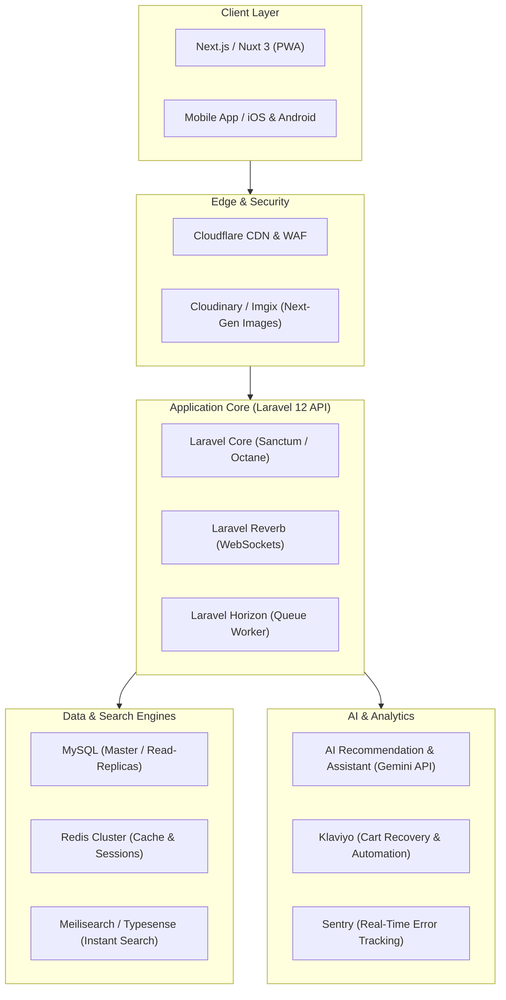

# Habitto BD — টেকনোলজি স্ট্যাক ও বিশ্বমানের ই-কমার্স আর্কিটেকচার রোডম্যাপ

> এই নথিতে **Habitto BD** ই-কমার্স ওয়েবসাইটের বর্তমান প্রযুক্তিগত কাঠামো এবং এটিকে আন্তর্জাতিক ও এন্টারপ্রাইজ মানের (World-Class / Enterprise-Grade) ই-কমার্স প্ল্যাটফর্মে উন্নীত করার সম্পূর্ণ কারিগরি রোডম্যাপ তুলে ধরা হয়েছে।

---

## সূচিপত্র
1. [বর্তমান প্রযুক্তিগত কাঠামো (Current Tech Stack)](#১-বর্তমান-প্রযুক্তিগত-কাঠামো-current-tech-stack)
   - [ব্যাকএন্ড ও কোর ফ্রেমওয়ার্ক](#১-ব্যাকএন্ড-ও-কোর-ফ্রেমওয়ার্ক-backend)
   - [ডাটাবেজ ও ডাটা লেয়ার](#২-ডাটাবেজ-ও-ডাটা-লেয়ার-database)
   - [ফ্রন্টএন্ড ও ইউআই লাইব্রেরি](#৩-ফ্রন্টএন্ড-ও-ইউআই-frontend--ui)
   - [ই-কমার্স ইঞ্জিন ও পেমেন্ট গেটওয়ে](#৪-ই-কমার্স-ইঞ্জিন-ও-পেমেন্ট-গেটওয়ে-ecommerce--payments)
   - [বিল্ড টুলস ও প্যাকেজ ম্যানেজার](#৫-বিল্ড-টুলস-ও-প্যাকেজ-ম্যানেজার-build-tools)
   - [অতিরিক্ত মডিউল ও প্লাগইন](#৬-অতিরিক্ত-মডিউল-ও-প্লাগইন-plugins)
2. [বিশ্বমানের ই-কমার্স তৈরির প্রযুক্তিগত রোডম্যাপ (World-Class Roadmap)](#২-বিশ্বমানের-ই-কমার্স-তৈরির-প্রযুক্তিগত-রোডম্যাপ)
   - [১. সার্চ ও ডিসকভারি ইঞ্জিন](#১-সার্চ-ও-ডিসকভারি-ইঞ্জিন-search--discovery)
   - [২. ক্যাশিং ও ডাটাবেজ স্কেলিং](#২-ক্যাশিং-ও-ডাটাবেজ-স্কেলিং-caching--database-scaling)
   - [৩. ফ্রন্টএন্ড মডার্নাইজেশন ও হেডলেস আর্কিটেকচার](#৩-ফ্রন্টএন্ড-মডার্নাইজেশন-ও-হেডলেস-আর্কিটেকচার-headless--pwa)
   - [৪. অ্যাসিনক্রোনাস কিউ ও ব্যাকগ্রাউন্ড প্রসেসিং](#৪-অ্যাসিনক্রোনাস-কিউ-ও-ব্যাকগ্রাউন্ড-প্রসেসিং-background-queues)
   - [৫. রিয়েল-টাইম কমিউনিকেশন](#৫-রিয়েল-টাইম-কমিউনিকেশন-websockets--live-events)
   - [৬. সিডিএন ও স্মার্ট মিডিয়া অপ্টিমাইজেশন](#৬-সিডিএন-ও-স্মার্ট-মিডিয়া-অপ্টিমাইজেশন-cdn--media)
   - [৭. এআই ও পার্সোনালাইজেশন ইঞ্জিন](#৭-এআই-ও-পার্সোনালাইজেশন-ইঞ্জিন-ai--recommendations)
   - [৮. মার্কেটিং অটোমেশন ও অ্যানালিটিক্স](#৮-মার্কেটিং-অটোমেশন-ও-অ্যানালিটিক্স-marketing--analytics)
   - [৯. ডেভঅপস, অবজার্ভেবিলিটি ও এরর ট্র্যাকিং](#৯-ডেভঅপস-অবজার্ভেবিলিটি-ও-এরর-ট্র্যাকিং-devops--observability)
   - [১০. সিকিউরিটি ও ফ্রড প্রিভেনশন](#১০-সিকিউরিটি-ও-ফ্রড-প্রিভেনশন-security--fraud-prevention)
3. [বর্তমান বনাম প্রস্তাবিত স্থাপত্যের তুলনামূলক চার্ট](#৩-বর্তমান-বনাম-প্রস্তাবিত-স্থাপত্যের-তুলনামূলক-চার্ট)
4. [ধাপে ধাপে বাস্তবায়নের পরিকল্পনা (Phased Implementation Plan)](#৪-ধাপে-ধাপে-বাস্তবায়নের-পরিকল্পনা)

---

## ১. বর্তমান প্রযুক্তিগত কাঠামো (Current Tech Stack)

### ১. ব্যাকএন্ড ও কোর ফ্রেমওয়ার্ক (Backend)
* **প্রোগ্রামিং ল্যাঙ্গুয়েজ:** **PHP** (সংস্করণ: `^8.2` / `^8.3`)
* **ওয়েব ফ্রেমওয়ার্ক:** **Laravel** (সংস্করণ: `12.x` / `12.34.0`)
* **সিএমএস ইঞ্জিন:** **Botble CMS Platform** (মডুলার আর্কিটেকচার বিশিষ্ট লারাভেল ই-কমার্স প্ল্যাটফর্ম)
* **অথেনটিকেশন ও এপিআই:** **Laravel Sanctum** (`^4.0`)
* **ওআরএম ও কুয়েরি বিল্ডার:** Laravel Eloquent ORM এবং Doctrine DBAL (`^4.2`)

### ২. ডাটাবেজ ও ডাটা লেয়ার (Database)
* **মূল ডাটাবেজ:** **MySQL** / MariaDB (ইনস্টলেশন: XAMPP MySQL)
* **সেশন ও ক্যাশ ড্রাইভার:** File Driver (`storage/framework/cache`, `storage/framework/sessions`)
* **রেডিস সাপোর্ট:** Predis লাইব্রেরি ইন্টিগ্রেশন রয়েছে (`predis/predis: ^3.0`)

### ৩. ফ্রন্টএন্ড ও ইউআই (Frontend & UI)
* **থিম (Active Theme):** **Ninico** (মিনিমাল ও আধুনিক ই-কমার্স থিম)
* **টেম্পলেটিং ইঞ্জিন:** **Laravel Blade**
* **সিএসএস ফ্রেমওয়ার্ক ও স্টাইলিং:**
  * **Bootstrap 5** (v5.3.7)
  * **Sass / SCSS** (কম্পোনেন্ট ভিত্তিক মডুলার সিএসএস আর্কিটেকচার)
  * **Animate.css & WOW.js** (স্ক্রোল অ্যানিমেশন ও ট্রানজিশন)
* **জাভাস্ক্রিপ্ট কোর ও লাইব্রেরি:**
  * **Vue.js 3** (v3.3.4) (ইন্টারঅ্যাক্টিভ কম্পোনেন্ট ও অ্যাডমিন প্যানেলের জন্য)
  * **jQuery** (v3.7.1)
  * **Axios** (v1.12.2) (অ্যাজাক্স ও ব্যাকএন্ড এপিআই রিকোয়েস্ট)
  * **Lodash** ও **Moment.js**
* **ইউআই স্লাইডার ও ইন্টারঅ্যাকশন প্লাগইন:**
  * **Swiper Slider** ও **Slick Slider** (ক্যারোসেল ও ব্যানার)
  * **Nice Select** (কাস্টম ড্রপডাউন সিলেক্টর)
  * **Magnific Popup** (ইমেজ লাইটবক্স ও জুম)
  * **Isotope & ImagesLoaded** (প্রোডাক্ট গ্রিড লেআউট ও ফিল্টারিং)
  * **jQuery UI** (প্রাইস রেঞ্জ স্লাইডার ও ড্র্যাগ ইন্টারঅ্যাকশন)
  * **FontAwesome Icons** ও **Google Fonts (Jost)**

### ৪. ই-কমার্স ইঞ্জিন ও পেমেন্ট গেটওয়ে (eCommerce & Payments)
* **কোর ই-কমার্স মডিউল:** প্রোডাক্ট ক্যাটালগ, ক্যাটাগরি, ব্র্যান্ড, অ্যাট্রিবিউট/ভ্যারিয়েশন, শপিং কার্ট, উইশলিস্ট, তুলনা (Compare), কুপন/ডিসকাউন্ট এবং ইনভেন্টরি ম্যানেজমেন্ট।
* **সাপোর্টেড পেমেন্ট গেটওয়ে:**
  * **SSLCommerz** (বাংলাদেশের গ্রাহকদের জন্য বিকাশ, নগদ, রকেট, কার্ড পেমেন্ট)
  * **Stripe**
  * **PayPal**
  * **Razorpay**
  * **Paystack**
  * **Mollie**

### ৫. বিল্ড টুলস ও প্যাকেজ ম্যানেজার (Build Tools)
* **অ্যাসেট বান্ডলার:** **Laravel Mix** (Webpack 5 ভিত্তিক)
* **স্টাইলিং অপ্টিমাইজেশন:** **PostCSS** ও **PurgeCSS** (অব্যবহৃত CSS ছেঁটে ফেলার জন্য)
* **প্যাকেজ ম্যানেজার:** Composer (PHP ডিপেন্ডেন্সি) এবং NPM (JavaScript ডিপেন্ডেন্সি)

### ৬. অতিরিক্ত মডিউল ও প্লাগইন (Plugins)
* **SEO & Sitemap:** স্বয়ংক্রিয় রোবট, মেটা ট্যাগ ও সাইটম্যাপ জেনারেটর (`botble/seo-helper`, `botble/sitemap`)
* **সোশ্যাল লগইন:** গুগল ও ফেসবুক দিয়ে ও-অথ (OAuth) সাইন-ইন
* **বহুভাষিক সাপোর্ট:** মাল্টি-ল্যাঙ্গুয়েজ ও ট্রান্সলেশন ম্যানেজার
* **অ্যাডমিন ইউটিলিটি:** অ্যাক্টিভিটি অডিট লগ (Audit Log), ডাটাবেজ ব্যাকআপ ম্যানেজার, ফাইল মিডিয়া ম্যানেজার ও রিভিশন হিস্টোরি

---

## ২. বিশ্বমানের ই-কমার্স তৈরির প্রযুক্তিগত রোডম্যাপ

একটি ই-কমার্স প্ল্যাটফর্মকে লক্ষ লক্ষ ব্যবহারকারীর ট্রাফিক সামলানোর উপযোগী এবং আন্তর্জাতিক ব্রান্ডগুলোর (যেমন: Amazon, ASOS, Nike, Daraz) মতো দ্রুতগতির করতে নিচের প্রযুক্তিগুলো যুক্ত করা আবশ্যক:

---

### ১. সার্চ ও ডিসকভারি ইঞ্জিন (Search & Discovery)
* **বর্তমান সমস্যা:** ডাটাবেজের `LIKE %term%` সার্চ বেশি প্রোডাক্ট হলে অত্যন্ত ধীরগতির এবং বানান ভুল হলে কোনো রেজাল্ট দিতে পারে না।
* **প্রস্তাবিত টেকনোলজি:** **Meilisearch** অথবা **Typesense** (সেলফ-হোস্টেড) / **Algolia** (ক্লাউড সার্ভিস)।
* **যেসব সুবিধা আসবে:**
  * **১০-২০ মিলিসেকেন্ডে রেজাল্ট:** কাস্টমার কিবোর্ডে টাইপ করার সাথে সাথেই রেজাল্ট প্রিভিউ দেখতে পাবেন।
  * **টাইপো-টলারেন্স (Typo Tolerance):** গ্রাহক বানান ভুল করলেও সঠিক প্রোডাক্ট খুঁজে পাবে (যেমন: "shrt" লিখলেও "shirt" খুঁজে পাবে)।
  * **ফেসেটেড ফিল্টারিং (Faceted Search):** পেজ রিলোড ছাড়া মুহূর্তের মধ্যে সাইজ, কালার, মূল্য ও ক্যাটাগরি ফিল্টার করা।

### ২. ক্যাশিং ও ডাটাবেজ স্কেলিং (Caching & Database Scaling)
* **বর্তমান সমস্যা:** লোকাল ফাইল ভিত্তিক ক্যাশ ব্যবহারে বড় ট্রাফিকের সময় ডিস্ক I/O জ্যাম তৈরি হয়।
* **প্রস্তাবিত টেকনোলজি:** **Redis Cluster** এবং **MySQL Read-Replicas** (বা PostgreSQL)।
* **যেসব সুবিধা আসবে:**
  * সেশন, শপিং কার্ট এবং ঘনঘন ভিজিট করা পেজ ও প্রোডাক্ট মেমরি (RAM) থেকে সার্ভ হবে।
  * ডাটাবেজে **Master-Slave Replication** ব্যবহার করে পড়ার কাজ (Read) রেপ্লিকা সার্ভার থেকে এবং লেখার কাজ (Write) মূল সার্ভারে ভাগ করে দেওয়া যাবে।
  * হাজার হাজার ট্রাফিকেও সার্ভার ক্র্যাশ বা ডাটাবেজ হ্যাং হবে না।

### ৩. ফ্রন্টএন্ড মডার্নাইজেশন ও হেডলেস আর্কিটেকচার (Headless & PWA)
* **প্রস্তাবিত আর্কিটেকচার:**
  * **বিকল্প ক (পুরোপুরি হেডলেস):** **Next.js (React)** অথবা **Nuxt 3 (Vue.js)** দিয়ে ফ্রন্টএন্ড আলাদা করে Laravel-কে শুধুমাত্র হেডলেস API হিসেবে ব্যবহার করা।
  * **বিকল্প খ (লারাভেল ভিত্তিক মনোলিথ আধুনিকায়ন):** **Inertia.js + Vue 3** বা **Livewire 3** ব্যবহার করা—এতে পেজ রিফ্রেশ ছাড়াই অ্যাপ্লিকেশনের মতো স্মুথ ইউজার এক্সপেরিয়েন্স পাওয়া যায়।
  * **PWA (Progressive Web App):** ব্যবহারকারীরা তাদের অ্যান্ড্রয়েড ও আইফোনে ওয়েবসাইটটি সরাসরি অ্যাপের মতো ইন্সটল করতে পারবেন এবং ব্যাকগ্রাউন্ড পুশ নোটিফিকেশন পাবেন।

### ৪. অ্যাসিনক্রোনাস কিউ ও ব্যাকগ্রাউন্ড প্রসেসিং (Background Queues)
* **বর্তমান সমস্যা:** বর্তমানে `sync` কিউ ড্রাইভার ব্যবহার হচ্ছে, ফলে অর্ডার প্লেস করার সময় ইমেইল বা এসএমএস পাঠানো পর্যন্ত গ্রাহককে অপেক্ষা করতে হয়।
* **প্রস্তাবিত টেকনোলজি:** **Laravel Horizon + Redis** অথবা **RabbitMQ / Apache Kafka**।
* **যেসব সুবিধা আসবে:**
  * অর্ডার প্লেস বাটনে চাপার সাথে সাথেই অর্ডার কনফার্ম হবে।
  * ইনভয়েস পিডিএফ তৈরি, এসএমএস অ্যালার্ট, পেমেন্ট ভেরিফিকেশন এবং ইমেইল পাঠানোর মতো ভারী কাজগুলো ব্যাকগ্রাউন্ডে স্বয়ংক্রিয়ভাবে প্রসেস হবে।

### ৫. রিয়েল-টাইম কমিউনিকেশন (WebSockets & Live Events)
* **প্রস্তাবিত টেকনোলজি:** **Laravel Reverb** (লারাভেলের নিজস্ব আল্ট্রা-ফাস্ট ওয়েব সকেট ইঞ্জিন) অথবা **Pusher / Soketi**।
* **যেসব সুবিধা আসবে:**
  * **লাইভ স্টক আপডেট:** একজন ক্রেতা শেষ প্রোডাক্টটি কিনে নিলে অন্য ক্রেতার স্ক্রিনে পেজ রিফ্রেশ ছাড়াই ‘Out of Stock’ লেবেল চলে আসবে।
  * **লাইভ অর্ডার ট্র্যাকিং:** খাবার বা পার্সেল ডেলিভারি অ্যাপের মতো অর্ডারের প্রতিটি স্ট্যাটাস কাস্টমারের স্ক্রিনে লাইভ আপডেট হবে।
  * অ্যাডমিন এবং কাস্টমারের মধ্যে ইনস্ট্যান্ট লাইভ চ্যাট সাপোর্ট।

### ৬. সিডিএন ও স্মার্ট মিডিয়া অপ্টিমাইজেশন (CDN & Media)
* **প্রস্তাবিত টেকনোলজি:** **Cloudflare CDN + WAF**, **AWS S3 / Cloudflare R2** এবং **Cloudinary / Imgix**।
* **যেসব সুবিধা আসবে:**
  * ছবির সাইজ স্বয়ংক্রিয়ভাবে ৭০-৮০% সংকুচিত হয়ে আধুনিক **WebP / AVIF** ফরম্যাটে পরিবর্তিত হবে।
  * মোবাইল স্ক্রিনের জন্য ছোট রেজোলিউশন এবং ল্যাপটপের জন্য মানানসই রেজোলিউশন স্বয়ংক্রিয়ভাবে অন-দ্য-ফ্লাই (On-the-fly) তৈরি হয়ে লোড হবে।
  * বিশ্বজুড়ে ক্লাউডফ্লেয়ারের এজ সার্ভার থেকে স্ট্যাটিক ফাইলগুলো দ্রুততম সময়ে ডেলিভার হবে।

### ৭. এআই ও পার্সোনালাইজেশন ইঞ্জিন (AI & Recommendations)
* **প্রস্তাবিত টেকনোলজি:** **Google Gemini API** অথবা কাস্টম রিকমেন্ডেশন ইঞ্জিন।
* **যেসব সুবিধা আসবে:**
  * **স্মার্ট প্রোডাক্ট সাজেশন:** গ্রাহকের ব্রাউজিং প্যাটার্ন বিশ্লেষণ করে "You may also like" এবং "Frequently bought together" দেখানো।
  * **AI শপিং অ্যাসিস্ট্যান্ট:** সাইটে একজন স্মার্ট সেলস সহকারীর মতো এআই চ্যাটবট থাকবে, যা ব্যবহারকারীর মাপ, বাজেট ও পছন্দ অনুযায়ী পোশাক খুঁজে সাজেস্ট করবে।
  * **ভিজুয়াল সার্চ (Image Search):** ক্রেতা সোশ্যাল মিডিয়া থেকে যেকোনো পোশাক বা পণ্যের ছবি আপলোড করলেই সাইট থেকে একই রকমের পণ্য খুঁজে বের করে দেওয়া।

### ৮. মার্কেটিং অটোমেশন ও অ্যানালিটিক্স (Marketing & Analytics)
* **প্রস্তাবিত টেকনোলজি:** **Klaviyo** (অথবা Omnisend), **Google Analytics 4 (GA4) Enhanced eCommerce**, **Facebook Conversion API (CAPI)** এবং **Microsoft Clarity**।
* **যেসব সুবিধা আসবে:**
  * **অটোমেটেড কার্ট রিকভারি:** কার্টে পণ্য যোগ করে চেকআউট না করে চলে গেলে ৩০ মিনিট পর কাস্টমারের কাছে স্বয়ংক্রিয় কুপন কোডসহ এসএমএস ও হোয়াটসঅ্যাপ পাঠানো।
  * **ইউজার বিহেভিয়ার হিটম্যাপ:** কাস্টমার ঠিক কোন বাটনে ক্লিক করতে গিয়ে আটকে যাচ্ছে বা কোন জায়গা থেকে ফেরত যাচ্ছে তা ভিডিও রেকর্ডিংয়ের মতো স্ক্রিনে দেখা যাবে।

### ৯. ডেভঅপস, অবজার্ভেবিলিটি ও এরর ট্র্যাকিং (DevOps & Observability)
* **প্রস্তাবিত টেকনোলজি:** **Sentry**, **Docker**, **Kubernetes / AWS ECS**, **Laravel Octane (FrankenPHP / Swoole)**।
* **যেসব সুবিধা আসবে:**
  * **Laravel Octane:** পিএইচপি অ্যাপ্লিকেশনের গতি ৪ গুণ থেকে ১০ গুণ পর্যন্ত বাড়িয়ে দেবে।
  * **Sentry রিয়েল-টাইম এরর ট্র্যাকিং:** কোনো কাস্টমার পেমেন্ট বা চেকআউট করতে গিয়ে ব্যর্থ হলে সাথে সাথে ডেভেলপারদের কাছে অ্যালার্ট চলে যাবে।
  * **অটো-স্কেলিং (Auto-scaling):** ঈদ ক্যাম্পেইন বা ফ্ল্যাশ সেলে লাখ লাখ ভিজিটর আসলেও স্বয়ংক্রিয়ভাবে সার্ভার রিসোর্স বৃদ্ধি পেয়ে সাইট ডাউন হওয়া প্রতিরোধ করবে।

### ১০. সিকিউরিটি ও ফ্রড প্রিভেনশন (Security & Fraud Prevention)
* **প্রস্তাবিত টেকনোলজি:** SMS Gateway (OTP Verification), Cloudflare Bot Management, Fraud Detection Rules।
* **যেসব সুবিধা আসবে:**
  * ক্যাশ অন ডেলিভারিতে (COD) ভুয়া অর্ডার ঠেকাতে অর্ডার কনফার্মেশনে মোবাইল নম্বরে তাৎক্ষণিক OTP ভেরিফিকেশন।
  * ডুপ্লিকেট অ্যাকাউন্ট বা সন্দেহজনক বাল্ক অর্ডার প্রতিরোধ।

---

## ৩. বর্তমান বনাম প্রস্তাবিত স্থাপত্যের তুলনামূলক চার্ট

| কারিগরি স্তর | বর্তমান অবস্থা (Current) | বিশ্বমানের করতে প্রস্তাবিত (Target) | অর্জিত ব্যবসায়িক সুবিধা |
| :--- | :--- | :--- | :--- |
| **কোর ইঞ্জিন** | Laravel 12 (Traditional PHP-FPM) | **Laravel Octane (FrankenPHP/Swoole)** | ৩-৫ গুণ দ্রুত রেসপন্স ও সার্ভার ক্যাপাসিটি বৃদ্ধি |
| **সার্চ** | সাধারণ SQL Query (`LIKE`) | **Meilisearch / Typesense** | ইনস্ট্যান্ট সার্চ রেজাল্ট ও টাইপো সংশোধন |
| **ডাটা ক্যাশ** | File-based Cache | **Redis Cluster** | ডেটাবেজের লোড ৮০% হ্রাস ও হাই কনকারেন্সি |
| **ফ্রন্টএন্ড** | Blade + jQuery | **Headless Next.js** অথবা **Inertia + Vue 3** | পেজ রিলোডহীন সুপার-ফাস্ট ইউজার এক্সপেরিয়েন্স |
| **ছবি ও স্টোরেজ** | লোকাল সার্ভার ডিস্ক | **Cloudflare R2 + Imgix/Cloudinary** | স্বয়ংক্রিয় WebP/AVIF রূপান্তর ও দ্রুত পেজ লোড |
| **ব্যাকগ্রাউন্ড কিউ** | `sync` ড্রাইভার | **Laravel Horizon + Redis** | বিদ্যুতের গতিতে চেকআউট সম্পন্ন হওয়া |
| **লাইভ ফিচার** | সাধারণ পেজ রিফ্রেশ | **Laravel Reverb (WebSockets)** | লাইভ স্টক ও রিয়েল-টাইম অর্ডার ট্র্যাকিং |
| **মার্কেটিং ও রিটেনশন**| ম্যানুয়াল পদ্ধতি | **Klaviyo / WhatsApp CRM** | পরিত্যক্ত কার্ট রিকভারি ও ২০-৩০% সেলস বৃদ্ধি |
| **মনিটরিং** | ফাইল এরর লগ | **Sentry + Datadog** | সাইটে সমস্যা হওয়ার সাথে সাথেই ফিক্স করার নোটিফিকেশন |

---

## ৪. ধাপে ধাপে বাস্তবায়নের পরিকল্পনা

### ধাপ ১: পারফরম্যান্স অপ্টিমাইজেশন (Immediate / Low-effort, High-impact)
1. ক্যাশ ও সেশনের জন্য **Redis** চালু করা।
2. ইমেইল, এসএমএস এবং ইনভয়েস প্রসেসিংয়ের জন্য **Laravel Horizon + Redis Queue** কনফিগার করা।
3. ডিএনএস, ডিডিওএস (DDoS) সুরক্ষা এবং স্ট্যাটিক অ্যাসেট ক্যাশিংয়ের জন্য **Cloudflare CDN** যুক্ত করা।
4. রিয়েল-টাইম বাগ ও এরর ট্র্যাকিংয়ের জন্য **Sentry** ইন্টিগ্রেট করা।

### ধাপ ২: ইউজার এক্সপেরিয়েন্স ও সার্চ আধুনিকায়ন (Medium-term)
1. দ্রুত ও আকর্ষণীয় সার্চ অভিজ্ঞতার জন্য **Meilisearch** অথবা **Typesense** সেটআপ করা।
2. প্রোডাক্ট ইমেজ ক্লাউড স্টোরেজে স্থানান্তরিত করে **Next-gen WebP/AVIF** কম্প্রেশন নিশ্চিত করা।
3. ক্যাশ অন ডেলিভারি (COD) অর্ডারে ফ্রড ও ভুয়া অর্ডার কমাতে **OTP SMS ভেরিফিকেশন** যোগ করা।
4. কাস্টমারদের আচরণ বিশ্লেষণ ও কার্ট রিকভারির জন্য **GA4 Enhanced eCommerce** ও **Klaviyo** যুক্ত করা।

### ধাপ ৩: আর্কিটেকচারাল আপগ্রেড ও এআই কমার্স (Long-term / Enterprise)
1. লাইভ স্টক ও নোটিফিকেশনের জন্য **Laravel Reverb (WebSockets)** চালু করা।
2. উচ্চ ট্রাফিকের জন্য **Laravel Octane** দিয়ে অ্যাপ্লিকেশন মেমরিতে রান করানো।
3. **Google Gemini API** ব্যবহার করে এআই শপিং অ্যাসিস্ট্যান্ট ও পার্সোনালাইজড প্রোডাক্ট রিকমেন্ডেশন সিস্টেম তৈরি করা।
4. প্রয়োজন অনুসারে ফ্রন্টএন্ডকে পিওর **Headless (Next.js/Nuxt 3)** বা **Inertia.js PWA** তে রূপান্তর করা।
