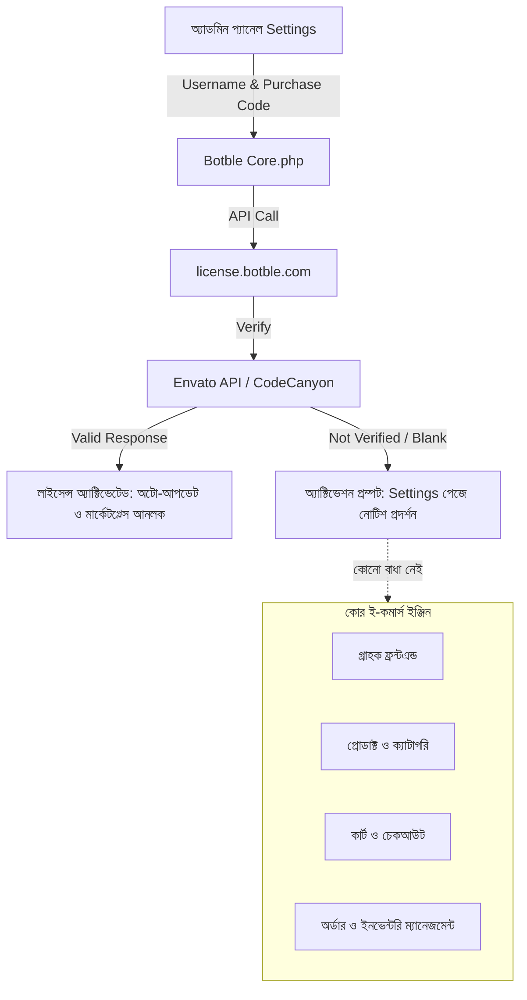

# Botble CMS & Ninico Theme: লাইসেন্স আর্কিটেকচার ও টেকনিক্যাল অ্যানালাইসিস

> **তারিখ:** ৮ নভেম্বর, ২০২৬  
> **প্রকল্প:** Habitto E-Commerce (`c:\Habitto`)  
> **প্ল্যাটফর্ম:** PHP 8.2 / Laravel 12.34 / Botble CMS & Ninico Theme  
> **ডকুমেন্ট উদ্দেশ্য:** লাইসেন্সিং মেকানিজম, বাইপাস/নালড কোডের নিরাপত্তা ঝুঁকি এবং টেকসই সমাধানের পূর্ণাঙ্গ বিশ্লেষণ।

---

## ১. সারসংক্ষেপ (Executive Summary)

বর্তমান ওয়েবসাইটটি লারাভেল ফ্রেমওয়ার্কের ওপর নির্মিত **Botble CMS** এবং **Ninico** প্রিমিয়াম থিম ব্যবহার করে পরিচালিত। অ্যাডমিন প্যানেলে প্রদর্শিত লাইসেন্স অ্যাক্টিভেশন নোটিশটি নিয়ে বিস্তারিত টেকনিক্যাল বিশ্লেষণ করা হয়েছে। এই ডকুমেন্টে সিস্টেমটির ভেরিফিকেশন মেকানিজম, লাইসেন্স না থাকলে সিস্টেমে কী প্রভাব পড়ে, অননুমোদিত বাইপাস বা নালড কোড ব্যবহারের নিরাপত্তা ও ব্যবসায়িক ঝুঁকি এবং একটি স্থিতিশীল ই-কমার্স প্ল্যাটফর্মের জন্য সর্বোত্তম সমাধান লিপিবদ্ধ করা হলো।

---

## ২. লাইসেন্স আর্কিটেকচার ও ভেরিফিকেশন মেকানিজম

### ২.১ ভেরিফিকেশন কীভাবে কাজ করে?
- **কোর হ্যান্ডলার:** প্ল্যাটফর্মের লাইসেন্স যাচাই প্রক্রিয়াটি পরিচালিত হয় `Botble\Base\Supports\Core.php` ফাইলের মাধ্যমে।
- **রিমোট রিকোয়েস্ট:** অ্যাডমিন প্যানেলে সংরক্ষিত ক্রেডেনশিয়াল নিয়ে সিস্টেমটি `license.botble.com` এবং Envato API-এর সাথে সুরক্ষিত HTTPS রিকোয়েস্টের মাধ্যমে কমিউনিকেট করে।
- **ডাটাবেজ ফ্ল্যাগ:** ডাটাবেজের `settings` টেবিলে বৈধ লাইসেন্স তথ্য সংরক্ষিত না থাকলে `hasLicenseData()` ফাংশনটি `false` রিটার্ন করে।

### ২.২ লাইসেন্স মূলত কোন কোন সুবিধার জন্য প্রয়োজন?
1. **১-ক্লিক অটোমেটিক কোর আপডেট:** বটবলের রিমোট সার্ভার থেকে সরাসরি নতুন রিলিজ, ফিচার বা সিকিউরিটি প্যাচ ওয়ান-ক্লিকে ইনস্টল করা।
2. **অফিসিয়াল মার্কেটপ্লেস রিপোজিটরি:** অ্যাডমিন ড্যাশবোর্ড থেকে সরাসরি অতিরিক্ত প্রিমিয়াম প্লাগইন ডাউনলোড ও সক্রিয় করা।
3. **ভেন্ডর টেকনিক্যাল সাপোর্ট:** Envato/ThemeForest থেকে মূল ডেভেলপার টিমের কাছ থেকে অফিসিয়াল হেল্পডেস্ক সাপোর্ট পাওয়া।

### ২.৩ লাইসেন্স না থাকলে কি ওয়েবসাইট বন্ধ বা লক হয়ে যায়?
- **না।** বটবল সিএমএস সম্পূর্ণ সেলফ-হোস্টেড এবং ওপেন-সোর্স লারাভেল কাঠামোর ওপর স্থাপিত।
- **ফ্রন্টএন্ড সুরক্ষিত:** গ্রাহকদের সামনে কোনো লাইসেন্স এরর, ওয়াটারমার্ক বা বাধা প্রদর্শিত হয় না।
- **ই-কমার্স ফিচার চালু:** পণ্য ব্রাউজিং, কার্ট, চেকআউট, পেমেন্ট গেটওয়ে, অর্ডার কালেকশন এবং ইনভেন্টরি ১০০% সক্রিয় থাকে।
- **নোটিশের সীমাবদ্ধতা:** নোটিশটি শুধুমাত্র অ্যাডমিন প্যানেলের নির্দিষ্ট একটি পেজে (`Dashboard -> Settings -> General Settings`) সীমাবদ্ধ থাকে।

---

## ৩. লাইসেন্স বাইপাস বা Nulled স্ক্রিপ্টের ক্রিটিক্যাল ঝুঁকি

বাণিজ্যিক সফটওয়্যারের লাইসেন্স জোরপূর্বক বাইপাস করা বা ইন্টারনেট থেকে 'Nulled' ফাইল ব্যবহারের ক্ষেত্রে মারাত্মক প্রযুক্তিগত ও আইনি ঝুঁকি বিদ্যমান:

| ঝুঁকির ক্ষেত্র | প্রযুক্তিগত বিবরণ | সম্ভাব্য ক্ষতি |
| :--- | :--- | :--- |
| **১. ম্যালওয়্যার ও ব্যাকডোর** | ইন্টারনেটে পাওয়া বেশিরভাগ নালড কোডে লুকানো `eval()`, `base64_decode()` বা রিমোট ওয়েবশেল ইনজেক্ট করা থাকে। | গ্রাহকের ব্যক্তিগত তথ্য, পাসওয়ার্ড ও পেমেন্ট ডাটা চুরি; সম্পূর্ণ সার্ভার হ্যাক হওয়া। |
| **২. সিকিউরিটি প্যাচের অভাব** | পিএইচপি এবং লারাভেলে প্রতি বছর নতুন নিরাপত্তা প্যাচ আসে। অফিসিয়াল লাইসেন্স না থাকলে নিয়মিত সিকিউরিটি আপডেট বন্ধ থাকে। | জিরো-ডে (0-Day) এক্সপ্লয়েটের শিকার হয়ে সাইট ডিফেইস বা ব্ল্যাকলিস্টেড হওয়া। |
| **৩. পেমেন্ট গেটওয়ে জটিলতা** | বিকাশ, নগদ, SSLCommerz বা ব্যাংক পেমেন্ট গেটওয়ে ব্যবহারের জন্য মার্চেন্ট কেওয়াইসি (KYC) লাগে। কপিরাইট কমপ্লেইন্ট এলে গেটওয়ে অ্যাকাউন্ট ফ্রিজ হতে পারে। | ফান্ড আটকে যাওয়া এবং আর্থিক লেনদেন স্থায়ীভাবে বন্ধ হওয়া। |
| **৪. হোস্টিং ও DMCA ব্যান** | লাইসেন্স ছাড়া বা ক্র্যাক করা থিম লাইভ সার্ভারে ব্যবহার করলে মূল স্বত্বাধিকারী DMCA Takedown নোটিশ পাঠাতে পারে। | হোস্টিং প্রোভাইডার সম্পূর্ণ সার্ভার বা সিপ্যানেল অ্যাকাউন্ট কোনো নোটিশ ছাড়াই সাসপেন্ড করতে পারে। |
| **৫. সিস্টেম ক্র্যাশ (Fatal Error)** | লাইসেন্স চেকিং মেকানিজমটি লারাভেলের সার্ভিস কন্টেইনার এবং ইভেন্ট লিসেনারের সাথে গভীরভাবে যুক্ত। জোরপূর্বক কোড বদলালে কম্পোজার আপডেট বা ক্যাশিংয়ে সাইট ক্র্যাশ করে। | ডাটাবেজ করাপশন ও দীর্ঘমেয়াদী সাইট ডাউনটাইম। |

---

## ৪. সঠিক, নিরাপদ ও টেকসই সমাধান (Actionable Roadmap)

একটি নিরাপদ ও প্রফেশনাল ই-কমার্স বিজনেস গড়ে তোলার জন্য নিচের তিনটি কার্যকর পথ রয়েছে:

### পথ ১: অফিসিয়াল রেগুলার লাইসেন্স অ্যাক্টিভেশন (সর্বোত্তম ও রিকমেন্ডেড)
একটি রিয়েল লাইভ বিজনেসের জন্য এটি সবচেয়ে নির্ভরযোগ্য এবং আইনসম্মত উপায়:
1. **Envato / CodeCanyon** থেকে থিমটির একটি জেনুইন **Regular License** সংগ্রহ করুন।
2. আপনার অ্যাডমিন প্যানেলে লগইন করে যান: `Dashboard -> Settings -> General Settings`।
3. ফর্মের মধ্যে আপনার **Envato Username** এবং প্রদত্ত **Purchase code** ইনপুট দিন।
4. **Activate license** বাটনে ক্লিক করুন।
> **ফলাফল:** লাইসেন্স সফলভাবে ভেরিফাই হবে, জেনারেল সেটিংসের নোটিশটি স্থায়ীভাবে মুছে যাবে এবং ১-ক্লিকে অফিসিয়াল সিকিউরিটি আপডেট সুবিধা আনলক হবে।

---

### পথ ২: লোকাল ও টেস্টিং পর্যায়ে সেলফ-মেইনটেইন্ড মডেল
আপনি যদি বর্তমানে ডেভেলপমেন্ট, ডিজাইন কাস্টমাইজেশন বা টেস্ট পর্যায়ে থাকেন:
- কোনো ক্ষতিকারক বাইপাস বা কোড পরিবর্তন করার কোনো প্রয়োজন নেই।
- বর্তমান কাঠামোতেই ওয়েবসাইটটির ডাটাবেজ, প্রোডাক্ট, ক্যাটাগরি, ব্যানার, কার্ট এবং অর্ডার সিস্টেম নির্বিঘ্নে চলবে।
- লাইভ সার্ভারে ব্যবসায়িক কার্যক্রম শুরু করার পূর্বে লাইসেন্স সংগ্রহ করে নেওয়া নিরাপদ।

---

### পথ ৩: ১০০% ফ্রি ও ওপেন-সোর্স বিকল্পে রূপান্তর
যদি আপনি কোনো বাণিজ্যিক থিম/সিএমএস প্ল্যাটফর্মের লাইসেন্স ফি দিতে না চান এবং লাইসেন্স চেকিং সংক্রান্ত কোনো ঝামেলা ছাড়াই সম্পূর্ণ স্বাধীন থাকতে চান:
1. **Bagisto (লারাভেল ভিত্তিক):**
   - এটি লারাভেলের ওপর তৈরি একটি সম্পূর্ণ ওপেন-সোর্স (MIT License) শক্তিশালী ই-কমার্স ফ্রেমওয়ার্ক।
   - এতে কোনো থার্ড-পার্টি ভেন্ডর লাইসেন্স চেক বা ক্রয় কোডের বাধ্যবাধকতা থাকে না।
2. **WooCommerce (ওয়ার্ডপ্রেস ভিত্তিক):**
   - বিশ্বজুড়ে সর্বাধিক ব্যবহৃত ফ্রি ও ওপেন-সোর্স ই-কমার্স প্ল্যাটফর্ম।

---

## ৫. ই-কমার্স নিরাপত্তা ও ব্যবসায়িক সুরক্ষার চেকলিস্ট

- [x] সাইটের কোর ডাটাবেজ ও কোড লোকালহোস্টে সচল রাখা হয়েছে।
- [x] অপ্রয়োজনীয় ও অব্যবহৃত আন্তর্জাতিক পেমেন্ট প্লাগইনগুলো আনলোড করে সাইট হালকা করা হয়েছে।
- [x] গ্রাহক ফ্রন্টএন্ড সম্পূর্ণ ওয়াটারমার্ক ও নোটিশমুক্ত রাখা হয়েছে।
- [ ] প্রোডাকশনে ডেপ্লয় করার পূর্বে অফিসিয়াল লাইসেন্স কি সংযোজন অথবা ওপেন-সোর্স আর্কিটেকচার চূড়ান্ত করা।
- [ ] ডাটাবেজ এবং মিডিয়া ফাইলের নিয়মিত অফ-সাইট ব্যাকআপ ব্যবস্থা নিশ্চিত করা।

---
*ডকুমেন্টটি Habitto আর্কিটেকচারাল নলেজবেসের অংশ হিসেবে সংরক্ষিত।*
