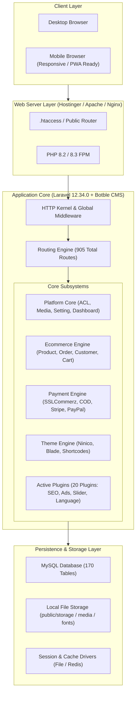
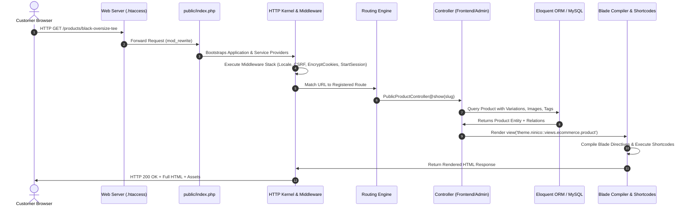

# 00. মাস্টার ওভারভিউ ও সিস্টেম আর্কিটেকচার (Master Overview & System Architecture)

> **প্রজেক্ট:** Habbito (হ্যাবিতো) — প্রিমিয়াম স্ট্রিটওয়্যার ও লাইফস্টাইল ই-কমার্স  
> **ডোমেইন:** `habbitobd.com`  
> **কোর ইঞ্জিন:** Laravel 12.34.0 & Botble CMS Modular Architecture  
> **ফ্রন্টএন্ড থিম:** Ninico Responsive Minimal Theme  
> **ডেটাবেজ:** MySQL / MariaDB (১৭০টি টেবিল)  
> **তারিখ:** নভেম্বর ২০২৬  

---

## ১. প্ল্যাটফর্ম পরিচিতি ও ব্যবসায়িক লক্ষ্য

**Habbito** (`habbitobd.com`) হলো বাংলাদেশের একটি বিশেষায়িত, আধুনিক স্ট্রিটওয়্যার ও সমসাময়িক মেনসওয়্যার ফ্যাশন ব্র্যান্ড। প্ল্যাটফর্মটি ভারী ফ্যাব্রিকের ড্রপ-শোল্ডার টি-শার্ট (240+ GSM Combed Cotton), ভিন্টেজ স্টোন অ্যাসিড ওয়াশ কালেকশন, উইন্টার ফ্লিস হুডি, স্ট্রিমলাইনড চিনো ও কার্গো বটমস বিক্রয়ের জন্য বিশেষভাবে প্রস্তুত। 

ব্যবসায়িক দিক থেকে প্ল্যাটফর্মটি সরাসরি গ্রাহক (D2C - Direct to Consumer) মডেল অনুসরণ করে এবং ক্যাশ অন ডেলিভারি (COD), ডিজিটাল পেমেন্ট গেটওয়ে (SSLCommerz) এবং সরাসরি ১-ক্লিক হোয়াটসঅ্যাপ অর্ডার ব্যবস্থার সমন্বয়ে পরিচালিত হয়।

---

## ২. হাই-লেভেল টেকনিক্যাল স্ট্যাক



### কোর টেকনোলজি ম্যাট্রিক্স:
* **ব্যাকএন্ড ল্যাঙ্গুয়েজ:** PHP 8.2 / PHP 8.3 (Strict types, Enums, Fibers, JIT ready).
* **ফ্রেমওয়ার্ক:** Laravel Framework 12.34.0.
* **সিএমএস আর্কিটেকচার:** Botble Platform Modular Package Architecture (`platform/core`, `platform/packages`, `platform/plugins`).
* **ডেটাবেজ ড্রাইভার:** MySQL / MariaDB via PDO (`pdo_mysql`, Doctrine DBAL `^4.2`).
* **অথেনটিকেশন ও গার্ড:** Laravel Web Guard (Session based) + Laravel Sanctum (`^4.0`) ফর এপিআই টোকেন।
* **ফ্রন্টএন্ড স্টাইলিং:** Bootstrap 5.3.7, Dart Sass (SCSS Modular Pipeline), PostCSS, Autoprefixer.
* **জাভাস্ক্রিপ্ট লাইব্রেরি:** Vanilla JS ES6+, Vue.js 3.3.4, jQuery 3.7.1, Axios 1.12.2, Swiper Slider, Slick, Magnific Popup.

---

## ৩. ডিরেক্টরি হাইরার্কি ও স্ট্রাকচার

Habbito-এর ডিরেক্টরি সাধারণ লারাভেলের চেয়ে অনেক বেশি সমৃদ্ধ ও মডুলার। নিচে প্রতিটি গুরুত্বপূর্ণ ফোল্ডারের ভূমিকা দেওয়া হলো:

```text
C:\Habitto
├── app/                        # এপ্লিকেশন সার্ভিস ও কনফিগারেশন
│   ├── Http/Controllers/       # কাস্টম এপ্লিকেশন কন্ট্রোলার
│   ├── Models/                 # জেনারেল এপ্লিকেশন মডেল
│   └── Providers/              # সার্ভিস প্রোভাইডার্স
├── bootstrap/                  # বুটস্ট্র্যাপ ও অটোলোড
│   ├── app.php                 # এপ্লিকেশন ইন্সট্যান্স ইনিশিয়ালাইজেশন
│   └── cache/                  # প্যাকেজ ও কনফিগ ক্যাশ
├── config/                     # সিস্টেম কনফিগারেশন ফাইলস (database, mail, session, etc.)
├── database/                   # ডেটাবেজ মাইগ্রেশন ও সীডার
├── docs/                       # সম্পূর্ণ সিস্টেম ডকুমেন্টেশন ও গাইডস
│   └── full_website_documentation/ # এই সমন্বিত ডকুমেন্টেশন ফাইলসমূহ
├── lang/                       # বহুভাষিক ট্রান্সলেশন ফাইলস (bn, en)
├── platform/                   # বটবল সিএমএস এর প্রাণকেন্দ্র (The Core)
│   ├── core/                   # বেসিক সিএমএস ফাংশনালিটি (ACL, Base, Dashboard, Media, Setting, Table)
│   ├── packages/               # ইউটিলিটি প্যাকেজেস (SEO Helper, Sitemap, Shortcode, Theme, Menu, Slug)
│   ├── plugins/                # ৩০টি প্লাগইন (Ecommerce, Payment, SSLCommerz, Ads, Slider, ইত্যাদি)
│   └── themes/                 # থিম ইঞ্জিন
│       └── ninico/             # অ্যাক্টিভ থিম (Views, Layouts, Partials, Assets, SCSS, JS)
├── public/                     # ওয়েবসাইটের পাবলিক রুট (Document Root)
│   ├── index.php               # মূল ফ্রন্ট কন্ট্রোলার
│   ├── .htaccess               # এপাচি রিরাইট রুলস (লারাভেল রাউটিং ও ক্যাশিং)
│   ├── storage/                # আপলোড করা মিডিয়া ফাইল ও প্রোডাক্ট ইমেজ
│   └── themes/ninico/          # কম্পাইল করা থিম সিএসএস ও জাভাস্ক্রিপ্ট
├── resources/                  # কোর ভিউ ও র অ্যাসেট
├── routes/                     # ওয়েব, কনসোল ও এপিআই রাউটস
├── storage/                    # ফ্রেমওয়ার্ক জেনারেটেড ফাইল
│   ├── framework/              # ক্যাশ, সেশন ও কম্পাইল করা ব্লেড ভিউ
│   └── logs/                   # দৈনিক এরর ও সিস্টেম লগ ফাইল
├── vendor/                     # কম্পোজার দ্বারা ইন্সটল করা সকল থার্ড পার্টি পিএইচপি প্যাকেজ
├── .env                        # লোকাল এনভায়রনমেন্ট কনফিগারেশন
├── .env.deploy_hostinger       # লাইভ হোস্টিংগারের জন্য প্রস্তুত এনভায়রনমেন্ট টেমপ্লেট
├── artisan                     # লারাভেল সিএলআই রানার
├── composer.json               # পিএইচপি ডিপেন্ডেন্সি ফাইল
└── start_server.bat            # উইন্ডোজ লোকাল সার্ভার এক-ক্লিকে স্টার্ট করার ব্যাচ স্ক্রিপ্ট
```

---

## ৪. রিকোয়েস্ট লাইফসাইকেল (Request Lifecycle)

যখন একজন ভিজিটর বা কাস্টমার ব্রাউজারে `https://habbitobd.com` বা কোনো প্রোডাক্ট লিঙ্ক ওপেন করেন, তখন ব্যাকএন্ডে নিচের ধাপগুলো নিখুঁতভাবে সম্পাদিত হয়:



### মিডলওয়্যার পাইপলাইন (Middleware Pipeline):
১. **`CheckForMaintenanceMode`:** সাইট মেইনটেন্যান্স মোডে আছে কিনা তা যাচাই করে।  
২. **`EncryptCookies` & `AddQueuedCookiesToResponse`:** ব্যবহারকারীর ব্রাউজার কুকিজ এনক্রিপ্ট করে এবং নিরাপদ রাখে।  
৩. **`StartSession`:** কাস্টমারের সেশন (কার্ট আইটেম, কারেন্সি, অথেনটিকেশন) লোড করে।  
৪. **`VerifyCsrfToken`:** সব ধরনের POST, PUT, DELETE রিকোয়েস্টে CSRF টোকেন ভ্যালিডেট করে।  
৫. **`LocaleMiddleware`:** ব্যবহারকারীর ভাষা (বাংলা বা ইংরেজি) শনাক্ত করে সঠিক ট্রান্সলেশন লোড করে।  
৬. **`RedirectIfNotInstalledMiddleware`:** সিএমএস ইন্সটল্ড আছে কিনা তা চেক করে।

---

## ৫. রাউটিং আর্কিটেকচার (Routing Architecture)

সাইটটিতে মোট **৯০৫টি সুনির্দিষ্ট রাউট** রয়েছে, যা ৩টি প্রধান ভাগে বিভক্ত:

| ক্যাটাগরি | রাউট সংখ্যা | প্রিফিক্স / গ্রুপ | দায়িত্ব ও উদ্দেশ্য |
| :--- | :---: | :--- | :--- |
| **অ্যাডমিন রাউটস (Admin)** | **৬৭৮টি** | `/admin/*` | প্রোডাক্ট ক্রিয়েশন, অর্ডার প্রসেসিং, ক্যাটাগরি, ইনভেন্টরি, সেটিংস, থিম অপশন ও রিপোর্টস। গার্ড: `auth:web` + ACL পারমিশন। |
| **পাবলিক/ফ্রন্টএন্ড (Public)** | **১২৪টি** | `/*` | হোমপেজ, শপ পেজ, প্রোডাক্ট ডিটেইল, কার্ট ড্রয়ার, চেকআউট, উইশলিস্ট, ব্লগ ও স্ট্যাটিক পেজেস। |
| **রেস্ট এপিআই (API)** | **১০৩টি** | `/api/v1/*` | মোবাইল অ্যাপ্লিকেশন ও থার্ড-পার্টি ইন্টিগ্রেশনের জন্য হেডলেস REST API এন্ডপয়েন্টস (Sanctum টোকেন অথেনটিকেটেড)। |

---

## ৬. কোর ফ্রেমওয়ার্কের নিরাপত্তামূলক কনফিগারেশন

Habbito প্ল্যাটফর্মে এন্টারপ্রাইজ লেভেলের ডেটা সুরক্ষা নিশ্চিত করা হয়েছে:
1. **SQL Injection Prevention:** Eloquent ORM এবং PDO প্যারামিটার বাইন্ডিং ব্যবহারের ফলে ম্যানুয়াল বা কাঁচা এসকিউএল ইনজেকশনের কোনো সুযোগ নেই।
2. **XSS (Cross-Site Scripting) Guard:** সকল ইউজার ইনপুট ব্লেড ইঞ্জিনের `{{ $data }}` স্বয়ংক্রিয় HTML escaping এবং `BaseHelper::clean()` স্যানিটাইজার দিয়ে ফিল্টার করা হয়।
3. **Secure Cookie & HTTPS Enforce:** `.env` ফাইলে `SESSION_SECURE_COOKIE=true` এবং `FORCE_SCHEMA=https` যুক্ত রয়েছে, ফলে সব ধরনের লেনদেন ও সেশন কেবল এনক্রিপ্টেড SSL চ্যানেলে পরিবাহিত হয়।
4. **Rate Limiting:** ব্রুট-ফোর্স বা স্প্যাম আক্রমণ রোধে অথেনটিকেশন ও চেকআউট এন্ডপয়েন্টে রেট লিমিটার সক্রিয়।
