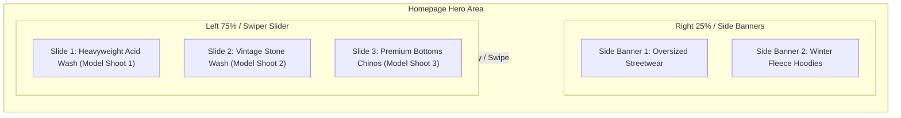

# 01. ফ্রন্টএন্ড থিম ও ইউআই কম্পোনেন্ট আর্কিটেকচার (Frontend Theme & UI Components)

> **ফোল্ডার অবস্থান:** `platform/themes/ninico/`  
> **থিম নাম:** Ninico (Minimal eCommerce & Modern Streetwear)  
> **টেম্পলেট ইঞ্জিন:** Laravel Blade Engine  
> **সিএসএস সিস্টেম:** Bootstrap 5.3.7 + Custom Dart SCSS Architecture  
> **টাইপোগ্রাফি:** 'Jost' Google Font  

---

## ১. থিম ইঞ্জিন ও ডিরেক্টরি পরিচিতি

Habbito-এর সমস্ত ভিজ্যুয়াল ডিজাইন এবং কাস্টমার ইন্টারঅ্যাকশন পরিচালিত হয় `platform/themes/ninico` ফোল্ডার থেকে। এর গঠন নিচে তুলে ধরা হলো:

```text
platform/themes/ninico/
├── assets/                     # সোর্স ফাইলস (Dev Environment)
│   ├── js/                     # থিমের কাস্টম স্ক্রিপ্ট (app.js, theme.js, ecommerce.js, page.js)
│   └── sass/                   # মডুলার এসসিএসএস আর্কিটেকচার
│       ├── components/         # বাটন, মডাল, অফ-ক্যানভাস, প্রিলোডার, ট্যাব, অ্যাকর্ডিয়ন
│       ├── layout/             # হেডার, স্লাইডার, ফুটার, কার্ট, প্রোডাক্ট গ্রিড, ব্যানার
│       └── theme.scss          # মূল মাস্টার স্টাইলশীট
├── config.php                  # থিমের সার্ভিস কনফিগারেশন ও অ্যাসেট রেজিস্ট্রি
├── functions/                  # থিম হেল্পার ও ফিল্টার ফাংশনসমূহ
├── layouts/                    # মাস্টার লেআউট ব্লেড ফাইল
│   ├── base.blade.php          # HTML5 রুট লেআউট (Head, Fonts, Footer Scripts)
│   ├── default.blade.php       # সাইডবারসহ সাধারণ পেজ লেআউট
│   └── full-width.blade.php    # হোমপেজ ও ল্যান্ডিং পেজের জন্য ফুল-উইডথ লেআউট
├── partials/                   # পুনরায় ব্যবহারযোগ্য ইউআই কম্পোনেন্ট
│   ├── header-middle.blade.php # সার্চ বার, লোগো ও কার্ট আইকন
│   ├── navbar.blade.php        # মূল মেনু ও ক্যাটাগরি ড্রপডাউন
│   ├── navigation-bar.blade.php# মোবাইলের জন্য ফিক্সড বটম বার
│   ├── floating-whatsapp.blade.php # ফ্লোটিং হোয়াটসঅ্যাপ বাটন
│   ├── footer.blade.php        # ফুটার উইজেট ও কপিরাইট
│   └── shortcodes/             # ভিজ্যুয়াল পেজ বিল্ডার শর্টকোড
└── views/                      # পেজ ও ই-কমার্স স্পেসিফিক ব্লেড ভিউ
    └── ecommerce/              # প্রোডাক্ট, কার্ট, চেকআউট, উইশলিস্ট ও কুইক-শপ
```

---

## ২. গ্লোবাল লেআউট আর্কিটেকচার

ওয়েবসাইটের প্রতিটি পেজ `layouts/base.blade.php` ফাইলের কাঠামো অনুসরণ করে:

1. **`<head>` সেকশন:**
   * মেটা ট্যাগ, ভিউপোর্ট (Mobile Optimized), সিএসআরএফ টোকেন (`csrf-token`)।
   * **Jost** ফন্ট অটোমেটিক গুগল ফন্টস এপিআই থেকে প্রি-লোড হয়।
   * সিএসএস ইনজেকশন: `Theme::header()`-এর মাধ্যমে Bootstrap 5, Animate.css, Swiper, Slick, FontAwesome এবং কম্পাইল করা `theme.css` লোড হয়।
2. **`<body>` সেকশন:**
   * টপ অ্যানাউন্সমেন্ট বার।
   * হেডার (লোগো, ক্যাটাগরি, সার্চ, কার্ট কাউন্টার)।
   * মূল কনটেন্ট এরিয়া (`@yield('content')`)।
   * স্ক্রোল-টু-টপ বাটন (`scroll-top`)।
   * ফ্লোটিং হোয়াটসঅ্যাপ বাটন (`floating-whatsapp`)।
   * মোবাইল বটম ন্যাভিগেশন বার (`navigation-bar`)।
   * ফুটার স্ক্রিপ্টস: `Theme::footer()`-এর মাধ্যমে jQuery 3.7.1, Swiper, Slick, Magnific Popup, Axios, এবং `ecommerce.js` লোড হয়।

---

## ৩. হেডার ও নেভিগেশন সিস্টেম (Header Anatomy)

```
+------------------------------------------------------------------------------------+
|  [Announcement Bar] Free Delivery all over Bangladesh on orders over ৳২,০০০         |
+------------------------------------------------------------------------------------+
|  [ Habbito Logo ]   [ Search Bar: Categories | Search Drops... 🔍 ]   [ ❤️ 0 ] [ 🛒 2 ] |
+------------------------------------------------------------------------------------+
|  [ ☰ All Categories ]   Home   |   Oversized Tees   |   Acid Wash   |   Hoodies   | ...|
+------------------------------------------------------------------------------------+
```

### হেডার কম্পোনেন্টস:
1. **টপ অ্যানাউন্সমেন্ট বার (`header-top.blade.php`):**  
   অ্যাডমিন থেকে কন্ট্রোল করা যায়। বিশেষ অফার, ফ্রি ডেলিভারি থ্রেশহোল্ড এবং হেল্পলাইন নম্বর প্রদর্শিত হয়।
2. **লোগো ও ব্র্যান্ডিং (`logo.blade.php`):**  
   অ্যাডমিন সেটিংস থেকে যেকোনো সাইজের SVG, PNG বা JPG লোগো আপলোড করা যায়।
3. **লাইভ সার্চ বার (`header-search-bar.blade.php`):**  
   গ্রাহক কিবোর্ডে টাইপ করার সাথে সাথে নির্দিষ্ট ক্যাটাগরি সিলেক্ট করে দ্রুত পণ্য খুঁজতে পারেন।
4. **হেডার কার্ট ড্রয়ার টগল (`header-middle.blade.php`):**  
   রিয়েল-টাইম কাউন্টার ব্যাজ `{{ Cart::instance('cart')->count() }}` প্রদর্শন করে। এতে ক্লিক করলে পেজ রিফ্রেশ ছাড়া ডান পাশ থেকে মিনি-কার্ট স্লাইড হয়ে বের হয়।

---

## ৪. হোমপেজ হিরো সেকশন ও ব্যানার ইঞ্জিন

হোমপেজে ব্যবহৃত হিরো সেকশনটি `[simple-slider]` শর্টকোড দিয়ে নিয়ন্ত্রিত:
* **ফাইল অবস্থান:** `partials/shortcodes/simple-slider/styles/wooden.blade.php`



* **বাম পাশের স্লাইডার:** প্রতিটি স্লাইডে বড় টাইটেল, ফ্যাব্রিক স্পেসিফিকেশন (যেমন: *240+ GSM Combed Cotton*), হাই-রেজোলিউশন মডেল শুট এবং সরাসরি ক্যাটাগরিতে রিডাইরেক্ট হওয়া **`Shop Now`** বাটন থাকে।
* **ডান পাশের দুটি ব্যানার:** সর্বাধিক বিক্রিত দুটি কালেকশনে দ্রুত ট্রাফিক ড্রাইভ করার জন্য স্থায়ী বিজ্ঞাপন কার্ড।

---

## ৫. ট্রাস্ট ও সার্ভিস ব্যাজ সেকশন (`[services]`)

হিরো স্লাইডারের ঠিক নিচেই ৪টি ট্রাস্ট ব্যাজ থাকে যা বাংলাদেশি গ্রাহকদের কনভার্সন বাড়াতে অত্যন্ত কার্যকর:
1. **Nationwide Fast Delivery:** ঢাকায় ২৪ ঘণ্টা, ঢাকার বাইরে ৭২ ঘণ্টায় দ্রুত ডেলিভারি।
2. **100% Cash On Delivery:** পণ্য হাতে পেয়ে মূল্য পরিশোধের সুবিধা।
3. **240+ GSM Combed Cotton:** প্রিমিয়াম ও ভারী ফ্যাব্রিকের নিশ্চয়তা।
4. **WhatsApp Order Support:** সকাল ১০টা থেকে রাত ১০টা পর্যন্ত লাইভ কাস্টমার সাপোর্ট।

---

## ৬. প্রোডাক্ট কার্ড অ্যানাটমি (`product-item.blade.php`)

হোমপেজ ও ক্যাটাগরি পেজে প্রতিটি পণ্যের কার্ড অত্যন্ত নিখুঁতভাবে তৈরি:

```text
+---------------------------------------+
|  [ -20% OFF ]             [ ❤️ Wishlist]|
|                                       |
|          [ PRODUCT IMAGE ]            |
|       (Hover: Secondary Shot)         |
|                                       |
|  [ 🔄 Compare ]   [ 👁️ Quick View ]    |
+---------------------------------------+
|  Black Oversize Acid Wash T-Shirt     |
|  ⭐⭐⭐⭐⭐ (12 Reviews)                 |
|  ৳১,১৯০  <del>৳১,৪৫০</del>            |
|  -----------------------------------  |
|  [ 🛒 Select Options / Buy Now ]      |
+---------------------------------------+
```

### কার্ডের বিশেষ সুবিধাসমূহ:
* **ডুয়াল ইমেজ ফ্লিপ:** মাউস হোভার করলে স্বয়ংক্রিয়ভাবে দ্বিতীয় কোণের মডেল শুট (`product-thumb-secondary`) প্রদর্শিত হয়।
* **ডাইনামিক ব্যাজ:** স্টক শেষ হলে লাল রঙের `Out of stock`, ছাড় থাকলে সবুজ/অ্যাম্বার রঙের `% off` ব্যাজ।
* **কুইক অ্যাকশন টুলস:**
  * **Quick View:** ক্লিক করলে পেজ না ছেড়ে পপআপে বড় ছবি ও বর্ণনা দেখা যায়।
  * **Wishlist:** এক ক্লিকে পছন্দের তালিকায় পণ্য সেভ করে রাখা যায়।
* **অ্যাকশন বাটন:**
  * পণ্যটিতে সাইজ/ভ্যারিয়েশন থাকলে: **`Select options`** (কুইক শপ পপআপ খোলে)।
  * সাধারণ পণ্য হলে: **`Add To Cart`** (কার্টে যুক্ত হয়)।

---

## ৭. কুইক শপ পপআপ আর্কিটেকচার (`quick-shop.blade.php`)

হোমপেজে `Select options` চাপলে যে পপআপটি ওপেন হয়, সেটিতে ৩টি শক্তিশালী পারচেজ চ্যানেল যুক্ত আছে:
1. **অ্যাট্রিবিউট ও সাইজ পিকার:** সরাসরি `[ M ] [ L ] [ XL ] [ XXL ]` সিলেক্ট করা যায়।
2. **পরিমাণ কাউন্টার:** মাইনাস (-) এবং প্লাস (+) বাটন দিয়ে সংখ্যা কমানো/বাড়ানো যায়।
3. **৩টি ডেডিকেটেড অ্যাকশন বাটন:**
   * **`Add To Cart` (কার্ট বাটন):** পণ্য কার্টে যোগ করে মিনি-কার্ট ড্রয়ার ওপেন করে।
   * **`Buy Now` (সরাসরি চেকআউট):** সাইজ বেছে এক ক্লিকে সরাসরি চেকআউট পেজে নিয়ে যায় (কার্ট ড্রয়ার স্কিপ করে)।
   * **`Order on WhatsApp` (হোয়াটসঅ্যাপে অর্ডার):** নির্বাচিত সাইজ, পণ্যের নাম, দাম ও লিঙ্ক নিয়ে স্বয়ংক্রিয়ভাবে হোয়াটসঅ্যাপ চ্যাট চালু করে।

---

## ৮. ফ্ল্যাশ ডিল ও কাউন্টডাউন সেকশন (`[deal-product]`)

হোমপেজের মাঝামাঝি একটি বিশেষ অফার সেকশন রয়েছে:
* **কাউন্টডাউন টাইমার:** অফার শেষ হতে কত দিন, ঘণ্টা ও মিনিট বাকি তা লাইভ টিক করে।
* **স্টক প্রগ্রেস বার:** কতটি পণ্য স্টক ছিল এবং কতটি ইতিমধ্যে বিক্রি হয়েছে তার রিয়েল-টাইম শতকরা বার।
* **`Shop The Deal` অ্যাকশন বাটন:** সরাসরি অফারের পণ্যে প্রবেশ করার জন্য আকর্ষণীয় বাটন।

---

## ৯. মিনি কার্ট ড্রয়ার (Off-Canvas Cart Drawer)

গ্রাহক যেকোনো পণ্য কার্টে যোগ করলে পেজ রিলোড ছাড়াই ডান পাশ থেকে অফ-ক্যানভাস কার্ট ড্রয়ার স্লাইড হয়ে চলে আসে:
* কার্টের প্রতিটি আইটেমের ছবি, নির্বাচিত সাইজ, প্রতি পিসের মূল্য এবং সাবটোটাল দেখা যায়।
* ড্রয়ারের ভেতর থেকেই আইটেম ডিলিট (`remove-cart-item`) বা সংখ্যা পরিবর্তন করা যায়।
* নিচে দুটি বড় বাটন থাকে: **`View Cart`** এবং **`Checkout`**।

---

## ১০. মোবাইল এক্সপেরিয়েন্স ও ফিক্সড বটম বার (`navigation-bar.blade.php`)

মোবাইল ডিভাইসে ব্যবহারের সুবিধার্থে স্ক্রিনের নিচে অ্যাপের মতো একটি ফিক্সড বার থাকে:
* **Home (হোম):** হোমপেজে ফেরত যাওয়ার আইকন।
* **Categories (ক্যাটাগরি):** ফুল-স্ক্রিন ক্যাটাগরি মেনু ওপেন করে।
* **Cart (কার্ট):** ব্যাজসহ লাইভ কার্ট কাউন্টার। ট্যাপ করলেই কার্ট ড্রয়ার খুলে যায়।
* **Wishlist (উইশলিস্ট):** পছন্দের তালিকা দেখার শর্টকাট।
* **Account (অ্যাকাউন্ট):** কাস্টমার প্রোফাইল ও অর্ডার হিস্টোরি।

---

## ১১. ইন্টেলিজেন্ট ফ্লোটিং হোয়াটসঅ্যাপ বাটন (`floating-whatsapp.blade.php`)

স্ক্রিনের নিচে ডান কোণায় একটি ইন্টারঅ্যাক্টিভ হোয়াটসঅ্যাপ বাটন যুক্ত আছে:
* **৪টি মোশন ইফেক্ট (অ্যাডমিন কন্ট্রোল্ড):**
  1. `radar_pulse`: রাডার তরঙ্গের মতো অ্যানিমেশন (সবচেয়ে জনপ্রিয়)।
  2. `gentle_float`: মৃদুভাবে বাতাসে ভাসার মতো মুভমেন্ট।
  3. `online_badge`: সাপোর্ট এজেন্ট লাইভ অনলাইনে থাকার মতো সবুজ পালসিং ডট।
  4. `hover_minimal`: হোভার করলে রোটেট ও বড় হওয়া।
* **অটোমেটিক রেসপনসিভ ক্লিয়ারেন্স:** মোবাইলে বটম ন্যাভিগেশন বারের ওপরে থাকার জন্য স্বয়ংক্রিয়ভাবে `bottom: 75px` মার্জিন বজায় রাখে।
