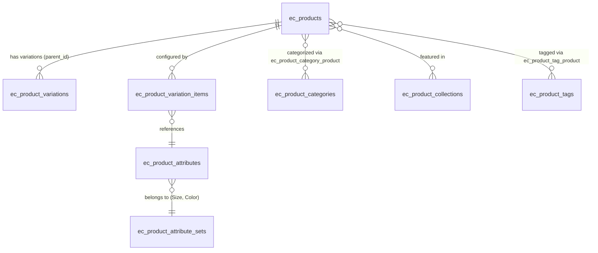
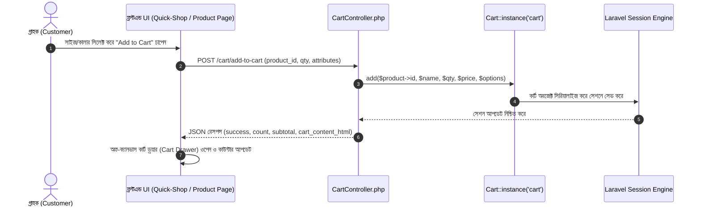
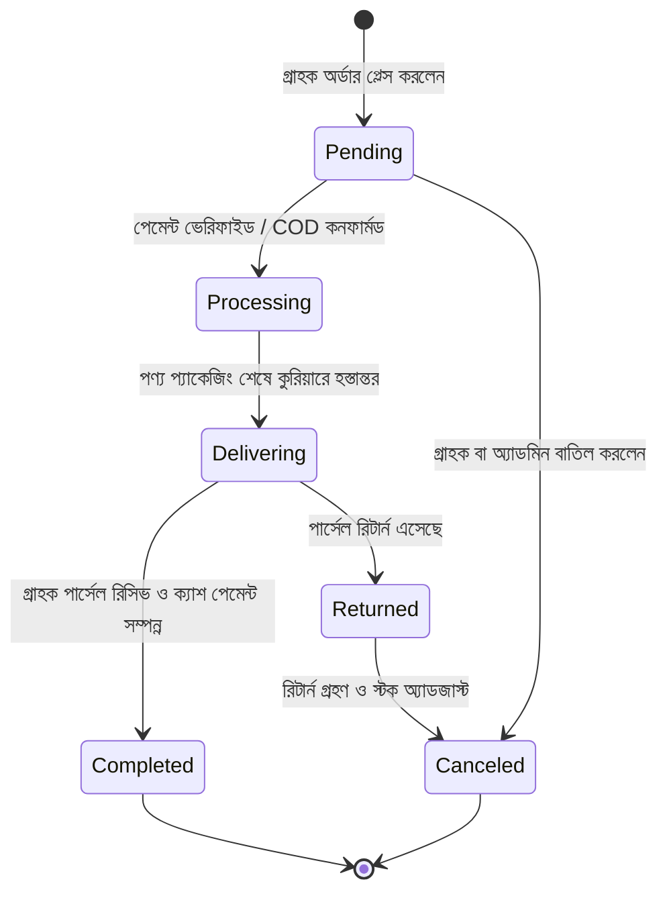
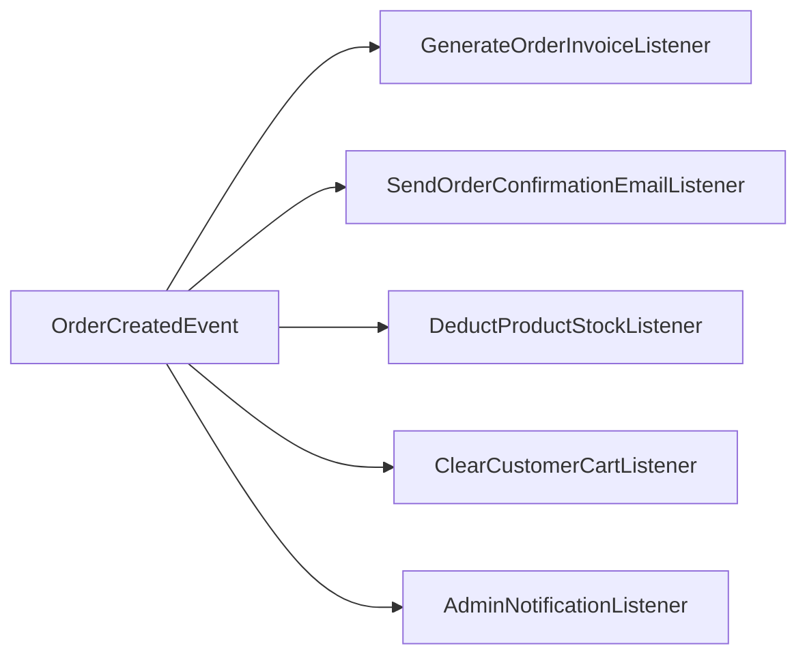

# Habbito (habbitobd.com) - ইকমার্স ইঞ্জিন ও অর্ডার লাইফসাইকেল আর্কিটেকচার
**ডকুমেন্ট কোড:** `DOC-HAB-02`  
**ভার্সন:** 1.0.0 (Production Edition)  
**মডিউল পাথ:** `platform/plugins/ecommerce`  
**ডোমেইন:** [habbitobd.com](https://habbitobd.com)

---

## ১. ভূমিকা ও আর্কিটেকচার পরিচিতি

Habbito প্ল্যাটফর্মের প্রধান প্রাণকেন্দ্র হলো Botble ই-কমার্স কোর ইঞ্জিন (`platform/plugins/ecommerce`)। এটি একটি এন্টারপ্রাইজ-গ্রেড, মডুলার এবং হাই-পারফরম্যান্স ই-কমার্স ফ্রেমওয়ার্ক যা লারাভেল (Laravel 12.x) আর্কিটেকচারের উপর প্রতিষ্ঠিত।

এই ইঞ্জিনটি নিচের মৌলিক উপাদানসমূহ পরিচালনা করে:
1. **প্রোডাক্ট ক্যাটালগ ও ভ্যারিয়েশন সিস্টেম (Product Catalog & Multi-Attribute Variation Engine)**
2. **ডাইনামিক প্রাইসিং ও ডিসকাউন্ট রুলস (Dynamic Pricing, Flash Sale & Tax Engine)**
3. **কার্ট মেকানিজম (Session & Database Cart Storage)**
4. **চেকআউট পাইপলাইন (Multi-step / Single-page Responsive Checkout Flow)**
5. **অর্ডার লাইফসাইকেল ও স্টেট মেশিন (Order State Machine & Transition Logic)**
6. **শিপিং ও ডেলিভারি ক্যালকুলেশন (Bangladesh Logistics Rules: Inside/Outside Dhaka)**
7. **ইনভেন্টরি ও স্টক ম্যানেজমেন্ট (Storehouse & Stock Level Management)**
8. **ইনভয়েসিং ও অটোমেটেড নোটিফিকেশন সিস্টেম (PDF Invoices & Event Listeners)**
9. **হোয়াটসঅ্যাপ ওয়ান-ক্লিক অর্ডার পাইপলাইন (Direct-to-WhatsApp Social Commerce)**

---

## ২. প্রোডাক্ট ক্যাটালগ মডেলিং (Product Catalog Modeling)

Habbito-এর ডাটাবেজে প্রোডাক্ট মূলত দুই ধরনের আর্কিটেকচারে রক্ষিত হয়:
- **Simple Product:** যে প্রোডাক্টের কোনো সাইজ বা রঙের ভ্যারিয়েশন নেই (একটি সিঙ্গেল SKU ও দাম)।
- **Configurable / Variable Product:** যে প্রোডাক্টের অধীনে একাধিক অ্যাট্রিবিউট যেমন: Size (M, L, XL, XXL) এবং Color (Black, Olive, Maroon) থাকে। মূল প্রোডাক্টটি হলো প্যারেন্ট কন্টেইনার এবং প্রতিটি কম্বিনেশন হলো একটি চাইল্ড ভ্যারিয়েশন প্রোডাক্ট।



### ২.১ অ্যাট্রিবিউট ও ভ্যারিয়েশন গঠন (Attribute & Variation System)
Habbito-তে প্রতিটি স্ট্রিটওয়্যার প্রোডাক্ট (যেমন: Acid Wash Drop-Shoulder T-Shirt বা Heavyweight Hoodie) একাধিক স্পেসিফিকেশন ধারণ করে:

| অ্যাট্রিবিউট সেট (`ec_product_attribute_sets`) | ডিসপ্লে টাইপ | ভ্যালুসমূহ (`ec_product_attributes`) |
| :--- | :--- | :--- |
| **Size** | Button / Text Badge | M, L, XL, XXL |
| **Color** | Color Swatch / Circle | Black (`#111111`), White (`#ffffff`), Olive (`#556b2f`), Beige (`#f5f5dc`) |
| **Fabric / GSM** | Dropdown / Badge | 240 GSM, 280 GSM, 320 GSM French Terry |

#### ডাটাবেজ ম্যাপিং কাঠামো:
- `ec_products` টেবিলে প্যারেন্ট প্রোডাক্ট এন্ট্রি থাকে (যেমন: `id = 101`, `name = "Vintage Acid Wash Oversized Tee"`, `is_variation = 0`)।
- চাইল্ড প্রোডাক্ট হিসেবে পৃথক পৃথক এন্ট্রি সংরক্ষিত থাকে (যেমন: `id = 102`, `is_variation = 1`, `sku = "HAB-TSH-BLK-M"` এবং `id = 103`, `sku = "HAB-TSH-BLK-L"` ইত্যাদি)।
- `ec_product_variations` টেবিল প্যারেন্ট এবং চাইল্ডের মধ্যকার সেতু হিসেবে কাজ করে:
  - `product_id` = চাইল্ড আইডি (`102`)
  - `configurable_product_id` = প্যারেন্ট আইডি (`101`)
  - `is_default` = ডিফল্ট ভ্যারিয়েশন ফ্ল্যাগ (1 বা 0)
- `ec_product_variation_items` টেবিলে নির্দিষ্ট ভ্যারিয়েশনটির সাথে অ্যাট্রিবিউটের সম্পর্ক জোড়া হয়:
  - `variation_id` = ভ্যারিয়েশন আইডি
  - `attribute_id` = অ্যাট্রিবিউট আইডি (যেমন: Size -> "XL")

---

## ৩. কার্ট আর্কিটেকচার ও লাইফসাইকেল (Cart Architecture)

Habbito-এর কার্ট ফ্রন্টএন্ডে রিয়েল-টাইম AJAX রিকোয়েস্ট এবং ব্যাকএন্ডে সেশন ড্রাইভেন সার্ভিস দ্বারা পরিচালিত হয়।



### ৩.১ কার্ট রুট ও কন্ট্রোলার কার্যপদ্ধতি
- **ক্লাস:** `Botble\Ecommerce\Http\Controllers\CartController`
- **কার্ট অ্যাড রুট:** `POST /cart/add-to-cart`
- **কার্ট আপডেট রুট:** `POST /cart/update` (পরিমাণ পরিবর্তন বা রিমুভ করার জন্য)
- **কার্ট রিমুভ রুট:** `GET /cart/remove/{rowId}`
- **কার্ট ভিউ রুট:** `GET /cart`

### ৩.২ কার্ট মেমরি ডাটা স্ট্রাকচার
কার্টের প্রতিটি আইটেম নিচের স্ট্রাকচারে সংরক্ষিত থাকে:
```php
[
    'rowId' => 'a2f9c8d...', // ইউনিক হ্যাশ যা প্রোডাক্ট আইডি ও নির্বাচিত অ্যাট্রিবিউটের কম্বিনেশন থেকে তৈরি
    'id' => 102,             // ভ্যারিয়েশন প্রোডাক্টের প্রাইমারি কি
    'name' => 'Vintage Acid Wash Oversized Tee - Black / XL',
    'qty' => 1,
    'price' => 1250.00,
    'weight' => 0.4,         // কেজিতে ওজন (শিপিং ক্যালকুলেশনে ব্যবহৃত)
    'options' => [
        'image' => '/storage/products/acid-wash-front.jpg',
        'attributes' => 'Size: XL, Color: Black',
        'taxRate' => 0,
        'originalPrice' => 1450.00
    ]
]
```

---

## ৪. চেকআউট পাইপলাইন ও লজিক (Checkout Pipeline)

চেকআউট প্রসেসটি গ্রাহকের জন্য অত্যন্ত দ্রুত ও ঝামেলামুক্ত করা হয়েছে। ব্যবহারকারী সরাসরি কার্ট থেকে অথবা প্রোডাক্ট পেজের **"Buy Now"** বাটন চেপে চেকআউটে প্রবেশ করতে পারেন।

### ৪.১ "Buy Now" বাটনের ব্যাকএন্ড মেকানিজম
ব্যবহারকারী যখন প্রোডাক্ট পেজ বা কুইক-শপে **"Buy Now"** ক্লিক করেন:
1. জাভাস্ক্রিপ্ট ইনপুট থেকে সিলেক্টেড `product_id`, `variation_id` এবং `quantity` সংগ্রহ করে।
2. `POST /cart/add-to-cart?checkout=true` এন্ডপয়েন্টে রিকোয়েস্ট পাঠায়।
3. কন্ট্রোলার পণ্যটি কার্টে যুক্ত করার সাথে সাথে ব্যবহারকারীকে স্বয়ংক্রিয়ভাবে `redirect()->route('public.checkout.information', $checkoutToken)`-এ পাঠিয়ে দেয়।

### ৪.২ চেকআউট স্ক্রিনের ডেটা ফ্লো
```mermaid
flowchart TD
    A[চেকআউট পেজ লোড: GET /checkout/{token}] --> B{গ্রাহক কি লগইন করা?}
    B -- হ্যাঁ --> C[কাস্টমার অ্যাড্রেস বুক থেকে ডিফল্ট ঠিকানা প্রি-ফিল]
    B -- না (Guest) --> D[নতুন ঠিকানা ইনপুট ফর্ম প্রদর্শন]
    C --> E[শিপিং মেথড ও রেট ক্যালকুলেশন]
    D --> E
    E --> F[Inside Dhaka ৳70 নাকি Outside Dhaka ৳130 নির্বাচন]
    F --> G[পেমেন্ট গেটওয়ে নির্বাচন: COD / SSLCommerz]
    G --> H[কুপন কোড প্রয়োগ যাচাই (যদি থাকে)]
    H --> I[গ্রাহক 'অর্ডার সম্পন্ন করুন' চাপেন: POST /checkout/process]
    I --> J{পেমেন্ট টাইপ?}
    J -- COD --> K[OrderCreatedEvent ফায়ার ও Thank-You পেজ]
    J -- SSLCommerz --> L[SSLCommerz পেমেন্ট গেটওয়েতে রিডাইরেক্ট]
```

### ৪.৩ শিপিং চার্জ ও ঠিকানা রুলস (Bangladesh Logistics Engine)
Habbito বাংলাদেশের ভূপ্রকৃতি ও ডেলিভারি কুরিয়ার (Steadfast / Pathao / RedX) এর স্ট্যান্ডার্ড চার্জ অনুযায়ী কনফিগার করা:
1. **ইনসাইড ঢাকা (Inside Dhaka):**
   - ডেলিভারি চার্জ: **৳৭০ (BDT 70)**
   - ডেলিভারি টাইমফ্রেম: ২৪ থেকে ৪৮ ঘণ্টা
   - ড্রপডাউন জেলা: ঢাকা (`city = 'Dhaka'`) সিলেক্ট হলে স্বয়ংক্রিয়ভাবে রেট ৭০ টাকা অ্যাসাইন হয়।
2. **আউটসাইড ঢাকা (Outside Dhaka):**
   - ডেলিভারি চার্জ: **৳১৩০ (BDT 130)**
   - ডেলিভারি টাইমফ্রেম: ২ থেকে ৪ কর্মদিবস
   - জেলা: বাংলাদেশের অবশিষ্ট ৬৩টি জেলার যেকোনো একটি সিলেক্ট হলে রেট ১৩০ টাকা অ্যাসাইন হয়।
3. **ফ্রি শিপিং থ্রেশহোল্ড (Free Shipping Threshold):**
   - অ্যাডমিন প্যানেল থেকে কনফিগারযোগ্য (যেমন: ৩,০০০ টাকার বেশি অর্ডারে সারা বাংলাদেশে ফ্রি ডেলিভারি)।

---

## ৫. অর্ডার লাইফসাইকেল ও স্টেট মেশিন (Order State Machine)

একটি অর্ডার ডাটাবেজে তৈরি হওয়া থেকে শুরু করে ডেলিভারি ও ক্লোজ হওয়া পর্যন্ত নির্দিষ্ট কতগুলো স্ট্যাটাসের মধ্য দিয়ে অতিক্রম করে।



### ৫.১ অর্ডার স্ট্যাটাস ম্যাট্রিক্স (Order Statuses)
`ec_orders.status` কলামে নিচের স্ট্যাটাস সংরক্ষিত থাকে:

| স্ট্যাটাস কোড | বাংলা অর্থ | ব্যাখ্যা ও অ্যাকশন |
| :--- | :--- | :--- |
| `pending` | অপেক্ষমান | অর্ডারটি ডাটাবেজে তৈরি হয়েছে, কিন্তু এখনো কল দিয়ে বা পেমেন্ট পেয়ে নিশ্চিত করা হয়নি। |
| `processing` | প্রসেসিং হচ্ছে | অ্যাডমিন অর্ডার কনফার্ম করেছেন। ওয়্যারহাউজে টি-শার্ট/হুডি প্রিন্টিং, কোয়ালিটি চেক ও প্যাকিং চলছে। |
| `delivering` | ডেলিভারিতে রয়েছে | পার্সেলটি স্টেডফাস্ট বা পাঠাও কুরিয়ারের কাছে হ্যান্ডওভার করা হয়েছে। ট্র্যাকিং কোড জেনারেট হয়েছে। |
| `completed` | সম্পন্ন | গ্রাহক পণ্য বুঝে পেয়েছেন এবং কুরিয়ার থেকে পেমেন্ট সফলভাবে রিকনসাইল হয়েছে। |
| `canceled` | বাতিল | গ্রাহক অর্ডার গ্রহণ করতে অপারগতা প্রকাশ করেছেন বা ফেক অর্ডার হিসেবে শনাক্ত হয়েছে। |

### ৫.২ পেমেন্ট স্ট্যাটাস ম্যাট্রিক্স (`ec_payments.status`)
| স্ট্যাটাস কোড | অর্থ | কখন প্রযোজ্য |
| :--- | :--- | :--- |
| `pending` | মুলতবি | COD অর্ডারের ক্ষেত্রে পার্সেল পৌঁছানো পর্যন্ত অথবা অনলাইন পেমেন্টের গেটওয়ে রেসপন্সের অপেক্ষায়। |
| `completed` | পরিশোধিত | SSLCommerz-এ bKash/Nagad/Cards দিয়ে সফল পেমেন্ট আসলে বা COD ডেলিভারি রিসিভ হলে। |
| `refunding` | রিফান্ডিং | রিটার্ন করা পণ্যের বিপরীতে গ্রাহককে টাকা ফেরত পাঠানোর প্রক্রিয়া চলমান। |
| `refunded` | রিফান্ড সম্পন্ন | টাকা কাস্টমারের অ্যাকাউন্টে পাঠিয়ে দেওয়া হয়েছে। |
| `failed` | ব্যর্থ | অনলাইন ট্রানজেকশনে ব্যাংক বা ওয়ালেটের ওটিপি ফেইল করলে বা বাতিল হলে। |

### ৫.৩ শিপিং স্ট্যাটাস ম্যাট্রিক্স (`ec_shipments.status`)
- `approved`: শিপমেন্ট রেকর্ড তৈরি হয়েছে।
- `arranging_delivery`: মার্চেন্ট ডেলিভারির জন্য পার্সেল রেডি করছেন।
- `delivering`: কুরিয়ার ডেলিভারি রাইডারের ব্যাগে রয়েছে।
- `delivered`: কাস্টমার পার্সেল গ্রহণ করেছেন।
- `canceled`: পার্সেল পাঠানো বাতিল করা হয়েছে।

---

## ৬. ইভেন্ট লিসেনার ও অটোমেশন চেইন (Event-Listener Automation Chain)

অর্ডার প্লেস হওয়ার সাথে সাথে লারাভেলের ইভেন্ট-লিসেনার আর্কিটেকচার ব্যাকগ্রাউন্ডে একাধিক জরুরি কাজ সম্পন্ন করে:



1. **`GenerateOrderInvoiceListener`:**
   - `ec_invoices` টেবিলে ইউনিক ইনভয়েস নম্বর তৈরি করে (যেমন: `INV-100024`)।
   - পিডিএফ ইনভয়েস রেন্ডার করে সার্ভারের স্টোরেজে ক্যাশ করে।
2. **`SendOrderConfirmationEmailListener`:**
   - গ্রাহকের ইমেইলে আকর্ষণীয় HTML ইমেইল টেমপ্লেট পাঠায় যাতে অর্ডার সামারি, ডেলিভারি ঠিকানা এবং ট্র্যাকিং লিংক থাকে।
3. **`DeductProductStockListener`:**
   - যদি পণ্যটিতে স্টক ম্যানেজমেন্ট অন থাকে (`with_storehouse_management = 1`), তবে প্রতিটি অর্ডারের পরিমাণের ভিত্তিতে মূল ইনভেন্টরি থেকে সংখ্যা কমিয়ে দেয় (`quantity = quantity - order_qty`)।
4. **`ClearCustomerCartListener`:**
   - সফল অর্ডারের পর গ্রাহকের সেশন বা ডাটাবেজ কার্ট খালি করে দেয় যাতে একই পণ্য আবার যোগ না থাকে।
5. **`AdminNotificationListener`:**
   - অ্যাডমিন ড্যাশবোর্ডে পুশ বেল নোটিফিকেশন পাঠায় যাতে নতুন অর্ডারের শব্দ ও অ্যালার্ট দেখা যায়।

---

## ৭. কুপন, ডিসকাউন্ট ও ফ্ল্যাশ সেল লজিক (Discounts & Flash Sales)

Habbito প্ল্যাটফর্মে ডিসকাউন্টের জন্য শক্তিশালী ইঞ্জিন কনফিগার করা আছে:
- **কুপন কোড (`ec_discounts`):**
  - **টাইপ ১ - Percentage (%):** মোট মূল্যের উপর শতকরা ছাড় (যেমন: `HABBITO10` দিলে ১০% ছাড়)।
  - **টাইপ ২ - Fixed Amount (৳):** নির্দিষ্ট অঙ্কের ছাড় (যেমন: `SAVE200` দিলে ২০০ টাকা ছাড়)।
  - **রুলস ও লিমিটেশন:** ন্যূনতম ক্রয়ের সীমা (যেমন: ১,৫০০ টাকার নিচে কুপন কার্যকর হবে না), ব্যবহারের সর্বোচ্চ সীমা (Usage limit per coupon / per user), এবং মেয়াদ উত্তীর্ণ তারিখ।
- **ফ্ল্যাশ সেল ও ডিল প্রোডাক্ট (`[deal-product]` শর্টকোড):**
  - হোমপেজে বা প্রমোশন পেজে কাউন্টডাউন টাইমার সহ ডিসকাউন্ট অফার প্রদর্শন।
  - মেয়াদ শেষ হলে স্বয়ংক্রিয়ভাবে নিয়মিত মূল্যে ব্যাক করার ব্যবস্থা।

---

## ৮. সোশ্যাল কমার্স: হোয়াটসঅ্যাপ ১-ক্লিক অর্ডার ইঞ্জিন (WhatsApp Direct Order)

বাংলাদেশি ক্রেতাদের একটি বিশাল অংশ সরাসরি কথা বলে বা সোশ্যাল মিডিয়া মারফত অর্ডার করতে স্বাচ্ছন্দ্যবোধ করেন। Habbito-তে আমরা একটি সমন্বিত হোয়াটসঅ্যাপ অর্ডারিং আর্কিটেকচার ইমপ্লিমেন্ট করেছি।

### ৮.১ কম্পোনেন্ট অবস্থান ও কোড রেফারেন্স
- **ভিউ ফাইল:** `platform/themes/ninico/views/ecommerce/includes/whatsapp-order-button.blade.php`
- **কুইক শপ মোডাল ইন্টিগ্রেশন:** `platform/themes/ninico/partials/quick-shop.blade.php`
- **টার্গেট নম্বর:** `+8801977797772`

### ৮.২ ইউআরএল এনকোডিং মেকানিজম
ব্যবহারকারী যখন সাইজ (যেমন: `L`) এবং কালার (যেমন: `Black`) সিলেক্ট করে **"অর্ডার করতে হোয়াটসঅ্যাপ করুন"** বাটনে চাপেন, জাভাস্ক্রিপ্ট স্বয়ংক্রিয়ভাবে নিচের মেসেজ ফরম্যাটটি তৈরি করে URL-এ এনকোড করে:

```text
হ্যালো Habbito, আমি এই পণ্যটি অর্ডার করতে চাই:
📦 পণ্য: Heavyweight Acid Wash Hoodie
🔗 লিংক: https://habbitobd.com/products/heavyweight-acid-wash-hoodie
💰 মূল্য: ৳১,৯৫০
📏 সাইজ: L
🎨 কালার: Black
🔢 পরিমাণ: 1

আমার ডেলিভারি ঠিকানা ও নাম নিচে দিচ্ছি:
```

ব্রাউজার স্বয়ংক্রিয়ভাবে `https://wa.me/8801977797772?text=...` লিংকে রিডাইরেক্ট করে গ্রাহকের মোবাইলের হোয়াটসঅ্যাপ অ্যাপ বা ডেস্কটপের হোয়াটসঅ্যাপ ওয়েবে চ্যাট উইন্ডো ওপেন করে দেয়। এর ফলে কোনো চেকআউট ফর্ম পূরণ না করেও কাস্টমার ১ ক্লিকে সেলস প্রতিনিধির সাথে অর্ডার কনফার্ম করতে পারেন।

---

## ৯. সামারি ও কোড ইন্টিগ্রিটি চেক

| কম্পোনেন্ট | স্ট্যাটাস | পাথ |
| :--- | :--- | :--- |
| ইকমার্স কোর প্লাগইন | সচল (Active) | `platform/plugins/ecommerce` |
| ভ্যারিয়েশন জেনারেটর | সক্রিয় (Ready) | `Botble\Ecommerce\Services\StoreProductService` |
| কার্ট সার্ভিস | সক্রিয় (Ready) | `Botble\Ecommerce\Cart\Cart` |
| চেকআউট রুট | সক্রিয় (Ready) | `routes/web.php` -> `platform/plugins/ecommerce/routes/checkout.php` |
| হোয়াটসঅ্যাপ বাটন | সংযুক্ত (Live) | `whatsapp-order-button.blade.php` |

---
*পরবর্তী অধ্যায়: [03_ADMIN_PANEL_AND_OPERATIONS_MANUAL.md](file:///c:/Habitto/docs/full_website_documentation/03_ADMIN_PANEL_AND_OPERATIONS_MANUAL.md)*
