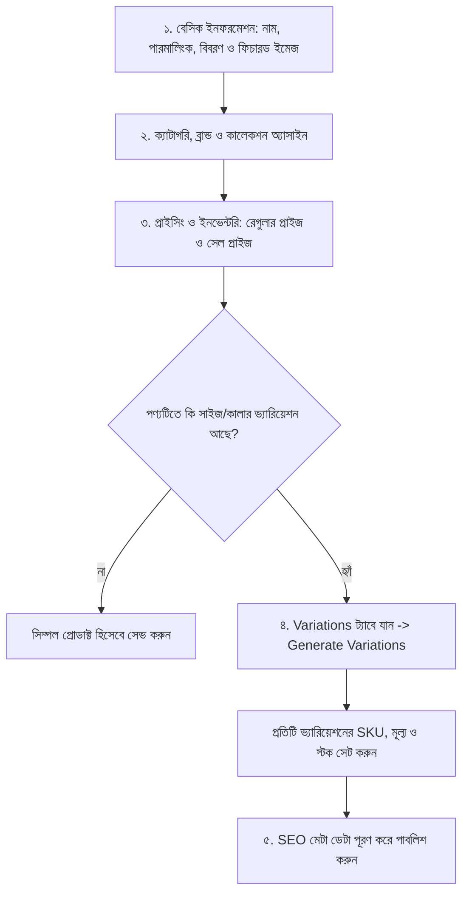
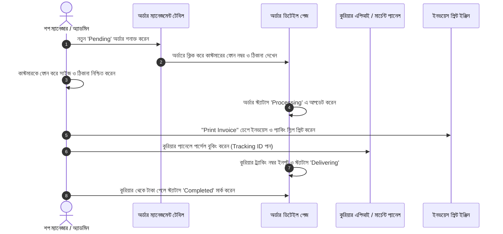

# Habbito (habbitobd.com) - অ্যাডমিন প্যানেল ও অপারেশনাল গাইডলাইন
**ডকুমেন্ট কোড:** `DOC-HAB-03`  
**ভার্সন:** 1.0.0 (Production Edition)  
**মডিউল পাথ:** `platform/core/base`, `platform/plugins/ecommerce`  
**অ্যাডমিন ইউআরএল:** `https://habbitobd.com/admin` (লোকাল: `http://localhost:8000/admin`)

---

## ১. ভূমিকা ও অ্যাডমিন অ্যাক্সেস ক্রেডেনশিয়াল

Habbito-এর ব্যাকএন্ড অ্যাডমিন প্যানেলটি একটি অত্যন্ত সুরক্ষিত, আধুনিক ও ব্যবহারকারী-বান্ধব ড্যাশবোর্ড যা স্টোরের দৈনন্দিন ইনভেন্টরি, কাস্টমার অর্ডার, পেমেন্ট, মার্কেটিং ব্যানার এবং সাইট কনফিগারেশন সম্পূর্ণভাবে নিয়ন্ত্রণ করতে ব্যবহৃত হয়।

### ১.১ ডিফল্ট লগইন ক্রেডেনশিয়াল
| ফিল্ডের নাম | মান / ভ্যালু |
| :--- | :--- |
| **লগইন ইউআরএল** | `/admin` অথবা `https://habbitobd.com/admin` |
| **সুপার অ্যাডমিন ইমেইল** | `admin@admin.com` |
| **ডিফল্ট পাসওয়ার্ড** | `admin123` |
| **সিকিউরিটি রোল** | Super Administrator (Full ACL Permissions) |

> [!IMPORTANT]
> লাইভ সার্ভারে ডিপ্লয়মেন্ট সম্পন্ন করার পর অনতিবিলম্বে অ্যাডমিন প্যানেলের **Administration -> Users -> Super Admin Profile** থেকে পাসওয়ার্ড পরিবর্তন করে শক্তিশালী পাসওয়ার্ড (কমপক্ষে ১২ অক্ষর, সংখ্যা ও সিম্বল সম্বলিত) সেট করুন।

---

## ২. ড্যাশবোর্ড পরিচিতি ও রিয়েল-টাইম অ্যানালিটিক্স (Dashboard & Widgets)

অ্যাডমিন প্যানেলে লগইন করার পর মূল স্ক্রিনে ড্যাশবোর্ড প্রদর্শিত হয়, যেখানে ব্যবসার বর্তমান অবস্থা এক নজরে পরিলক্ষিত হয়:

```mermaid
graph TD
    Dashboard[Habbito অ্যাডমিন ড্যাশবোর্ড] --> KpiWidgets[মূল সূচক / KPI উইজেট]
    Dashboard --> Charts[রেভিনিউ ও অর্ডার গ্রাফিক্স]
    Dashboard --> QuickTables[সাম্প্রতিক অ্যাক্টিভিটি টেবিল]

    KpiWidgets --> W1["মোট রাজস্ব (Total Revenue - ৳)"]
    KpiWidgets --> W2["মোট অর্ডার সংখ্যা (Total Orders)"]
    KpiWidgets --> W3["গ্রাহক সংখ্যা (Registered Customers)"]
    KpiWidgets --> W4["পণ্য সংখ্যা (Total Products: 174+)"]

    Charts --> C1[দৈনিক / মাসিক বিক্রয় গ্রাফ]
    Charts --> C2[অর্ডার কনভার্সন রেট]

    QuickTables --> T1[সাম্প্রতিক অর্ডারসমূহ (Recent Orders)]
    QuickTables --> T2[টপ সেলিং টি-শার্ট ও হুডি]
    QuickTables --> T3[স্টক শেষ হওয়ার সতর্কতা (Low Stock Alert)]
```

1. **KPI কাউন্টার কার্ড:** মোট বিক্রয়, নতুন অর্ডার, পেন্ডিং অর্ডার ও সক্রিয় গ্রাহক সংখ্যার রিয়েল-টাইম পরিসংখ্যান।
2. **অর্ডার অ্যানালিটিক্স চার্ট:** চার্ট ড্রপডাউনে শেষ ৭ দিন, ৩০ দিন বা নির্দিষ্ট বছরের মোট বিক্রয়ের রেখাচিত্র দেখা যায়।
3. **লো স্টক অ্যালার্ট (Low Stock Alerts):** যে সকল ভ্যারিয়েশন বা পণ্যের ইনভেন্টরি নির্ধারিত সীমার (যেমন: ৫ পিসের কম) নিচে নেমে গেছে, সেগুলো লাল রঙে হাইলাইট হয় যাতে সময়মতো রি-স্টক করা যায়।

---

## ৩. পণ্য ব্যবস্থাপনা (Product Catalog Management)

একটি নতুন পণ্য (যেমন: Oversized Drop-Shoulder Graphic T-Shirt) আপলোড এবং ভ্যারিয়েশন তৈরি করার সম্পূর্ণ গাইডলাইন নিচে দেওয়া হলো।

### ৩.১ নতুন পণ্য যুক্ত করার ধাপসমূহ
**মেনু পাথ:** `Ecommerce -> Products -> Create`



#### ধাপসমূহ বিস্তারিত:
1. **Name (পণ্যের নাম):** আকর্ষণীয় নাম দিন, যেমন: *Habbito Heavyweight Vintage Acid Wash Tee*.
2. **Permalink (স্লাগ):** স্বয়ংক্রিয়ভাবে তৈরি হবে (`heavyweight-vintage-acid-wash-tee`)। প্রয়োজন হলে কাস্টমাইজ করতে পারবেন।
3. **Description (সংক্ষিপ্ত বিবরণ):** পণ্যের প্রধান ৩-৪টি আকর্ষণীয় বৈশিষ্ট্য (Bullet point আকারে)।
4. **Content (বিস্তারিত বিবরণ):** ফেব্রিকের জিএসএম (240 GSM 100% Combed Cotton), সাইজ চার্ট গাইড, ওয়াশ কেয়ার নির্দেশিকা ইত্যাদি।
5. **Images (ছবি ও গ্যালারি):**
   - **Featured Image:** পণ্যের ফ্রন্ট ভিউ (রেশিও: ১:১ বা ১০০০x১০০০ পিক্সেল)।
   - **Gallery Images:** সাইড ভিউ, ব্যাক ভিউ, ফেব্রিক ক্লোজ-আপ এবং মডেলের পরিহিত ছবি।
6. **Categories (ক্যাটাগরি):** ডানদিকের সাইডবার থেকে উপযুক্ত ক্যাটাগরি টিক দিন (যেমন: *Men's Streetwear -> T-Shirts*).
7. **Product Collections:** পণ্যটি যদি বিশেষ কোনো ক্যাম্পেইনের অংশ হয় (যেমন: *New Arrivals* বা *Trending Now*), টিক দিন।

---

### ৩.২ ভ্যারিয়েশন জেনারেটর (Multi-Attribute Variation Engine)
Habbito-এর পোশাক পণ্যে সাইজ (Size: M, L, XL, XXL) এবং কালার (Color: Black, Olive, White) ভ্যারিয়েশন কনফিগার করার নিয়ম:

1. প্রোডাক্ট এডিট পেজের নিচের দিকে স্ক্রোল করে **"Product attributes & variations"** সেকশনে যান।
2. **"Add attribute"** বাটনে ক্লিক করে নির্বাচন করুন:
   - `Size`: M, L, XL, XXL
   - `Color`: Black, Olive
3. **"Generate variations"** বাটনে ক্লিক করুন। সিস্টেম স্বয়ংক্রিয়ভাবে ৮টি কম্বিনেশন ভ্যারিয়েশন তৈরি করবে:
   - Black - M, Black - L, Black - XL, Black - XXL
   - Olive - M, Olive - L, Olive - XL, Olive - XXL
4. প্রতিটি ভ্যারিয়েশন ড্রপডাউন ওপেন করে:
   - **SKU লিখুন:** যেমন `HAB-TSH-AW-BLK-M`
   - **Price:** যদি নির্দিষ্ট সাইজ বা কালারের দাম বেশি হয়, তবে এখানে লিখুন (খালি রাখলে প্যারেন্ট প্রাইজ পাবে)।
   - **Stock Quantity:** যেমন সাইজ M-এ ২০ পিস, L-এ ৩৫ পিস ইত্যাদি।
   - **Variation Image:** কালার ভ্যারিয়েশনের জন্য নির্দিষ্ট রঙের ছবি আপলোড করুন।
5. **"Save changes"** ক্লিক করে সেভ করুন।

---

## ৪. অর্ডার প্রসেসিং ও কুরিয়ার হ্যান্ডলিং ম্যানুয়াল (Order Operations)

**মেনু পাথ:** `Ecommerce -> Orders`

প্রতিদিন নতুন অর্ডার আসলে কীভাবে তা প্রসেস ও স্টেডফাস্ট/পাঠাও কুরিয়ারে পাঠানো হবে তার ধাপে ধাপে নির্দেশনা:



### ৪.১ অর্ডার ডিটেইলস এর গুরুত্বপূর্ণ অংশসমূহ:
1. **Customer Info:** গ্রাহকের পুরো নাম, মোবাইল নম্বর এবং ইমেইল ঠিকানা।
2. **Shipping Address:** জেলা (Dhaka / Outside Dhaka), থানা ও পূর্ণাঙ্গ ডেলিভারি ঠিকানা।
3. **Order Items:** গ্রাহক কোন পণ্যের কোন সাইজ ও কোন রঙের কয়টি আইটেম অর্ডার করেছেন।
4. **Order Notes:** গ্রাহকের বিশেষ অনুরোধ (যেমন: "বিকেলে ডেলিভারি দিলে ভালো হয়")।
5. **Shipping Amount & Tax:** শিপিং চার্জ (৭০ টাকা বা ১৩০ টাকা) যুক্ত হয়েছে কিনা তা যাচাই।

### ৪.২ ইনভয়েস ও প্যাকিং স্লিপ প্রিন্টিং (Invoices):
- প্রতিটি অর্ডারের ডানদিকের কোণায় **"Print Invoice"** বাটন রয়েছে।
- এটিতে ক্লিক করলে অফিসিয়াল Habbito ব্র্যান্ডের লোগো, ইনভয়েস নম্বর, গ্রাহকের বিবরণ, পণ্যের বিবরণ এবং ক্যাশ অন ডেলিভারি (COD) অ্যামাউন্ট সম্বলিত আন্তর্জাতিক স্ট্যান্ডার্ড ফরম্যাটে PDF ইনভয়েস তৈরি হয় যা প্রিন্ট করে পার্সেলের সাথে সংযুক্ত করতে হয়।

---

## ৫. স্লাইডার, ব্যানার ও অ্যাডস ম্যানেজমেন্ট (Hero Sliders & Ads)

হোমপেজের আকর্ষণীয় ব্যানার ও প্রমোশনাল কার্ড পরিবর্তন করার নিয়ম:

### ৫.১ হিরো ব্যানার স্লাইডার (`simple-slider`)
- **মেনু পাথ:** `Plugins -> Simple Sliders`
- **টার্গেট স্লাইডার:** `Home Slider` বা `Wooden/Fashion Slider`
- **নতুন স্লাইড যুক্ত বা পরিবর্তন:**
  1. স্লাইডার লিস্ট থেকে এডিট বাটনে ক্লিক করুন।
  2. স্লাইডের টাইটেল (যেমন: *STREETWEAR CULTURE 2026*), সাব-টাইটেল (যেমন: *Heavyweight Tees & Oversized Hoodies*) লিখুন।
  3. লিংক ফিল্ডে ক্যাটাগরি বা পণ্যের ইউআরএল দিন (যেমন: `/product-categories/t-shirts`)।
  4. হাই-রেজুলেশন ব্যাকগ্রাউন্ড ইমেজ (১৯২০x৮০০ পিক্সেল) আপলোড করুন।
  5. সেভ করুন। ফ্রন্টএন্ডে স্বয়ংক্রিয়ভাবে স্লাইডার আপডেট হয়ে যাবে।

### ৫.২ প্রমোশনাল ব্যানার কার্ড (`ads`)
- **মেনু পাথ:** `Plugins -> Ads`
- হোমপেজের গ্রিডে প্রদর্শিত ছোট ছোট ব্যানার (যেমন: *Trendy Acid Wash Collection - 20% OFF*):
  - ব্যানারের ছবি আপলোড করুন।
  - ক্লিকের গন্তব্য ইউআরএল (Destination URL) নির্ধারণ করুন।
  - নির্দিষ্ট তারিখে স্বয়ংক্রিয়ভাবে বন্ধ হওয়ার এক্সপায়ারি ডেট সেট করতে পারেন।

---

## ৬. ডিসকাউন্ট ও কুপন তৈরি করার নিয়ম (Discounts & Coupons)

**মেনু পাথ:** `Ecommerce -> Discounts -> Create`

1. **Coupon Code:** একটি আকর্ষণীয় প্রোমো কোড দিন, যেমন: `HABBITO2026` বা `EIDSPECIAL`।
2. **Type of discount:**
   - **Percentage (%):** শতাংশ হারে ছাড় (যেমন: `15%`).
   - **Fixed amount (৳):** নির্দিষ্ট টাকার ছাড় (যেমন: `200 BDT`).
3. **Applies to:**
   - *All orders:* সমস্ত অর্ডারের জন্য প্রযোজ্য।
   - *Order amount from:* নির্দিষ্ট মূল্যের উপরের অর্ডারে (যেমন: ১,৫০০ টাকার অর্ডারে)।
   - *Specific products:* শুধুমাত্র নির্দিষ্ট কিছু টি-শার্টের উপর।
4. **Usage Limits:**
   - কুপনটি মোট কতবার ব্যবহার করা যাবে (যেমন: প্রথম ১০০ জন গ্রাহক)।
   - একজন গ্রাহক সর্বোচ্চ কয়বার ব্যবহার করতে পারবেন (যেমন: ১ বার)।
5. **Start & End Date:** অফার শুরুর ও শেষ হওয়ার সময় নির্ধারণ করুন।

---

## ৭. থিম অপশন ও কাস্টমাইজেশন (Theme Options & Site Settings)

**মেনু পাথ:** `Appearance -> Theme Options`

Habbito-এর সাইট ব্র্যান্ডিংয়ের সকল গুরুত্বপূর্ণ কনফিগারেশন এখান থেকে পরিচালিত হয়:

| অপশন ট্যাব | কি কি পরিবর্তন করা যায় |
| :--- | :--- |
| **General** | প্রধান লোগো (`Logo`), ডার্ক লোগো, ফেভিকন (`Favicon`), প্রি-লোডার আইকন। |
| **Header** | টপ হেডার নোটিশ বার, ফোন নম্বর (`+8801977797772`), ইমেইল, অফ-ক্যানভাস মেনু কন্ট্রোল। |
| **Footer** | ফুটার কপিরাইট টেক্সট (`© 2026 Habbito. All Rights Reserved`), পেমেন্ট মেথড আইকনসমূহ। |
| **Social Links** | অফিসিয়াল ফেসবুক পেজ, ইনস্টাগ্রাম প্রোফাইল, টিকটক ও ইউটিউব চ্যানেল লিংক। |
| **Styling** | প্রাইমারি কালার (Habbito ব্রান্ড রেড/ব্ল্যাক), সেকেন্ডারি কালার, টাইপোগ্রাফি ফন্ট ফ্যামিলি। |
| **Custom CSS/JS** | কোনো এক্সটার্নাল ট্র্যাকিং স্ক্রিপ্ট (Google Analytics, Meta Pixel, TikTok Pixel) বসানোর জায়গা। |

---

## ৮. মিডিয়া লাইব্রেরি ও ফাইল অর্গানাইজেশন (Media Manager)

**মেনু পাথ:** `Media`

Habbito সাইটে প্রায় ২৭৭টির বেশি মিডিয়া অ্যাসেট সুশৃঙ্খলভাবে সাজানো রয়েছে:
- **ডিরেক্টরি নিয়মাবলী:**
  - `products/`: সমস্ত টি-শার্ট, হুডি এবং পোলোর ছবি এই ফোল্ডারে রাখুন।
  - `banners/`: হোমপেজ স্লাইডার এবং প্রমোশনাল গ্রাফিক্স।
  - `general/`: লোগো, ফেভিকন, সার্ভিস আইকন ইত্যাদি।
- **ছবি আপলোডের সেরা টিপস:**
  - প্রতিটি ছবির সাইজ ৩০০ কেবির (300 KB) মধ্যে রাখার চেষ্টা করুন।
  - পণ্যের ফ্রন্ট ভিউয়ের জন্য স্কয়ার ফরম্যাট (১:১ রেশিও) ব্যবহার করুন।

---

## ৯. সামারি ও জরুরি চেকলিস্ট

| অ্যাডমিন টাস্ক | ফ্রিকোয়েন্সি | যে মেনুতে যাবেন |
| :--- | :--- | :--- |
| নতুন অর্ডার প্রসেসিং ও কনফার্মেশন | দৈনিক (প্রতি ঘণ্টায়) | `Ecommerce -> Orders` |
| লো স্টক পর্যবেক্ষণ ও ইনভেন্টরি আপডেট | প্রতি সপ্তাহে | `Ecommerce -> Products` |
| সেলস ও রেভিনিউ রিপোর্ট এক্সপোর্ট | প্রতি মাসে | `Ecommerce -> Reports` |
| মিডিয়া লাইব্রেরি পরিষ্কার রাখা | মাসিক | `Media` |

---
*পরবর্তী অধ্যায়: [04_PAYMENTS_GATEWAYS_AND_FINANCE.md](file:///c:/Habitto/docs/full_website_documentation/04_PAYMENTS_GATEWAYS_AND_FINANCE.md)*
