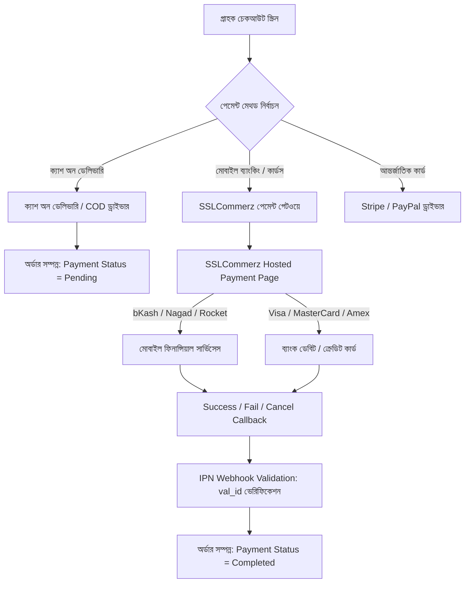
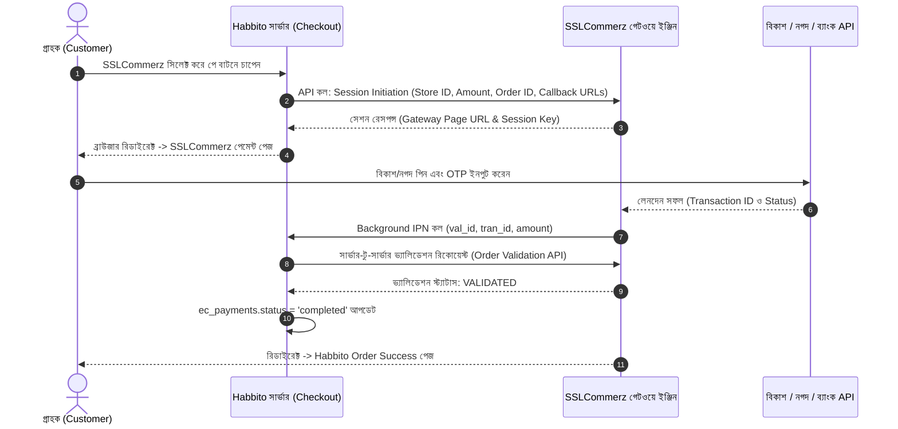
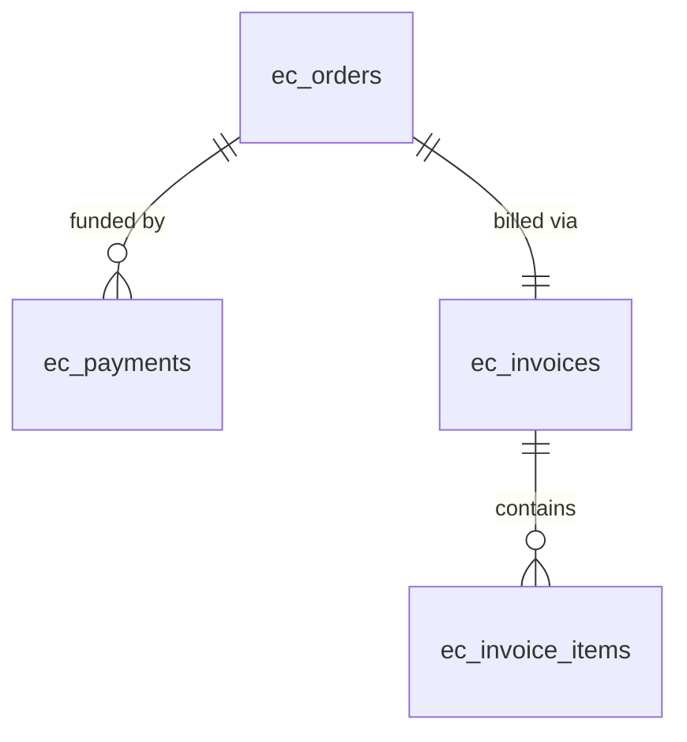

# Habbito (habbitobd.com) - পেমেন্ট গেটওয়ে, অর্থায়ন ও ট্রানজেকশন আর্কিটেকচার
**ডকুমেন্ট কোড:** `DOC-HAB-04`  
**ভার্সন:** 1.0.0 (Production Edition)  
**মডিউল পাথ:** `platform/plugins/payment`, `platform/plugins/sslcommerz`  
**কারেন্সি:** BDT (৳ - বাংলাদেশী টাকা)

---

## ১. পেমেন্ট ইঞ্জিন পরিচিতি ও আর্কিটেকচার

Habbito প্ল্যাটফর্মে একটি মাল্টি-চ্যানেল, নিরাপদ এবং ফ্লেক্সিবল পেমেন্ট আর্কিটেকচার ইন্টিগ্রেট করা হয়েছে। প্ল্যাটফর্মের পেমেন্ট সিস্টেম মূলত দুটি পৃথক লেয়ারে কাজ করে:
1. **কোর পেমেন্ট ম্যানেজার (`platform/plugins/payment`):** এটি লেনদেনের স্ট্যাটাস, কারেন্সি কনভার্সন, লেজার ট্র্যাকিং এবং ইনভয়েস লিংক পরিচালনা করে।
2. **গেটওয়ে ড্রাইভারস (Gateway Drivers):** নির্দিষ্ট পেমেন্ট মেথড (যেমন: ক্যাশ অন ডেলিভারি, SSLCommerz, Stripe, PayPal) বাস্তবায়নের জন্য প্লাগইন-ভিত্তিক ড্রাইভার।

---

## ২. ক্যাশ অন ডেলিভারি (Cash on Delivery - COD)

বাংলাদেশে ই-কমার্সে গ্রাহকদের সবচেয়ে জনপ্রিয় মাধ্যম হলো ক্যাশ অন ডেলিভারি। Habbito প্ল্যাটফর্মে সিওডি অত্যন্ত সুরক্ষিতভাবে ডিজাইন করা হয়েছে।

### ২.১ COD ওয়ার্কফ্লো
1. চেকআউট পেজে গ্রাহক পেমেন্ট মেথড হিসেবে **"Cash on Delivery (COD)"** নির্বাচন করেন।
2. সাবমিট করার সাথে সাথে কোনো এক্সটার্নাল গেটওয়ে ছাড়াই অর্ডারটি সরাসরি ডাটাবেজে তৈরি হয়:
   - `ec_orders.status` = `pending`
   - `ec_orders.is_finished` = `1`
   - `ec_payments.status` = `pending`
   - `ec_payments.payment_channel` = `cod`
3. গ্রাহককে তাৎক্ষণিক Thank You / Order Confirmation পেজে নিয়ে যাওয়া হয় এবং স্ক্রিনে অর্ডার আইডি (যেমন: `#100025`) প্রদর্শিত হয়।
4. ব্যাকএন্ডে গ্রাহক এবং শপ অ্যাডমিন দুজনের কাছেই স্বয়ংক্রিয় অর্ডার কনফার্মেশন ইমেইল চলে যায়।

### ২.২ ডেলিভারি ও রিকনসিলিয়েশন (Delivery & Reconciliation)
- অ্যাডমিন টিম ফোন কলের মাধ্যমে অর্ডার ও সাইজ কনফার্ম করে পার্সেল কুরিয়ারকে (যেমন: Steadfast বা Pathao) প্রদান করে।
- কুরিয়ার রাইডার কাস্টমারের কাছ থেকে নগদ অর্থ সংগ্রহ করে পার্সেল হস্তান্তর করে।
- কুরিয়ার কোম্পানি যখন ব্যাংক অ্যাকাউন্টে টাকা রেমিট্যান্স পাঠায়, অ্যাডমিন তখন অর্ডার এডিট পেজে গিয়ে পেমেন্ট স্ট্যাটাস `completed` মার্ক করেন।

---

## ৩. SSLCommerz ইন্টিগ্রেশন ও লাইফসাইকেল (SSLCommerz Gateway)

SSLCommerz হলো বাংলাদেশের সর্ববৃহৎ এবং বাংলাদেশ ব্যাংক অনুমোদিত পেমেন্ট গেটওয়ে এগ্রিগেটর। Habbito-তে নিজস্ব ডেডিকেটেড প্লাগইন (`platform/plugins/sslcommerz`) এর মাধ্যমে এটি যুক্ত রয়েছে।

### ৩.১ পেমেন্ট চ্যানেলসমূহ (Supported Payment Channels)
SSLCommerz গেটওয়ের মাধ্যমে গ্রাহক নিচের সকল পেমেন্ট সিস্টেমে অর্থ পরিশোধ করতে পারেন:
- **মোবাইল ব্যাংকিং (MFS):** বিকাশ (bKash), নগদ (Nagad), রকেট (Rocket), উপায় (Upay), সেলফিন (Cellfin), ট্যাপ (Tap), শিওরক্যাশ।
- **ব্যাংক কার্ড (Cards):** ভিসা (Visa), মাস্টারকার্ড (MasterCard), আমেরিকান এক্সপ্রেস (Amex), নেক্সাসপে (NexusPay), ইউনিয়নপে।
- **ইন্টারনেট ব্যাংকিং (Net Banking):** ইসলামী ব্যাংক, সিটি ব্যাংক (City Touch), ব্র্যাক ব্যাংক, ঢাকা ব্যাংক, ইবিএল (EBL SKYBANKING) ইত্যাদি।

### ৩.২ SSLCommerz সিকোয়েন্স ডায়াগ্রাম ও লেনদেন পদ্ধতি

### ৩.৩ আইপিএন (IPN - Instant Payment Notification) এর গুরুত্ব
অনেক সময় ব্যবহারকারী পেমেন্ট করার পর ব্রাউজার বন্ধ করে দিতে পারেন বা নেটওয়ার্ক ড্রপ করতে পারে। এই সমস্যার সমাধানে Habbito-তে **IPN Webhook Listener** যুক্ত রয়েছে:
- SSLCommerz ব্যাকগ্রাউন্ডে Habbito-এর IPN রুটে (`POST /payment/sslcommerz/ipn`) একটি নোটিফিকেশন পাঠায়।
- সিস্টেম ব্রাউজারের রিডাইরেক্টের জন্য অপেক্ষা না করেই সার্ভার-লেভেলে অর্ডারটি পেইড (`completed`) হিসেবে মার্ক করে ফেলে। ফলে কোনো কাস্টমারের টাকা কেটে নিলেও অর্ডার ফেইল হওয়ার ঝুঁকি থাকে না।

### ৩.৪ অ্যাডমিন প্যানেলে SSLCommerz কনফিগার করার নিয়ম
**মেনু পাথ:** `Ecommerce -> Settings -> Payment Methods -> SSLCommerz`

| ফিল্ডের নাম | ডেসক্রিপশন | সেটিং ভ্যালু |
| :--- | :--- | :--- |
| **Status** | গেটওয়ে সচল বা বন্ধ রাখা | `Enable` |
| **Mode** | স্যান্ডবক্স বা লাইভ এনভায়রনমেন্ট | `Live` (টেস্টিংয়ের জন্য `Sandbox`) |
| **Store ID** | SSLCommerz থেকে প্রদত্ত মার্চেন্ট স্টোর আইডি | মার্চেন্ট স্টোর আইডি |
| **Store Password** | SSLCommerz থেকে প্রদত্ত গোপন সিক্রেট কি | মার্চেন্ট পাসওয়ার্ড |

---

## ৪. আন্তর্জাতিক গেটওয়ে অপশনসমূহ (Global Gateways)

Habbito যদি ভবিষ্যতে প্রবাসী বাংলাদেশী বা আন্তর্জাতিক গ্রাহকদের কাছে শিপমেন্ট পাঠায়, তবে নিচের গেটওয়েগুলো তাৎক্ষণিক চালু করার ব্যবস্থা সিস্টেমে অন্তর্নির্মিত আছে:

1. **Stripe:** আন্তর্জাতিক ক্রেডিট/ডেবিট কার্ড লেনদেনের জন্য বিশ্বমানের গেটওয়ে।
   - পাথ: `platform/plugins/payment` -> Stripe Driver.
   - সেটিংস: `Publishable Key` এবং `Secret Key`.
2. **PayPal:** বিশ্বব্যাপী পেপাল একাউন্ট ও কার্ড পেমেন্টের জন্য।
   - সেটিংস: `Client ID` এবং `Client Secret`.
3. **Razorpay & Paystack:** দক্ষিণ এশিয়া ও আফ্রিকান অঞ্চলের জন্য রেডি ড্রাইভার।

---

## ৫. কারেন্সি ও মুদ্রা ফরম্যাটিং ইঞ্জিন (Currency Engine)

Habbito-এর সমস্ত আর্থিক হিসাব-নিকাশ বাংলাদেশী টাকার (BDT) মানদণ্ডে পরিচালিত হয়।

### ৫.১ কারেন্সি কনফিগারেশন সেটিংস
**মেনু পাথ:** `Ecommerce -> Settings -> Currencies`

| প্রোপার্টি | কনফিগারেশন ভ্যালু | ব্যাখ্যা |
| :--- | :--- | :--- |
| **Currency Code** | `BDT` | ISO 4217 স্ট্যান্ডার্ড কোড |
| **Currency Symbol** | `৳` | বাংলা টাকার আন্তর্জাতিক প্রতীক |
| **Symbol Position** | `Before (পূর্বে)` | প্রতীকের অবস্থান, যেমন: `৳৭৫০` |
| **Number of Decimals** | `0` (অথবা `2`) | পয়সা না দেখাতে চাইলে `0`, পয়সা দেখালে `2` (৳৭৫০.০০) |
| **Thousands Separator** | `,` (কমা) | হাজার ও লাখের কমা সেপারেটর (যেমন: ৳১,৯৫০) |
| **Is Default?** | `Yes` (ডিফল্ট কারেন্সি) | স্টোরের প্রধান মুদ্রা হিসেবে চিহ্নিত |

---

## ৬. ট্রানজেকশন লেজার ও ডাটাবেজ মডেলিং (Ledger & Audit Trail)

প্রতিটি আর্থিক লেনদেনের সম্পূর্ণ রেকর্ড ডাটাবেজের `ec_payments` এবং `ec_invoices` টেবিলে স্থায়ীভাবে রক্ষিত থাকে:

### ৬.১ `ec_payments` টেবিলের গুরুত্বপূর্ণ ফিল্ডসমূহ:
- `id`: লেনদেনের ইউনিক আইডি।
- `order_id`: যে অর্ডারের বিপরীতে টাকা প্রদান করা হয়েছে।
- `amount`: পরিশোধিত মোট অর্থের পরিমাণ (যেমন: `1950.00`)।
- `currency`: লেনদেনের মুদ্রা (`BDT`)।
- `payment_channel`: পেমেন্ট মাধ্যম (`sslcommerz`, `cod`, `stripe`)।
- `charge_id` / `transaction_id`: ব্যাংক বা SSLCommerz ট্রানজেকশন আইডি (যেমন: `SSL_TXN_673e21...`)।
- `status`: লেনদেনের স্থিতি (`pending`, `completed`, `refunded`, `failed`)।
- `created_at`: অর্থ পরিশোধের সুনির্দিষ্ট তারিখ ও সময়।

### ৬.২ ইনভয়েস টেবিল (`ec_invoices`):
- প্রতিটি সফল অর্ডারের বিপরীতে একটি ইউনিক ইনভয়েস কোড তৈরি হয় (যেমন: `INV-100025`)।
- ইনভয়েস পেজে স্বয়ংক্রিয়ভাবে সাব-টোটাল, শিপিং চার্জ, কুপন ডিসকাউন্ট এবং গ্র্যান্ড টোটাল হিসাব করে কাস্টমার ও মার্চেন্ট কপি তৈরি করা হয়।

---

## ৭. রিফান্ড ও রিটার্ন প্রসেস (Refund Management)

যদি কোনো গ্রাহক কোনো কারণে পণ্য রিটার্ন করেন বা ত্রুটিযুক্ত পণ্য ফেরত দেন:
1. অ্যাডমিন সংশ্লিষ্ট অর্ডার পেজে প্রবেশ করে **"Refund"** বাটনে ক্লিক করেন।
2. কত টাকা রিফান্ড করা হবে তা ইনপুট করেন (সম্পূর্ণ টাকা অথবা আংশিক টাকা)।
3. রিফান্ডের কারণ সিলেক্ট করে সাবমিট করেন।
4. পেমেন্ট গেটওয়ের মাধ্যমে অনলাইনে টাকা ব্যাক করা অথবা ম্যানুয়ালি কাস্টমারের বিকাশ/নগদ নাম্বারে টাকা ফেরত পাঠিয়ে সিস্টেমে স্ট্যাটাস `refunded` মার্ক করা হয়।

---
*পরবর্তী অধ্যায়: [05_DATABASE_SCHEMA_AND_DATA_RELATIONSHIPS.md](file:///c:/Habitto/docs/full_website_documentation/05_DATABASE_SCHEMA_AND_DATA_RELATIONSHIPS.md)*
