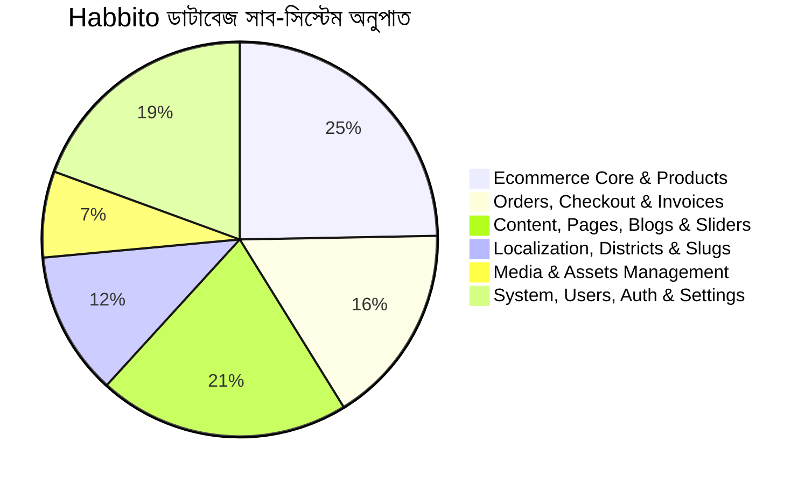
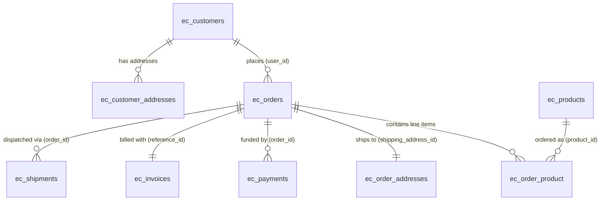
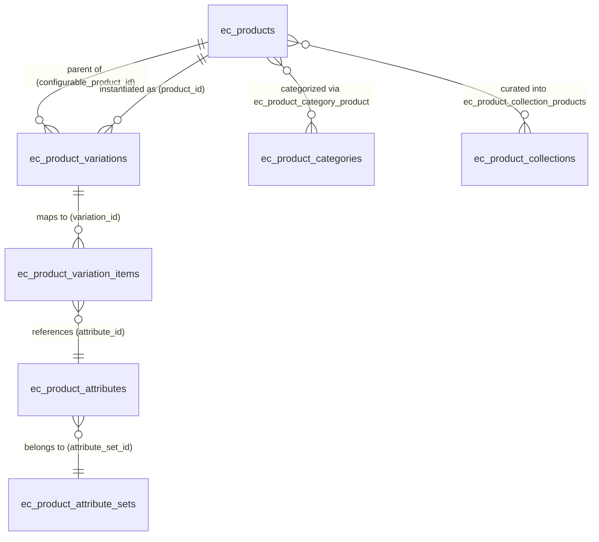

# Habbito (habbitobd.com) - ডাটাবেজ স্কিমা ও রিলেশনশিপ আর্কিটেকচার
**ডকুমেন্ট কোড:** `DOC-HAB-05`  
**ভার্সন:** 1.0.0 (Production Edition)  
**ডাটাবেজ ইঞ্জিন:** MariaDB 10.4.32 / MySQL 8.0+  
**কোল্যাশন (Collation):** `utf8mb4_unicode_ci` / `utf8mb4_general_ci`  
**মোট টেবিল সংখ্যা:** ১৭০টি (170 Tables)  
**ব্যাকআপ ফাইল:** `database_habbito_latest.sql` (866 KB)

---

## ১. ডাটাবেজ ওভারভিউ ও আর্কিটেকচারাল ম্যাট্রিক্স

Habbito প্ল্যাটফর্মের সমস্ত তথ্য ১৭০টি রিলেশনাল ডাটাবেজ টেবিলে অত্যন্ত সুশৃঙ্খলভাবে সংরক্ষিত। প্রতিটি টেবিল লারাভেলের Eloquent ORM আর্কিটেকচারের সাথে সুসংহত এবং ফরেন কি (Foreign Keys) ও ইনডেক্সিং (Indexing) দ্বারা দ্রুত কুয়েরি নিশ্চিত করা হয়েছে।

### ১.১ সাব-সিস্টেম অনুযায়ী টেবিল বিভাজন (Table Subsystems)
ডাটাবেজের ১৭০টি টেবিলকে মূলত ৬টি প্রধান কার্যভিত্তিক ব্লকে ভাগ করা হয়েছে:

1. **ইকমার্স কোর ও প্রোডাক্ট ক্যাটালগ (Ecommerce Core):** পণ্য, ক্যাটাগরি, ব্রান্ড, ট্যাগ, কালেকশন, সাইজ/কালার ভ্যারিয়েশন।
2. **অর্ডার ও গ্রাহক ব্যবস্থাপনা (Orders & Customers):** গ্রাহক একাউন্ট, চেকআউট অর্ডার, কার্ট, শিপমেন্ট, ইনভয়েস, রিভিউ ও কুপন।
3. **পেমেন্ট ও মুদ্রা লেজার (Payments & Financials):** পেমেন্ট মেথড, গেটওয়ে ট্রানজেকশন হিস্ট্রি, কারেন্সি ফরম্যাট।
4. **কনটেন্ট, থিম ও উইজেট (CMS & Content):** পেজ, ব্লগ পোস্ট, মেনু ট্রি, সিম্পল স্লাইডার, অ্যাডস ব্যানার, নোটিশ বার।
5. **ভৌগোলিক ও লজিস্টিকস (Geographical Data):** বাংলাদেশের ৬৪টি জেলা (`cities`), বিভাগ ও পোস্টকোড।
6. **সিস্টেম, ইউজার ও সেটিংস (Core Infrastructure):** অ্যাডমিন ইউজার, পারমিশন রোল, সিস্টেম কনফিগারেশন সেটিংস, স্লাগস ও অডিট লগ।

---

## ২. প্রধান ই-আর ডায়াগ্রাম (Entity-Relationship Diagrams)

### ২.১ অর্ডার, গ্রাহক ও পেমেন্ট ই-আর ডায়াগ্রাম
একটি অর্ডার সম্পন্ন হলে কীভাবে বিভিন্ন টেবিলের মধ্যে সম্পর্ক তৈরি হয় তা নিচের ডায়াগ্রামে দেখানো হলো:

### ২.২ প্রোডাক্ট ক্যাটালগ ও ভ্যারিয়েশন ই-আর ডায়াগ্রাম
পোশাকের সাইজ ও কালার ভ্যারিয়েশন কীভাবে ডাটাবেজে সংযুক্ত থাকে:

---

## ৩. গুরুত্বপূর্ণ কোর টেবিলসমূহের বিস্তারিত স্কিমা

### ৩.১ `ec_products` (প্রোডাক্ট টেবিল)
প্ল্যাটফর্মের মূল পণ্য এবং তাদের চাইল্ড ভ্যারিয়েশন ধারণ করে (মোট ১৭৪+ রেকর্ড)।

| কলামের নাম | ডাটা টাইপ | কী / ইনডেক্স | বিবরণ |
| :--- | :--- | :--- | :--- |
| `id` | `bigint(20) unsigned` | Primary Key, Auto Increment | পণ্যের ইউনিক প্রাইমারি আইডি। |
| `name` | `varchar(255)` | Index | পণ্যের শিরোনাম (যেমন: Acid Wash Tee)। |
| `description` | `text` | Nullable | পণ্যের সংক্ষিপ্ত বৈশিষ্ট্য। |
| `content` | `longtext` | Nullable | পণ্যের পূর্ণাঙ্গ ডেসক্রিপশন (HTML ফরম্যাটে)। |
| `status` | `varchar(60)` | Default `'published'` | অবস্থা (`published`, `draft`, `pending`). |
| `sku` | `varchar(150)` | Nullable, Unique | স্টক কিপিং ইউনিট (যেমন: `HAB-TSH-01`). |
| `price` | `double(15,2)` | Nullable | মূল বিক্রয়মূল্য (Regular Price)। |
| `sale_price` | `double(15,2)` | Nullable | অফার বা ছাড়ের পর বিক্রয়মূল্য (Sale Price)। |
| `images` | `text` | Nullable | পণ্যের ইমেজ গ্যালারি (JSON অ্যারে ফরম্যাটে সংরক্ষিত)। |
| `is_variation` | `tinyint(1)` | Default `0` | এটি কি প্যারেন্ট পণ্য (0) নাকি চাইল্ড ভ্যারিয়েশন (1)। |
| `is_featured` | `tinyint(1)` | Default `0` | হোমপেজের ফিচারড সেকশনে দেখাবে কিনা (1 বা 0)। |
| `with_storehouse_management` | `tinyint(1)` | Default `0` | স্বয়ংক্রিয় স্টক কাউন্ট অন করা কিনা। |
| `quantity` | `int(11)` | Nullable | বর্তমান স্টকে মোট কত পিস পণ্য আছে। |
| `created_at` / `updated_at` | `timestamp` | Nullable | তৈরির ও শেষ পরিবর্তনের সময়কাল। |

---

### ৩.২ `ec_orders` (অর্ডার টেবিল)
গ্রাহকের প্রতিটি ক্রয়ের মাস্টার রেকর্ড।

| কলামের নাম | ডাটা টাইপ | বিবরণ |
| :--- | :--- | :--- |
| `id` | `bigint(20) unsigned` | ইউনিক অর্ডার আইডি। |
| `code` | `varchar(120)` | ফ্রন্টএন্ডে প্রদর্শিত অর্ডার কোড (যেমন: `#100024`)। |
| `user_id` | `bigint(20) unsigned` | নিবন্ধিত গ্রাহকের আইডি (গেস্ট অর্ডারে `0` বা `NULL`)। |
| `shipping_address_id` | `bigint(20) unsigned` | ডেলিভারি ঠিকানার ফরেন কি (`ec_order_addresses.id`)। |
| `shipping_method` | `varchar(120)` | শিপিং মেথড (যেমন: `default` - Inside Dhaka / Outside Dhaka)। |
| `shipping_amount` | `double(15,2)` | ডেলিভারি চার্জ (যেমন: `70.00` বা `130.00`)। |
| `tax_amount` | `double(15,2)` | ভ্যাট বা ট্যাক্স পরিমাণ (ডিফল্ট `0.00`)। |
| `sub_total` | `double(15,2)` | পণ্যের মোট মূল্য (ডেলিভারি চার্জ ছাড়া)। |
| `amount` | `double(15,2)` | গ্র্যান্ড টোটাল (`sub_total + shipping_amount - discount`)। |
| `discount_amount`| `double(15,2)` | কুপন বা প্রোমো কোডের মাধ্যমে ছাড়ের পরিমাণ। |
| `status` | `varchar(120)` | অর্ডারের স্থিতি (`pending`, `processing`, `delivering`, `completed`, `canceled`)। |
| `is_finished` | `tinyint(1)` | চেকআউট সফলভাবে শেষ হয়েছে কিনা (1 বা 0)। |

---

### ৩.৩ `ec_order_product` (অর্ডারের লাইন আইটেম টেবিল)
একটি অর্ডারে কোন কোন আইটেম কেনা হয়েছে তার ম্যাপিং।

| কলামের নাম | ডাটা টাইপ | বিবরণ |
| :--- | :--- | :--- |
| `id` | `bigint(20) unsigned` | প্রাইমারি কি। |
| `order_id` | `bigint(20) unsigned` | `ec_orders.id` এর সাথে ফরেন কি লিংক। |
| `product_id` | `bigint(20) unsigned` | যে প্রোডাক্ট বা ভ্যারিয়েশনটি কেনা হয়েছে। |
| `product_name`| `varchar(255)` | অর্ডারের সময় পণ্যের যে নাম ছিল (হিস্টোরিক্যাল ব্যাকআপ)। |
| `qty` | `int(11)` | কয়টি পিস কেনা হয়েছে। |
| `price` | `double(15,2)` | প্রতিটি পিসের মূল্য। |
| `options` | `text` | নির্বাচিত অ্যাট্রিবিউট তথ্য (যেমন: `{"Size":"XL","Color":"Black"}`). |

---

### ৩.৪ `ec_payments` (পেমেন্ট ট্রানজেকশন টেবিল)
| কলামের নাম | ডাটা টাইপ | বিবরণ |
| :--- | :--- | :--- |
| `id` | `bigint(20) unsigned` | ইউনিক পেমেন্ট আইডি। |
| `order_id` | `bigint(20) unsigned` | সম্পর্কিত অর্ডার আইডি। |
| `charge_id` | `varchar(120)` | গেটওয়ে ট্রানজেকশন রেফারেন্স বা সেশন আইডি। |
| `payment_channel` | `varchar(60)` | পেমেন্ট চ্যানেল (`cod`, `sslcommerz`, `stripe`)। |
| `amount` | `double(15,2)` | পরিশোধিত অর্থের অঙ্ক। |
| `currency` | `varchar(10)` | মুদ্রা (`BDT`)। |
| `status` | `varchar(60)` | পেমেন্ট স্ট্যাটাস (`pending`, `completed`, `failed`). |

---

### ৩.৫ `settings` (সিস্টেম কনফিগারেশন টেবিল)
প্ল্যাটফর্মের ১৩৮টি গ্লোবাল সেটিংস কী-ভ্যালু পেয়ার আকারে এখানে রক্ষিত আছে।

| কী (`key`) | সংরক্ষিত মান (`value`) | বিবরণ |
| :--- | :--- | :--- |
| `admin_title` | `Habbito` | ব্যাকএন্ড অ্যাডমিন প্যানেলের নাম। |
| `site_title` | `Habbito` | ওয়েবসাইটের ব্র্যান্ড নাম। |
| `ecommerce_store_name` | `Habbito` | ই-কমার্স স্টোরের অফিসিয়াল নাম। |
| `ecommerce_store_phone` | `+8801977797772` | কাস্টমার কেয়ার ও হোয়াটসঅ্যাপ হেল্পলাইন নম্বর। |
| `ecommerce_store_email` | `info@habbitobd.com` | অফিসিয়াল যোগাযোগের ইমেইল। |
| `payment_sslcommerz_mode` | `1` / `0` | SSLCommerz লাইভ বা স্যান্ডবক্স মোড ফ্ল্যাগ। |
| `payment_cod_status` | `1` | ক্যাশ অন ডেলিভারি অন/অফ ফ্ল্যাগ। |

---

### ৩.৬ `cities` (বাংলাদেশ জেলা টেবিল)
বাংলাদেশের ৬৪টি জেলার ভৌগোলিক তথ্য ধারণ করে:
- প্রতিটি জেলার নাম যেমন: `Dhaka`, `Chittagong`, `Sylhet`, `Rajshahi`, `Khulna`, `Barisal`, `Rangpur`, `Mymensingh`, `Gazipur`, `Narayanganj` ইত্যাদি।
- চেকআউট পেজে কাস্টমার যখন জেলা নির্বাচন করেন, এই টেবিল থেকেই ড্রপডাউন ডাটা ফেচ করা হয়।

---

## ৪. ব্যাকআপ ও ডাটাবেজ রিকভারি প্রসিডিউর

### ৪.১ ব্যাকআপ ফাইলের বৈশিষ্ট্য
- **ফাইল নেম:** `C:\Habitto\database_habbito_latest.sql` (এবং জিপ ভার্সন `habbito_database.zip`)
- **এনকোডিং:** খাঁটি **UTF-8 (Without BOM)**, কোনো বাইনারি নাল বাইট বা UTF-16 লিডিং হেক্স নেই।
- **ডাটাবেজ ইঞ্জিন স্টেটমেন্ট:** `ENGINE=InnoDB DEFAULT CHARSET=utf8mb4 COLLATE=utf8mb4_unicode_ci`

### ৪.২ হোস্টিংগার phpMyAdmin-এ ইমপোর্ট করার নির্দেশিকা
1. Hostinger hPanel থেকে **phpMyAdmin** ওপেন করুন।
2. আপনার তৈরি করা ডাটাবেজে ক্লিক করুন (যেমন: `u123456789_habbitodb`)।
3. উপরের মেনু থেকে **"Import"** ট্যাবে যান।
4. **"Choose File"** এ ক্লিক করে `database_habbito_latest.sql` ফাইলটি সিলেক্ট করুন।
5. "Character set of the file" যেন অবশ্যই **`utf-8`** থাকে।
6. নিচে স্ক্রোল করে **"Import" / "Go"** চাপুন। কয়েক সেকেন্ডের মধ্যে ১৭০টি টেবিল সফলভাবে তৈরি হয়ে যাবে।

---
*পরবর্তী অধ্যায়: [06_PLUGINS_AND_CUSTOM_MODULES.md](file:///c:/Habitto/docs/full_website_documentation/06_PLUGINS_AND_CUSTOM_MODULES.md)*
