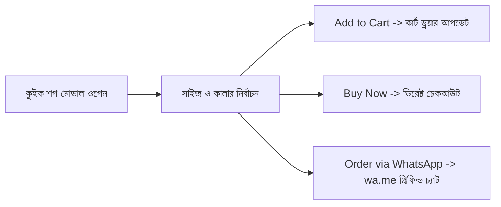

# Habbito (habbitobd.com) - প্লাগইন ও কাস্টম মডিউল আর্কিটেকচার
**ডকুমেন্ট কোড:** `DOC-HAB-06`  
**ভার্সন:** 1.0.0 (Production Edition)  
**মডিউল ডিরেক্টরি:** `platform/plugins/`  
**মোট সক্রিয় প্লাগইন:** ২০টি (20 Active Plugins)

---

## ১. প্লাগইন আর্কিটেকচার ওভারভিউ

Habbito প্ল্যাটফর্মটি অত্যন্ত মডুলার আর্কিটেকচারে গঠিত। প্রতিটি কার্যপ্রণালী একটি স্বতন্ত্র প্লাগইনের মাধ্যমে এনক্যাপসুলেট করা থাকে। এর ফলে মূল ফ্রেমওয়ার্কের কোড অক্ষত রেখেই যেকোনো নতুন ফিচার চালু, বন্ধ বা বর্ধিত করা যায়।

### ১.১ প্লাগইন গঠন কাঠামো (Plugin Anatomy)
প্রতিটি প্লাগইন নিচের স্ট্যান্ডার্ড ডিরেক্টরি স্ট্রাকচার মেনে চলে:
```text
platform/plugins/{plugin-name}/
├── plugin.json               # প্লাগইনের মেটাডাটা (নাম, সংস্করণ, ডিপেনডেন্সি, অথর)
├── routes/
│   ├── web.php               # ফ্রন্টএন্ড ও পাবলিক রুটসমূহ
│   └── api.php               # মোবাইল অ্যাপ বা এক্সটার্নাল এপিআই রুট
├── src/
│   ├── Http/
│   │   ├── Controllers/      # বিজনেস লজিক কন্ট্রোলার
│   │   └── Requests/         # ফর্ম ভ্যালিডেশন রিকোয়েস্ট ক্লাস
│   ├── Models/               # Eloquent ORM ডাটাবেজ মডেল
│   ├── Repositories/         # রিপোজিটরি ইন্টারফেস ও এলিমেন্ট
│   ├── Tables/               # অ্যাডমিন প্যানেলের এজাক্স ডাটাটেবিল
│   └── Providers/            # সার্ভিস প্রোভাইডার ও ডিপেনডেন্সি ইনজেকশন
├── database/
│   └── migrations/           # ডাটাবেজ স্কিমা মাইগ্রেশন ফাইল
└── resources/
    ├── views/                # ব্লেড টেমপ্লেট ভিউ ফাইল
    └── lang/                 # ভাষা ও লোকালাইজেশন ফাইল
```

---

## ২. ২০টি সক্রিয় প্লাগইনের সম্পূর্ণ তালিকা ও ভূমিকা (Plugin Matrix)

Habbito-এর ডাটাবেজে সক্রিয় থাকা ২০টি প্লাগইনের ভূমিকা ও কনফিগারেশন বিবরণ নিচে দেওয়া হলো:

| ক্রম | প্লাগইনের নাম | ফোল্ডার পাথ | প্রধান দায়িত্ব ও ভূমিকা |
| :---: | :--- | :--- | :--- |
| **১** | **Ecommerce** | `platform/plugins/ecommerce` | প্ল্যাটফর্মের প্রধান ই-কমার্স ইঞ্জিন (প্রোডাক্ট, ভ্যারিয়েশন, কার্ট, অর্ডার, ইনভয়েস, শিপিং)। |
| **২** | **SSLCommerz** | `platform/plugins/sslcommerz` | বাংলাদেশের শীর্ষ পেমেন্ট গেটওয়ে (বিকাশ, নগদ, রকেট, ব্যাংক কার্ড ও আইপিএন ভ্যালিডেশন)। |
| **৩** | **Payment** | `platform/plugins/payment` | কোর পেমেন্ট ম্যানেজার, ট্রানজেকশন লেজার ও ক্যাশ অন ডেলিভারি (COD) হ্যান্ডলার। |
| **৪** | **Simple Slider** | `platform/plugins/simple-slider` | হোমপেজের হিরো ব্যানার স্লাইডার (Wooden/Fashion স্লাইডার অ্যানিমেশন ও টেক্সট)। |
| **৫** | **Ads** | `platform/plugins/ads` | প্রমোশনাল ব্যানার গ্রিড (যেমন: Acid Wash ও Oversized Hoodie ডিসকাউন্ট কার্ড)। |
| **৬** | **Blog** | `platform/plugins/blog` | স্ট্রিটওয়্যার ফ্যাশন ও লাইফস্টাইল ব্লগ পোস্ট, ক্যাটাগরি এবং আর্টিকেল পাবলিশিং। |
| **৭** | **Location** | `platform/plugins/location` | বাংলাদেশের ৬৪টি জেলা (`cities`), থানা ও ভৌগোলিক ম্যাপিং ম্যানেজমেন্ট। |
| **৮** | **Analytics** | `platform/plugins/analytics` | গুগল অ্যানালিটিক্স (GA4) ট্র্যাকিং স্ক্রিপ্ট ইনজেকশন ও ড্যাশবোর্ড ভিজিটর মেট্রিক। |
| **৯** | **Audit Log** | `platform/plugins/audit-log` | অ্যাডমিন প্যানেলে কে, কখন, কোন প্রোডাক্ট বা সেটিং এডিট করেছে তার নিরপত্তা অডিট ট্রেইল। |
| **১০**| **Backup** | `platform/plugins/backup` | এক ক্লিকে সম্পূর্ণ ডাটাবেজ ও মিডিয়া ফাইলের ব্যাকআপ তৈরি ও ডাউনলোড করার সিস্টেম। |
| **১১**| **Contact** | `platform/plugins/contact` | যোগাযোগের ফর্ম হ্যান্ডলিং এবং ব্যবহারকারীদের প্রেরিত মেসেজ ডাটাবেজে সেভ রাখা। |
| **১২**| **Cookie Consent** | `platform/plugins/cookie-consent` | ব্যবহারকারীর কুকি সম্মতি সংক্রান্ত ফুটার পপআপ/নোটিশ প্রদর্শন। |
| **১৩**| **Captcha** | `platform/plugins/captcha` | স্প্যাম অর্ডার ও বট ট্রাফিক প্রতিরোধে Google reCAPTCHA v2/v3 ও Cloudflare Turnstile। |
| **১৪**| **FAQ** | `platform/plugins/faq` | অর্ডার, রিটার্ন ও ডেলিভারি সংক্রান্ত সচরাচর জিজ্ঞাসিত প্রশ্নাবলী (FAQ) ও অ্যাকর্ডিয়ন। |
| **১৫**| **Gallery** | `platform/plugins/gallery` | স্ট্রিটওয়্যার লুকবুক ও ফটো গ্যালারি পেজ রেন্ডারিং। |
| **১৬**| **Language** | `platform/plugins/language` | মাল্টি-ল্যাঙ্গুয়েজ সুইচিং ইঞ্জিন (বাংলা ও ইংরেজি ইন্টারফেস সাপোর্ট)। |
| **১৭**| **Language Advanced**| `platform/plugins/language-advanced`| ডাটাবেজ মডেলসমূহের বহুভাষিক কনটেন্ট রূপান্তর ও আলাদা লোকালাইজেশন টেবিল ম্যানেজমেন্ট। |
| **১৮**| **Social Login** | `platform/plugins/social-login` | গ্রাহকদের ফেসবুক ও গুগল অ্যাকাউন্টের মাধ্যমে ১-ক্লিকে লগইন সুবিধা। |
| **১৯**| **Team** | `platform/plugins/team` | Habbito ব্র্যান্ড টিম, ডিজাইনার ও ফাউন্ডার প্রোফাইল প্রদর্শন। |
| **২০**| **Translation** | `platform/plugins/translation` | সিস্টেমের টেক্সট ও ইন্টারফেস স্ট্রিং ব্রাউজার থেকে বাংলা বা ইংরেজিতে সম্পাদনা। |

---

## ৩. Habbito স্পেশাল কাস্টম মডিউল ও এনহ্যান্সমেন্টস

ফ্রেমওয়ার্কের স্ট্যান্ডার্ড প্লাগইনের পাশাপাশি Habbito-এর ইউজার এক্সপেরিয়েন্সকে আন্তর্জাতিক মানে উন্নীত করতে একাধিক কাস্টম ফিচার ডেভেলপ ও ইনজেক্ট করা হয়েছে:

### ৩.১ ভাসমান হোয়াটসঅ্যাপ বাটন (Floating WhatsApp Widget)
- **অবস্থান:** `platform/themes/ninico/partials/floating-whatsapp.blade.php`
- **আর্কিটেকচার:** সম্পূর্ণ সাইটের প্রতিটি পেজের নিচে ডান কোণায় একটি আকর্ষণীয় পালসিং গ্রিন বাটন।
- **কোড লজিক:**
  ```html
  <div class="habbito-whatsapp-floating">
      <a href="https://wa.me/8801977797772" target="_blank" rel="noopener noreferrer">
          <i class="fab fa-whatsapp"></i>
          <span class="tooltip-text">Habbito হেল্পলাইনে কথা বলুন</span>
      </a>
  </div>
  ```
- **বৈশিষ্ট্য:** স্ক্রিন স্ক্রোল করলেও বাটনটি ফিক্সড থাকে এবং মোবাইলে বটম ন্যাভিগেশন বারের উপরে স্মার্টলি অ্যাডজাস্ট হয়ে যায়।

---

### ৩.২ কুইক-শপ মোডালে "Buy Now" ও হোয়াটসঅ্যাপ অর্ডার ইঞ্জিন
- **অবস্থান:** `platform/themes/ninico/partials/quick-shop.blade.php`
- **কার্যপদ্ধতি:** গ্রাহক ক্যাটালগ পেজ থেকে যেকোনো প্রোডাক্টের ওপর মাউস নিলে "Quick View / Quick Shop" বাটন দেখতে পান। ক্লিক করলে পেজ রিলোড ছাড়াই একটি লাইটবক্স মোডাল ওপেন হয়।
- **তিনটি শক্তিশালী অ্যাকশন বাটন:**
  1. **Add to Cart (কার্টে যোগ করুন):** সাধারণ কেনাকাটার জন্য আইটেমটি কার্ট ড্রয়ারে যোগ করে।
  2. **Buy Now (এখনই কিনুন):** সরাসরি পণ্যটি সহ চেকআউট পেজে রিডাইরেক্ট করে।
  3. **Order via WhatsApp (হোয়াটসঅ্যাপে অর্ডার করুন):** নির্বাচিত সাইজ ও কালার সহ মেসেজ বানিয়ে তাৎক্ষণিক হোয়াটসঅ্যাপে চ্যাট শুরু করায়।



---

### ৩.৩ ডিল প্রোডাক্ট সিটিএ বাটন এনহ্যান্সমেন্ট (Deal-Product CTA)
- **অবস্থান:** `platform/themes/ninico/views/ecommerce/widgets/deal-product/styles/wooden.blade.php`
- **উন্নয়ন:** হোমপেজের স্পেশাল অফার সেকশনে যেখানে কাউন্টডাউন টাইমার থাকে, সেখানে পূর্বে সরাসরি কোনো অ্যাকশন বাটন ছিল না। আমরা এতে একটি স্টাইলিশ **"Shop The Deal"** CTA বাটন যুক্ত করেছি যা কাস্টমারকে সরাসরি অফারকৃত পণ্যের বিস্তারিত পেজে নিয়ে যায়।

---

### ৩.৪ বাংলাদেশ লজিস্টিকস ও কুরিয়ার প্রস্তুতি
- **মডিউল:** `platform/plugins/location` এবং `platform/plugins/ecommerce`
- **কনফিগারেশন:** 
  - বাংলাদেশের ৬৪টি জেলাকে সিস্টেমে প্রাইমারি ডেলিভারি জোন হিসেবে ইনডেক্স করা হয়েছে।
  - ঢাকা সিটির জন্য ৭০ টাকা এবং ঢাকার বাইরের জন্য ১৩০ টাকা ফ্ল্যাট রেট নির্ধারণ।
  - Steadfast ও Pathao কুরিয়ারে বুকিংয়ের জন্য প্রয়োজনীয় কাস্টমার নাম, ফোন নম্বর ও পূর্ণাঙ্গ ঠিকানা এক্সেসিবল করা।

---

## ৪. হুক ও ফিল্টার সিস্টেম (Hooks & Filter Architecture)

Botble কোর সিস্টেম ওয়ার্ডপ্রেসের মতো অ্যাকশন ও ফিল্টার হুক সাপোর্ট করে:
- **`add_action()`:** কোনো ইভেন্টের সময় নতুন কোড রান করানো (যেমন: অর্ডার হওয়ার পর এসএমএস এপিআই কল করা)।
- **`add_filter()`:** কোনো ডাটা বা ভিউ প্রদর্শন করার পূর্বে তা পরিবর্তন করা (যেমন: দামের পূর্বে ৳ সাইন যুক্ত করা বা পণ্যের টাইটেলে বিশেষ ব্যাজ বসানো)।

---
*পরবর্তী অধ্যায়: [07_DEVOPS_HOSTING_AND_SECURITY.md](file:///c:/Habitto/docs/full_website_documentation/07_DEVOPS_HOSTING_AND_SECURITY.md)*
