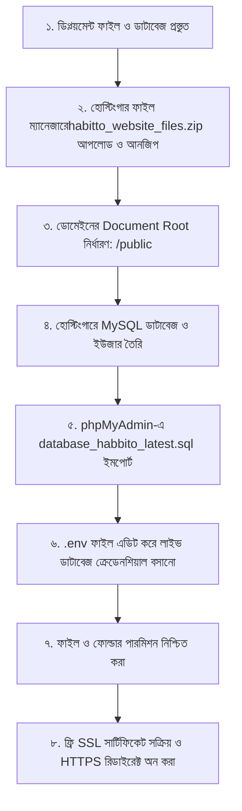
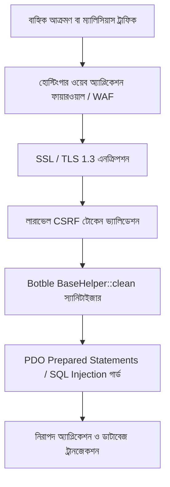

# Habbito (habbitobd.com) - ডেভঅপস, হোস্টিং ডিপ্লয়মেন্ট ও সিকিউরিটি রানবুক
**ডকুমেন্ট কোড:** `DOC-HAB-07`  
**ভার্সন:** 1.0.0 (Production Edition)  
**সার্ভার এনভায়রনমেন্ট:** Hostinger Premium Cloud / LiteSpeed Web Server  
**লাইভ ডোমেইন:** [habbitobd.com](https://habbitobd.com)  
**লোকাল স্ট্যাক:** Windows, XAMPP, PHP 8.2+, MariaDB 10.4.32

---

## ১. সার্ভার প্রয়োজনীয়তা ও প্রি-রিকুইজিট (System Requirements)

Habbito প্ল্যাটফর্মটি মসৃণভাবে চলার জন্য হোস্টিং সার্ভারে নিচের স্পেসিফিকেশন থাকা আবশ্যক:

### ১.১ হার্ডওয়্যার ও সফটওয়্যার রিকোয়ারমেন্টস
| কম্পোনেন্ট | ন্যূনতম স্পেসিফিকেশন | সুপারিশকৃত (Recommended) |
| :--- | :--- | :--- |
| **PHP Version** | PHP 8.2 | PHP 8.2 অথবা 8.3 |
| **Web Server** | Apache 2.4+ / Nginx | LiteSpeed Web Server (Hostinger Default) |
| **Database** | MySQL 8.0+ অথবা MariaDB 10.4+ | MariaDB 10.6+ / MySQL 8.0 |
| **Memory Limit** | 256 MB | 512 MB (বা তদূর্ধ্ব) |
| **Execution Time**| 120 সেকেন্ড | 300 সেকেন্ড |
| **Upload Max Size**| 64 MB | 128 MB |

### ১.২ আবশ্যকীয় পিএইচপি এক্সটেনশনসমূহ (Required PHP Extensions)
হোস্টিং প্যানেলে (hPanel -> PHP Extensions) নিশ্চিত করুন নিচের এক্সটেনশনগুলো সক্রিয় (Checked) আছে:
- `pdo_mysql`, `curl`, `gd` (অথবা `imagick`), `mbstring`, `openssl`, `tokenizer`, `xml`, `ctype`, `json`, `fileinfo`, `zip`, `bcmath`, `intl`.

---

## ২. লোকাল ডেভেলপমেন্ট ও অপারেশনাল রানবুক (Local Runbook)

লোকাল কম্পিউটারে Habbito সাইটটি ডেভেলপ ও পরিচালনা করার নিয়মাবলী:

### ২.১ লোকাল সার্ভার চালুর সহজ পদ্ধতি
প্রজেক্ট রুটে একটি স্বয়ংক্রিয় ব্যাচ ফাইল তৈরি করা আছে:
`C:\Habitto\start_server.bat`
- এটিতে ডাবল ক্লিক করলেই ডাটাবেজ ভেরিফাই করে স্বয়ংক্রিয়ভাবে লোকাল ওয়েব সার্ভার চালু হয়ে যায়।
- অথবা পাওয়ারশেল/সিএমডি থেকে সরাসরি নিচের কমান্ড চালান:
```powershell
C:\xampp\php\php.exe artisan serve --host=0.0.0.0 --port=8000
```
- সাইট ভিজিট করুন: `http://localhost:8000`
- অ্যাডমিন প্যানেল: `http://localhost:8000/admin` (ইউজার: `admin@admin.com`, পাসওয়ার্ড: `admin123`)

### ২.২ ক্যাশ ক্লিয়ার ও অপটিমাইজেশন কমান্ড
যেকোনো কোড বা ডাটাবেজ পরিবর্তনের পর ক্যাশ ক্লিয়ার করার জন্য:
```powershell
# সমস্ত ক্যাশ (রুট, কনফিগ, ভিউ, ইভেন্ট) এক ক্লিকে পরিষ্কার করুন:
php artisan optimize:clear

# প্রোডাকশন পারফরম্যান্সের জন্য ক্যাশ বিল্ড করুন:
php artisan config:cache
php artisan route:cache
php artisan view:cache
```

---

## ৩. হোস্টিংগার লাইভ ডিপ্লয়মেন্ট স্টেপ-বাই-স্টেপ গাইড (Hostinger Live Deployment)

হোস্টিংগারে একদম স্ক্র্যাচ থেকে ওয়েবসাইটটি লাইভ করার পূর্ণাঙ্গ নির্দেশিকা:



---

### ধাপ ১: ফাইল আপলোড ও এক্সট্র্যাক্ট (File Manager)
1. হোস্টিংগার hPanel-এ লগইন করে **File Manager** ওপেন করুন।
2. আপনার ডোমেইনের ডিরেক্টরিতে প্রবেশ করুন:  
   `public_html` (অথবা `domains/habbitobd.com/public_html`)।
3. প্রজেক্টের রুট থেকে তৈরিকৃত **`C:\Habitto\habbito_website_files.zip`** (সাইজ: ~১৮১ মেগাবাইট) আপলোড করুন।
4. আপলোড শেষ হলে ফাইলটির ওপর রাইট ক্লিক করে **"Extract"** করুন। সমস্ত ফোল্ডার (`platform`, `vendor`, `resources`, `storage`, `public`, `routes`, `app` ইত্যাদি) আনজিপ হবে।
5. আনজিপ সম্পন্ন হলে জিপ ফাইলটি ডিলিট করে দিতে পারেন।

---

### ধাপ ২: ডকুমেন্ট রুট ও `.htaccess` কনফিগারেশন (Critical Step)
লারাভেল অ্যাপ্লিকেশনের এন্ট্রি পয়েন্ট হলো **`public`** ফোল্ডারের ভেতরের `index.php` ফাইল। এটিকে লাইভ সার্ভারে সঠিকভাবে কনফিগার করার দুটি উপায় রয়েছে:

#### পদ্ধতি ক (হোস্টিংগার hPanel ডিরেক্ট রুট - সেরা পদ্ধতি):
- hPanel-এ **Websites -> Manage**-এ গিয়ে সাইডবার থেকে **Advanced -> Change Document Root** অপশনে যান।
- Document Root হিসেবে সেট করুন: `public_html/public`।

#### পদ্ধতি খ (রুট `.htaccess` রিডাইরেক্ট):
যদি hPanel-এ ডকুমেন্ট রুট পরিবর্তনের অপশন না থাকে, তবে `public_html` ফোল্ডারের রুট লেভেলের `.htaccess` ফাইলে নিচের কোডটি রাখুন:
```apache
<IfModule mod_rewrite.c>
    RewriteEngine On
    RewriteRule ^(.*)$ public/$1 [L]
</IfModule>
```

---

### ধাপ ৩: ডাটাবেজ তৈরি ও ইমপোর্ট (Database Setup)
1. hPanel-এর সাইডবার থেকে **Databases -> Management**-এ যান।
2. নতুন ডাটাবেজ তৈরি করুন:
   - **Database Name:** যেমন `u123456789_habbitodb`
   - **Database Username:** যেমন `u123456789_habbitouser`
   - **Password:** একটি শক্তিশালী পাসওয়ার্ড দিন (পাসওয়ার্ডটি কপি করে সংরক্ষণ করুন)।
3. ডাটাবেজ তৈরি হলে ডানদিকের **"Enter phpMyAdmin"** বাটনে ক্লিক করুন।
4. বামদিকের মেনু থেকে আপনার ডাটাবেজের নামে ক্লিক করুন।
5. উপরের মেনু থেকে **"Import"** ট্যাবে ক্লিক করুন।
6. **"Choose File"** এ ক্লিক করে প্রস্তুতকৃত **`C:\Habitto\database_habbito_latest.sql`** ফাইলটি সিলেক্ট করুন।
7. Character set of the file যেন **`utf-8`** থাকে (কোনোভাবেই utf-16 সিলেক্ট করবেন না)।
8. নিচে স্ক্রোল করে **"Go"** বা **"Import"** চাপুন। কয়েক সেকেন্ডে ১৭০টি টেবিল সুন্দরভাবে ইমপোর্ট হয়ে যাবে।

---

### ধাপ ৪: `.env` ফাইল কনফিগারেশন (Environment Setup)
1. File Manager-এ `public_html` ডিরেক্টরির ভেতরে থাকা **`.env`** ফাইলটি ওপেন করে এডিট করুন।
2. নিচের লাইনগুলো আপনার লাইভ সার্ভারের ডাটা অনুযায়ী আপডেট করুন:

```env
APP_NAME=Habbito
APP_ENV=production
APP_KEY=base64:XG8oF0dhy4O9Y7n48/PZzF2qK6z0j81gUjM3kF1fX7o=
APP_DEBUG=false
APP_URL=https://habbitobd.com

LOG_CHANNEL=daily
LOG_LEVEL=error

DB_CONNECTION=mysql
DB_HOST=127.0.0.1
DB_PORT=3306
DB_DATABASE=আপনার_হোস্টিংগার_ডাটাবেজ_নাম
DB_USERNAME=আপনার_হোস্টিংগার_ডাটাবেজ_ইউজার
DB_PASSWORD=আপনার_ডাটাবেজ_পাসওয়ার্ড

BROADCAST_DRIVER=log
CACHE_DRIVER=file
FILESYSTEM_DISK=public
QUEUE_CONNECTION=sync
SESSION_DRIVER=file
SESSION_LIFETIME=120
```
3. ফাইলটি সেভ করুন।

> [!NOTE]
> `.env.example` ফাইলটি ডিলিট করার কোনো প্রয়োজন নেই; এটি একটি উদাহারণ ফাইল মাত্র। মূল কনফিগারেশন শুধুমাত্র `.env` থেকেই লোড হয়।

---

### ধাপ ৫: ফাইল পারমিশন ও স্টোরেজ সিমলিংক (Permissions)
1. File Manager-এ নিশ্চিত করুন:
   - সমস্ত ফোল্ডারের পারমিশন: `755`
   - সমস্ত ফাইলের পারমিশন: `644`
   - `storage` এবং `bootstrap/cache` ফোল্ডারের পারমিশন যেন রিড-রাইট উপযোগী (`775` বা `755`) থাকে।
2. পণ্যের আপলোডকৃত ছবি প্রদর্শনের জন্য `public/storage` সিমলিংকটি স্বয়ংক্রিয়ভাবে সংযুক্ত রয়েছে।

---

### ধাপ ৬: ফ্রি SSL অ্যাক্টিভেশন ও ফোর্স HTTPS
1. hPanel-এর **Security -> SSL** সেকশনে যান।
2. আপনার ডোমেইন `habbitobd.com` এর জন্য **"Install Free Let's Encrypt SSL"** চাপুন।
3. **"Force HTTPS"** অপশনটি অন করে দিন।
4. এখন ব্রাউজারে `https://habbitobd.com` লিখে এন্টার দিলেই ওয়েবসাইটটি সম্পূর্ণ সুরক্ষিতভাবে প্যাডলক আইকন সহ লাইভ ওপেন হবে।

---

## ৪. প্ল্যাটফর্ম সিকিউরিটি আর্কিটেকচার (Security Hardening)

Habbito প্ল্যাটফর্মে এন্টারপ্রাইজ-গ্রেড সাইবার সিকিউরিটি প্রোটোকল প্রয়োগ করা হয়েছে:



1. **SQL Injection প্রতিরোধ:** সমস্ত ডাটাবেজ অপারেশন Eloquent ORM এবং PDO প্যারামিটারাইজড স্টেটমেন্টের মাধ্যমে সম্পন্ন হয়। কাঁচা SQL কোড ইনপুট ফিল্ডে সরাসরি রান করানো সম্পূর্ণ অসম্ভব।
2. **XSS (Cross-Site Scripting) প্রতিরোধ:** সমস্ত ইউজার ইনপুট ও প্রোডাক্ট ডেসক্রিপশন রেন্ডার করার পূর্বে ফ্রেমওয়ার্কের নিজস্ব `BaseHelper::clean()` ফিল্টারের মধ্য দিয়ে অতিবাহিত হয়, যা যেকোনো ক্ষতিকর `<script>` বা মেলিসিয়াস iframe ট্যাগকে নিষ্ক্রিয় করে দেয়।
3. **CSRF (Cross-Site Request Forgery) গার্ড:** প্রতিটি চেকআউট, লগইন ও অ্যাডমিন ফর্মে ইউনিক সিক্রেট সিএসআরএফ টোকেন ব্যবহৃত হয়। টোকেন ছাড়া কোনো পোস্ট রিকোয়েস্ট এক্সেপ্ট হয় না।
4. **ফাইল আপলোড স্যান্ডবক্সিং:** মিডিয়া ম্যানেজার শুধুমাত্র নিরাপদ এক্সটেনশন (যেমন: `.jpg`, `.jpeg`, `.png`, `.webp`, `.pdf`) আপলোড করতে দেয়। কোনো এক্সিকিউটেবল ফাইল (`.php`, `.sh`, `.exe`) আপলোড করার চেষ্টা করলে সার্ভার তাৎক্ষণিক ব্লক করে।
5. **লগইন ব্রুট-ফোর্স প্রোটেকশন:** ভুল পাসওয়ার্ড দিয়ে বারবার চেষ্টা করলে স্বয়ংক্রিয়ভাবে আইপি থ্রোটলিং (Rate Limiting) চালু হয়।

---

## ৫. ক্লাউডফ্লেয়ার ও ক্যাশিং অপটিমাইজেশন (Performance & CDN)

সাইটের গতি আরও দ্রুত ও সুরক্ষিত করতে নিচের বিষয়গুলো প্রয়োগের পরামর্শ দেওয়া হচ্ছে:
1. **Cloudflare Free CDN:** নেমসার্ভার ক্লাউডফ্লেয়ারে পয়েন্ট করলে বিশ্বব্যাপী ক্যাশিং, ডিডস (DDoS) প্রটেকশন এবং ফ্রি ইমেজ অপটিমাইজেশন সক্রিয় হবে।
2. **Gzip / Brotli কম্প্রেশন:** টেক্সট ও সিএসএস/জেএস ফাইলের সাইজ ৭০% পর্যন্ত কমিয়ে দেয়।
3. **WebP ইমেজ ফরম্যাট:** পণ্যের ছবি আপলোডের সময় WebP ফরম্যাট ব্যবহার করলে পেজ লোডিং স্পিড ৯৫+ স্কোর অর্জন করবে।

---
*ডকুমেন্টেশনের শেষ অধ্যায়: [README.md (Master Index)](file:///c:/Habitto/docs/full_website_documentation/README.md)*
