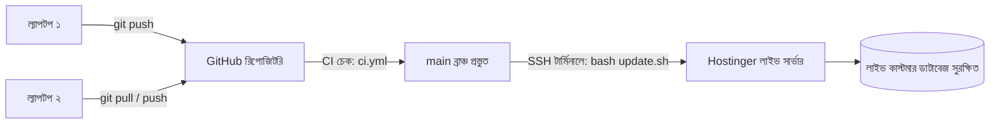

# Habbito (habbitobd.com) - একাধিক ল্যাপটপ ও গিটহাবের মাধ্যমে লাইভ আপডেট গাইডলাইন
**ডকুমেন্ট কোড:** `DOC-HAB-08`  
**ভার্সন:** 1.0.0 (Production Edition)  
**সংশ্লিষ্ট স্ক্রিপ্ট:** `update.sh`, `scripts/backup-database.sh`, `scripts/restore-database.sh`, `.github/workflows/ci.yml`  
**গিটহাব রিপোজিটরি:** `https://github.com/shafayetahmed80-eng/Habitto.git`

---

## ১. পুরো সিস্টেমটি কীভাবে কাজ করে? (এক নজরে)

**পদ্ধতি ১ (প্রফেশনাল Git ব্রাঞ্চিং + লাইভ SSH `update.sh`)** ব্যবহার করে একাধিক ল্যাপটপ থেকে নিরাপদে কোড লেখা, গিটহাবে রাখা এবং লাইভ সার্ভারে (`habbitobd.com`) ১-কমান্ডে আপডেট করা যায়।



* **গিটহাব (GitHub)** আপনার মূল কোডের কেন্দ্রীয় ভান্ডার হিসেবে কাজ করবে।
* আপনার **`.env` ফাইল, লাইভ ডাটাবেজ (কাস্টমার অর্ডার/পেমেন্ট) এবং `vendor` ফোল্ডার** গিটহাবে যায় না (`.gitignore` দ্বারা সুরক্ষিত)। ফলে কোনো ল্যাপটপ থেকে কোড আপডেট করলেও লাইভ সাইটের ডাটা বা সেটিংস কখনোই নষ্ট হবে না।

---

## ২. পর্ব ১: প্রথমবার লাইভ সার্ভার (Hostinger) প্রস্তুত করা (One-Time Setup)

যেহেতু লাইভ সার্ভারে `update.sh` গিটহাব থেকে কোড টেনে নেয়, তাই হোস্টিংগারে প্রথমবার গিট সংযোগটি ঠিক আছে কিনা তা নিশ্চিত করতে হবে।

### ধাপ ১: Hostinger SSH টার্মিনালে প্রবেশ
1. **Hostinger hPanel**-এ লগইন করে **Advanced -> SSH Access**-এ যান এবং SSH **Enable** করুন।
2. আপনার কম্পিউটারের টার্মিনাল (অথবা Hostinger-এর **Browser Terminal**) থেকে কানেক্ট করুন:
   ```bash
   ssh -p 65002 u123456789@your-server-ip
   ```
   *(এখানে আপনার হোস্টিংগারের আসল পোর্ট, ইউজারনেম ও আইপি দেবেন)*
3. প্রজেক্ট ফোল্ডারে যান:
   ```bash
   cd ~/domains/habbitobd.com/public_html
   ```

### ধাপ ২: সার্ভারে Git সংযোগ নিশ্চিত করা
টার্মিনালে নিচের কমান্ডটি দিন:
```bash
git status
```
* **যদি ব্রাঞ্চ ও ফাইলের তথ্য দেখায়:** তাহলে আপনার সার্ভারে Git আগে থেকেই সেটআপ করা আছে। নিচের কাজ লাগবে না।
* **যদি `fatal: not a git repository` দেখায়** (যেমন আপনি জিপ ফাইল থেকে আপলোড করে থাকলে): তাহলে লাইভের `.env` ও কোনো ফাইল নষ্ট না করেই নিচের কমান্ডগুলো একে একে চালিয়ে গিটহাবের সাথে যুক্ত করে নিন:
  ```bash
  git init
  git remote add origin https://github.com/shafayetahmed80-eng/Habitto.git
  git fetch origin
  git reset --mixed origin/main
  git branch -M main
  git branch --set-upstream-to=origin/main main
  ```
* এরপর স্ক্রিপ্টগুলোতে এক্সিকিউট পারমিশন দিয়ে রাখুন:
  ```bash
  chmod +x update.sh scripts/backup-database.sh scripts/restore-database.sh
  ```

> [!NOTE]
> এই সেটআপটি লাইভ সার্ভারে **শুধুমাত্র একবারই** করতে হবে।

---

## ৩. পর্ব ২: নতুন / দ্বিতীয় ল্যাপটপ প্রস্তুত করা (One-Time Setup)

আপনি যেকোনো নতুন ল্যাপটপ থেকে কাজ শুরু করতে চাইলে প্রথমে এই ৬টি ধাপ সম্পন্ন করুন:

1. **প্রয়োজনীয় সফটওয়্যার ইনস্টল:** ল্যাপটপে **Git**, **XAMPP (PHP 8.2+ ও MySQL)** এবং **Composer** ইনস্টল করুন।
2. **প্রজেক্ট ক্লোন করুন:** টার্মিনাল বা Git Bash খুলে লিখুন:
   ```bash
   git clone https://github.com/shafayetahmed80-eng/Habitto.git
   cd Habitto
   ```
3. **প্যাকেজ ইনস্টল করুন:**
   ```bash
   composer install
   ```
4. **`.env` ফাইল তৈরি করুন:**
   ```bash
   cp .env.example .env
   ```
   এবার `.env` ফাইলটি খুলে আপনার নতুন ল্যাপটপের লোকাল ডাটাবেজ তথ্য দিন:
   ```env
   APP_NAME=Habbito
   APP_ENV=local
   APP_KEY=base64:XG8oF0dhy4O9Y7n48/PZzF2qK6z0j81gUjM3kF1fX7o=
   APP_DEBUG=true
   APP_URL=http://localhost:8000

   DB_CONNECTION=mysql
   DB_HOST=127.0.0.1
   DB_PORT=3306
   DB_DATABASE=habbitodb
   DB_USERNAME=root
   DB_PASSWORD=
   ```
5. **লোকাল ডাটাবেজ ইমপোর্ট:**
   * XAMPP থেকে **Apache** ও **MySQL** চালু করুন।
   * `http://localhost/phpmyadmin`-এ গিয়ে **`habbitodb`** নামে একটি নতুন ডাটাবেজ তৈরি করুন (`utf8mb4_unicode_ci`)।
   * প্রজেক্টের ভেতরে থাকা `database_habbito_latest.sql` ফাইলটি ইমপোর্ট করুন।
6. **স্টোরেজ লিংক ও সার্ভার চালু:**
   ```bash
   php artisan storage:link
   php artisan optimize:clear
   php artisan serve
   ```
   এখন ব্রাউজারে `http://localhost:8000` খুললেই নতুন ল্যাপটপে সাইট চলবে।

---

## ৪. পর্ব ৩: দৈনন্দিন কাজের রুটিন (ল্যাপটপ -> GitHub)

যেকোনো ল্যাপটপে কাজ করার সময় নিচের নিয়মটি অনুসরণ করলে কখনোই কোড হারানোর বা কনফ্লিক্টের ভয় থাকবে না।

### ধাপ ১: কাজ শুরুর আগে সর্বশেষ কোড নামিয়ে নেওয়া
প্রতিদিন কাজ শুরু করার আগে অবশ্যই টার্মিনালে চালাবেন:
```bash
git pull origin main
```

### ধাপ ২: কাজ করা ও টেস্ট করা
এখানে আপনি দুটি উপায়ের যেকোনো একটি বেছে নিতে পারেন:

#### উপায় ক: Pull Request (PR) পদ্ধতি — *বড় কাজ বা টিমে কাজের জন্য সবচেয়ে নিরাপদ*
1. নতুন কাজের জন্য একটি আলাদা ব্রাঞ্চ খুলুন:
   ```bash
   git checkout -b feat/new-banner
   ```
2. কোডে পরিবর্তন আনুন এবং `http://localhost:8000`-এ গিয়ে সব ঠিক আছে কিনা টেস্ট করুন।
3. কোড গিটহাবে পাঠান:
   ```bash
   git add .
   git commit -m "feat: update homepage banner"
   git push origin feat/new-banner
   ```
4. এবার **GitHub.com**-এ আপনার রিপোজিটরিতে গেলে **"Compare & pull request"** বাটন দেখতে পাবেন।
5. Pull Request (PR) খুললে আমাদের সেট করা `.github/workflows/ci.yml` স্বয়ংক্রিয়ভাবে সব PHP ফাইলের সিনট্যাক্স ও `composer.json` চেক করে দেবে।
6. সবুজ টিক (Passed) এলে **"Merge pull request"** চাপুন। কোড `main` ব্রাঞ্চে চলে যাবে।
7. নিজের ল্যাপটপে আবার `main` ব্রাঞ্চে ফিরে আসুন:
   ```bash
   git checkout main
   git pull origin main
   ```

#### উপায় খ: সরাসরি `main` ব্রাঞ্চে পুশ — *একা কাজ করলে ও ছোট পরিবর্তনের জন্য দ্রুত*
1. কোডে পরিবর্তন করে লোকালে (`http://localhost:8000`) টেস্ট করুন।
2. গিটহাবে পুশ করুন:
   ```bash
   git add .
   git commit -m "fix: update product card spacing"
   git push origin main
   ```

> [!IMPORTANT]
> **ডাটাবেজ পরিবর্তন হলে করণীয়:** কোনো নতুন টেবিল বা কলাম যোগ করতে হলে phpMyAdmin-এ ম্যানুয়ালি না বানিয়ে লারাভেলের মাইগ্রেশন (`php artisan make:migration ...`) তৈরি করুন। তাহলে লাইভ সার্ভারে `update.sh` চালানোর সময় সেটি স্বয়ংক্রিয়ভাবে নিরাপদে আপডেট হয়ে যাবে।

---

## ৫. পর্ব ৪: লাইভ সার্ভারে ১-কমান্ডে আপডেট (`update.sh`)

গিটহাবের `main` ব্রাঞ্চে কোড চলে যাওয়ার পর লাইভ সাইট (`habbitobd.com`) আপডেট করতে আর কোনো জিপ ফাইল বানাতে হবে না।

1. Hostinger SSH টার্মিনালে ঢুকে প্রজেক্ট ফোল্ডারে যান:
   ```bash
   cd ~/domains/habbitobd.com/public_html
   ```
2. শুধু এই একটি কমান্ড দিন:
   ```bash
   bash update.sh
   ```

### কমান্ডটি দেওয়ার পর ভেতরে কী কী ঘটবে?
1. **নিরাপত্তা যাচাই:** সার্ভারে কেউ ম্যানুয়ালি কোনো কোড এডিট করেছে কিনা তা চেক করবে।
2. **কোড চেক:** গিটহাব থেকে নতুন কোনো কমিট এসেছে কিনা দেখবে (না থাকলে কোনো কিছু না বদলেই বের হয়ে যাবে)।
3. **স্বয়ংক্রিয় ডাটাবেজ ব্যাকআপ:** যদি নতুন ডাটাবেজ মাইগ্রেশন থাকে, তবে আপডেট শুরুর আগেই `scripts/backup-database.sh` দিয়ে লাইভ ডাটাবেজের একটি কম্প্রেসড কপি (`~/db-backups/habbito-...sql.gz`) সেভ করে রাখবে।
4. **মেইন্টেন্যান্স মোড:** কয়েক সেকেন্ডের জন্য `php artisan down` চালু করবে যাতে আপডেট চলাকালীন ভিজিটররা কোনো ভাঙা পেজ না দেখেন।
5. **কোড ও প্যাকেজ আপডেট:** `git merge` করবে এবং `composer.lock` বদলালে `composer install --no-dev` চালাবে।
6. **মাইগ্রেশন ও ক্যাশ বিল্ড:** `php artisan migrate --force` চালাবে এবং রুট, কনফিগ ও ভিউ ক্যাশ পরিষ্কার করে নতুন করে তৈরি করবে।
7. **লাইভ ও হেলথ চেক:** `php artisan up` দিয়ে সাইট চালু করবে এবং `curl` দিয়ে `https://habbitobd.com` পরীক্ষা করে কনফার্ম করবে যে সাইট HTTP 200 রেসপন্স দিচ্ছে।

---

## ৬. পর্ব ৫: ভুল হলে ১-কমান্ডে ফিরে যাওয়া (Rollback & Restore)

যদি কোনো কারণে লাইভ আপডেটের পর সাইটে কোনো সমস্যা দেখা দেয়, তবে সাথে সাথে পূর্বের অবস্থায় ফিরে যেতে পারবেন:

1. **কোড আগের অবস্থায় ফেরাতে:**
   ```bash
   bash update.sh --rollback
   ```
   এটি সাথে সাথে কোডকে আগের কমিটে ফিরিয়ে নিয়ে ক্যাশ পরিষ্কার করে সাইট সচল করে দেবে এবং জানাবে ওই আপডেটে ডাটাবেজ বদলেছিল কিনা।

2. **ডাটাবেজও আগের অবস্থায় ফেরাতে চাইলে:**
   ```bash
   bash scripts/restore-database.sh
   ```
   এটি সেভ করা ব্যাকআপগুলোর তালিকা দেখাবে। তালিকা থেকে নম্বর বেছে নিয়ে `RESTORE` লিখলেই আগের ডাটাবেজ ফিরে আসবে (রিস্টোর করার আগেও এটি বর্তমান ডাটাবেজের একটি সেফটি কপি রেখে নেয়)।

3. **যেকোনো সময় ম্যানুয়াল ডাটাবেজ ব্যাকআপ নিতে চাইলে:**
   ```bash
   bash scripts/backup-database.sh
   ```

---

## ৭. পর্ব ৬: সাধারণ কিছু সমস্যা ও সমাধান (Troubleshooting)

| সমস্যা | কেন হয় | সমাধান |
| :--- | :--- | :--- |
| **`Code files on the server were edited by hand`** বলে `update.sh` থেমে গেছে | সার্ভারে কোনো ট্র্যাকড ফাইল (যেমন ক্যাশ/ফন্ট `fonts.css`) পরিবর্তন হয়ে গেছে। | টার্মিনালে `git status` দেখুন। অপ্রয়োজনীয় পরিবর্তন হলে `git checkout -- .` চালিয়ে তারপর আবার `bash update.sh` দিন। |
| **ল্যাপটপে `git push` নিচ্ছে না (Rejected)** | অন্য ল্যাপটপ থেকে গিটহাবে নতুন কোড পুশ করা হয়েছিল, যা আপনার বর্তমান ল্যাপটপে নেই। | আগে `git pull --rebase origin main` দিয়ে নতুন কোড নামান, তারপর `git push origin main` দিন। |
| **নতুন ল্যাপটপে প্রোডাক্টের ছবি দেখাচ্ছে না** | ল্যাপটপে `public/storage` লিংক তৈরি হয়নি অথবা ছবির ফাইলগুলো লাইভ সার্ভারে রয়েছে। | টার্মিনালে `php artisan storage:link` চালান। আর লাইভ সাইটের নতুন আপলোড করা ছবিগুলোর ব্যাকআপ `storage/app/public` থেকে কপি করে নিতে পারেন। |

---
*মাস্টার ইনডেক্সে ফিরে যান: [README.md](file:///c:/Habitto/docs/full_website_documentation/README.md)*
