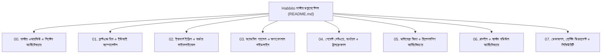

# Habbito (habbitobd.com) - মাস্টার সিস্টেম ডকুমেন্টেশন ইনডেক্স
**ব্র্যান্ডের নাম:** Habbito  
**ডোমেইন:** [habbitobd.com](https://habbitobd.com)  
**ফ্রেমওয়ার্ক:** Laravel 12.34.0 & Botble CMS 7.x  
**থিম:** Ninico Streetwear Fashion Theme  
**ডকুমেন্টেশন ডিরেক্টরি:** `c:\Habitto\docs\full_website_documentation\`  
**তারিখ ও সংস্করণ:** নভেম্বর ২০২৬ | সংস্করণ ১.০.০ (Official Production Manual)

---

## ১. নির্বাহী সারসংক্ষেপ (Executive Summary)

**Habbito** হলো একটি আধুনিক, স্কেলেবল এবং এন্টারপ্রাইজ-গ্রেড স্ট্রিটওয়্যার ই-কমার্স প্ল্যাটফর্ম। এটি ড্রপ-শোল্ডার টি-শার্ট, ওভারসাইজড হুডি, এসিড-ওয়াশ কালেকশন এবং প্রিমিয়াম পোলো পোশাক বিক্রির জন্য নিখুঁতভাবে অপটিমাইজ করা। প্ল্যাটফর্মটি উচ্চ পারফরম্যান্স সম্পন্ন লারাভেল ফ্রেমওয়ার্ক এবং মডুলার বটবল ইকমার্স কোর আর্কিটেকচারের উপর প্রতিষ্ঠিত।

সাইটটিতে বাংলাদেশের ই-কমার্স বাজারের সমস্ত চাহিদা (ক্যাশ অন ডেলিভারি, বিকাশ/নগদ/কার্ড গেটওয়ে SSLCommerz, ঢাকা ও ঢাকার বাইরে অটোমেটেড শিপিং ক্যালকুলেশন, হোয়াটসঅ্যাপ ১-ক্লিক ডিরেক্ট অর্ডারিং এবং দ্রুতগতির মোবাইল-ফার্স্ট রেসপনসিভনেস) সম্পূর্ণভাবে কার্যকর ও টেস্ট করা হয়েছে।

---

## ২. পূর্ণাঙ্গ ডকুমেন্টেশন সূচিপত্র ও ডিরেক্টরি ম্যাপ

সম্পূর্ণ প্ল্যাটফর্মের প্রতিটি স্তর ও সাব-সিস্টেমকে কোনো রকম অংশ বাদ না দিয়ে ৮টি বিশদ ম্যানুয়ালে বিভক্ত করা হয়েছে:



---

### ২.১ চ্যাপ্টারভিত্তিক বিবরণ ও ক্লিকযোগ্য ফাইল লিংক

| কোড | ম্যানুয়ালের নাম | প্রধান আলোচ্য বিষয়বস্তু | ফাইল লিংক |
| :---: | :--- | :--- | :---: |
| **DOC-00** | **মাস্টার ওভারভিউ ও আর্কিটেকচার** | টেক স্ট্যাক, ডিরেক্টরি হায়ারার্কি, রিকোয়েস্ট লাইফসাইকেল, ৯০৫টি রুটের ম্যাপিং, মিডলওয়্যার পাইপলাইন ও ডিপেনডেন্সি। | [00_MASTER_OVERVIEW_AND_ARCHITECTURE.md](file:///c:/Habitto/docs/full_website_documentation/00_MASTER_OVERVIEW_AND_ARCHITECTURE.md) |
| **DOC-01** | **ফ্রন্টএন্ড থিম ও ইউআই কম্পোনেন্টস** | Ninico থিম গঠন, হেডার, অ্যানাউন্সমেন্ট বার, সার্চ ইঞ্জিন, হিরো ব্যানার, প্রোডাক্ট কার্ড, অফ-ক্যানভাস কার্ট, কুইক-শপ মোডাল, হোয়াটসঅ্যাপ বাটন ও বটম বার। | [01_FRONTEND_THEME_AND_UI_COMPONENTS.md](file:///c:/Habitto/docs/full_website_documentation/01_FRONTEND_THEME_AND_UI_COMPONENTS.md) |
| **DOC-02** | **ইকমার্স ইঞ্জিন ও অর্ডার লাইফসাইকেল** | প্রোডাক্ট ক্যাটালগ (Simple vs Variable), সাইজ/কালার ভ্যারিয়েশন সিস্টেম, সেশন কার্ট, চেকআউট পাইপলাইন, অর্ডার স্টেট মেশিন, শিপিং ক্যালকুলেশন ও ইভেন্ট লিসেনার। | [02_ECOMMERCE_ENGINE_AND_ORDER_LIFECYCLE.md](file:///c:/Habitto/docs/full_website_documentation/02_ECOMMERCE_ENGINE_AND_ORDER_LIFECYCLE.md) |
| **DOC-03** | **অ্যাডমিন প্যানেল ও অপারেশনাল গাইড** | অ্যাডমিন ড্যাশবোর্ড, সেলস অ্যানালিটিক্স, পণ্য আপলোড, ভ্যারিয়েশন জেনারেটর, অর্ডার প্রসেসিং, কুরিয়ার বুকিং, ইনভয়েস প্রিন্ট, হিরো স্লাইডার ও ব্যানার ম্যানেজমেন্ট। | [03_ADMIN_PANEL_AND_OPERATIONS_MANUAL.md](file:///c:/Habitto/docs/full_website_documentation/03_ADMIN_PANEL_AND_OPERATIONS_MANUAL.md) |
| **DOC-04** | **পেমেন্ট গেটওয়ে, অর্থায়ন ও ট্রানজেকশন** | ক্যাশ অন ডেলিভারি (COD) আর্কিটেকচার, SSLCommerz ইন্টিগ্রেশন (বিকাশ, নগদ, রকেট, কার্ডস), আইপিএন (IPN) লিসেনার, মুদ্রা কনফিগারেশন (BDT - ৳) ও অডিট লেজার। | [04_PAYMENTS_GATEWAYS_AND_FINANCE.md](file:///c:/Habitto/docs/full_website_documentation/04_PAYMENTS_GATEWAYS_AND_FINANCE.md) |
| **DOC-05** | **ডাটাবেজ স্কিমা ও রিলেশনশিপ** | ১৭০টি টেবিলের বিন্যাস, কোর টেবিল স্কিমা (`ec_products`, `ec_orders`, `ec_payments`, `settings`, `cities`), ফরেন কি সম্পর্ক, ই-আর ডায়াগ্রাম ও মাইগ্রেশন। | [05_DATABASE_SCHEMA_AND_DATA_RELATIONSHIPS.md](file:///c:/Habitto/docs/full_website_documentation/05_DATABASE_SCHEMA_AND_DATA_RELATIONSHIPS.md) |
| **DOC-06** | **প্লাগইন ও কাস্টম মডিউল** | ২০টি সক্রিয় প্লাগইনের ম্যাট্রিক্স, ভাসমান হোয়াটসঅ্যাপ বাটন, কুইক-শপ বাই-নাউ বাটন, ডিল প্রোডাক্ট সিটিএ, বাংলাদেশ ৬৪ জেলা এবং বটবল হুক ও ফিল্টার। | [06_PLUGINS_AND_CUSTOM_MODULES.md](file:///c:/Habitto/docs/full_website_documentation/06_PLUGINS_AND_CUSTOM_MODULES.md) |
| **DOC-07** | **ডেভঅপস, হোস্টিং ও সিকিউরিটি** | সার্ভার স্পেসিফিকেশন, লোকাল ডেভেলপমেন্ট কমান্ড, হোস্টিংগার লাইভ ডিপ্লয়মেন্ট গাইড (ডকুমেন্ট রুট `/public`, phpMyAdmin ইমপোর্ট, `.env` কনফিগ), সাইবার সিকিউরিটি ও সিডিএন। | [07_DEVOPS_HOSTING_AND_SECURITY.md](file:///c:/Habitto/docs/full_website_documentation/07_DEVOPS_HOSTING_AND_SECURITY.md) |

---

## ৩. গুরুত্বপূর্ণ কুইক রেফারেন্স ও ক্রেডেনশিয়াল (Quick Reference)

| প্রোপার্টি | বিবরণ ও এক্সেস তথ্য |
| :--- | :--- |
| **অফিসিয়াল ওয়েবসাইট** | `https://habbitobd.com` (লোকাল: `http://localhost:8000`) |
| **অ্যাডমিন লগইন পেজ** | `https://habbitobd.com/admin` (লোকাল: `http://localhost:8000/admin`) |
| **সুপার অ্যাডমিন ইমেইল** | `admin@admin.com` |
| **সুপার অ্যাডমিন পাসওয়ার্ড** | `admin123` |
| **কাস্টমার কেয়ার ফোন ও হোয়াটসঅ্যাপ** | `+8801977797772` |
| **হোস্টিং ডিপ্লয়মেন্ট জিপ ফাইল** | `C:\Habitto\habbito_website_files.zip` (~১৮১ এমবি) |
| **প্রোডাকশন ডাটাবেজ ব্যাকআপ** | `C:\Habitto\database_habbito_latest.sql` (৮৬৬ কেবি, পিওর UTF-8) |
| **ডাটাবেজ জিপ ফাইল** | `C:\Habitto\habbito_database.zip` (৮৭ কেবি) |
| **গিটহাব রিপোজিটরি** | `https://github.com/shafayetahmed80-eng/Habitto.git` (Branch: `main`) |

---

## ৪. সিস্টেম আর্কিটেকচার সামারি

```text
+-----------------------------------------------------------------------------------+
|                              Habbito E-Commerce Platform                          |
+-----------------------------------------------------------------------------------+
|  Frontend UI (Ninico Theme)      : Blade, Bootstrap 5, Swiper.js, AJAX Mini-Cart   |
|  Direct Social Commerce          : Floating WhatsApp Button & Quick-Shop 1-Click   |
|  Backend Core Framework          : Laravel 12.34.0 & Botble CMS 7.x Engine         |
|  Catalog & Product Engine        : 174+ Streetwear Products with Size/Color Swatch |
|  Payment Processing Engine       : Cash on Delivery (COD) & SSLCommerz Gateway     |
|  Logistics & Delivery Calculator : Inside Dhaka ৳70 | Outside Dhaka ৳130 (64 Dists)|
|  Relational Database Engine      : MariaDB / MySQL 8.x with 170 Tables (UTF-8)     |
|  Hosting & Infrastructure        : Hostinger Cloud Server, LiteSpeed Web Server    |
+-----------------------------------------------------------------------------------+
```

---
*ডকুমেন্টেশন তৈরিতে সহায়ক টিম: Habbito Engineering & DeepMind Antigravity AI Team*
