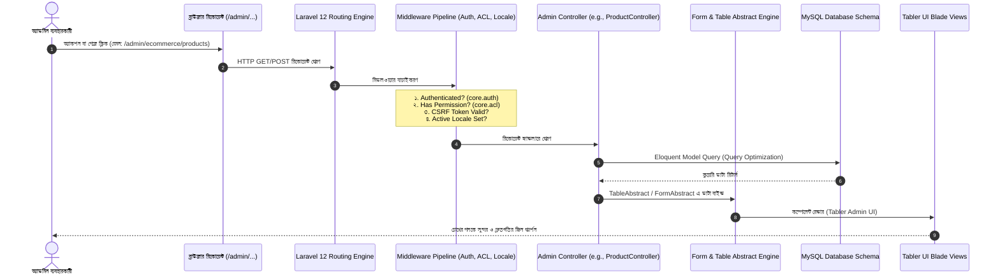
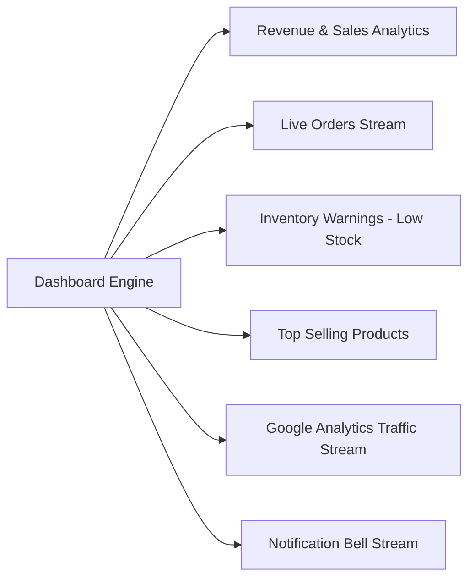
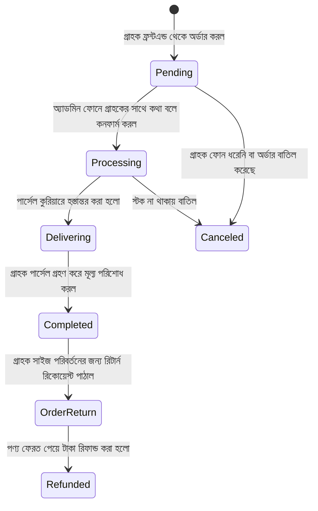

# Habitto BD - পূর্ণাঙ্গ অ্যাডমিন প্যানেল মাস্টার ডকুমেন্টেশন ও টেকনিক্যাল ইউজার ম্যানুয়াল

**ওয়েবসাইট:** Habitto BD (প্রিমিয়াম ফ্যাশন ও লাইফস্টাইল ই-কমার্স)  
**সিস্টেম ফ্রেমওয়ার্ক:** Botble CMS on Laravel 12 Enterprise Architecture  
**ফ্রন্টএন্ড থিম:** Ninico Premium Responsive eCommerce Theme  
**ডিফল্ট কারেন্সি:** Bangladeshi Taka (BDT ৳)  
**অ্যাডমিন ডিরেক্টরি:** `/admin` (কাস্টমাইজেবল via `.env`)  
**সর্বমোট অ্যাডমিন রাউট:** ৬৯৭টি  
**সক্রিয় প্লাগইন ও মডিউল:** ৩০টি  

---

# সূচিপত্র (Table of Contents)

1. [সিস্টেম আর্কিটেকচার, রিকোয়েস্ট লাইফসাইকেল ও ডেটাবেস স্কিমা](#১-সিস্টেম-আর্কিটেকচার-রিকোয়েস্ট-লাইফসাইকেল-ও-ডেটাবেস-স্কিমা)
2. [অ্যাক্সেস কন্ট্রোল, সিকিউরিটি ও অডিট লগ (ACL Management)](#২-অ্যাক্সেস-কন্ট্রোল-সিকিউরিটি-ও-অডিট-লগ)
   - ২.১ অ্যাডমিন ইউজার ম্যানেজমেন্ট
   - ২.২ ভূমিকা ও পারমিশন ট্রি (Roles & Permissions)
   - ২.৩ অ্যাক্টিভিটি অডিট লগ (Audit Logs)
   - ২.৪ বট প্রোটেকশন (Google reCAPTCHA / Cloudflare Turnstile)
   - ২.৫ সোশ্যাল লগইন আর্কিটেকচার (Google, Facebook OAuth 2.0)
3. [সেন্ট্রাল অ্যাডমিন ড্যাশবোর্ড ও অ্যানালিটিক্স মেট্রিক্স](#৩-সেন্ট্রাল-অ্যাডমিন-ড্যাশবোর্ড-ও-অ্যানালিটিক্স-মেট্রিক্স)
   - ৩.১ ড্যাশবোর্ড ওভারভিউ ও উইজেট ম্যানেজমেন্ট
   - ৩.২ মূল মেট্রিক্স ও রিয়েলটাইম চার্টস
   - ৩.৩ অ্যাডমিন রিয়েলটাইম বেল নোটিফিকেশন সিস্টেম (`/admin/notifications`)
   - ৩.৪ গ্লোবাল সার্চ ও ডার্ক/লাইট মোড
4. [ই-কমার্স: পণ্য ও ইনভেন্টরি আর্কিটেকচার (Product Management Deep Dive)](#৪-ই-কমার্স-পণ্য-ও-ইনভেন্টরি-আর্কিটেকচার)
   - ৪.১ পণ্য তৈরি করার সম্পূর্ণ ধাপ (১০টি ডেডিকেটেড ব্লক)
   - ৪.২ পণ্য ভ্যারিয়েশন বনাম কাস্টম অপশন (ডিপ মেকানিক্স)
   - ৪.৩ ক্যাটাগরি, ব্র্যান্ড ও কালেকশন
   - ৪.৪ স্পেসিফিকেশন টেবিল (Specification Tables)
   - ৪.৫ ডিজিটাল পণ্য ও লাইসেন্স কোড জেনারেটর
   - ৪.৬ প্রোডাক্ট লেবেল ও ব্যাজ
   - ৪.৭ কাস্টমার রিভিউ ও অ্যাডমিন রিপ্লাই ইঞ্জিন
   - ৪.৮ ফ্ল্যাশ সেল ক্যাম্পেইন কাউন্টডাউন
   - ৪.৯ বাল্ক ইনভেন্টরি ও প্রাইস কুইক এডিটর
5. [ই-কমার্স: অর্ডার, সেলস ও ইনভয়েস লাইফসাইকেল (Order & Sales Processing)](#৫-ই-কমার্স-অর্ডার-সেলস-ও-ইনভয়েস-লাইফসাইকেল)
   - ৫.১ অর্ডার লাইফসাইকেল স্টেট মেশিন (State Machine)
   - ৫.২ অর্ডারের অভ্যন্তরীণ স্বয়ংক্রিয় মেকানিজম (ইভেন্টস ও স্টক)
   - ৫.৩ অর্ডার ডিটেইলস পেজের পরিচালনা ও টাইমলাইন লগ
   - ৫.৪ অ্যাডমিন থেকে সরাসরি ম্যানুয়াল অর্ডার তৈরি
   - ৫.৫ পরিত্যক্ত কার্ট রিকভারি (Abandoned Cart Recovery)
   - ৫.৬ অর্ডার রিটার্ন ও রিফান্ড প্রসেস
   - ৫.৭ চালান (PDF Invoice) ও থার্মাল শিপিং লেবেল প্রিন্টিং
   - ৫.৮ কুপন ও ডিসকাউন্ট ইঞ্জিন
6. [গ্রাহক সম্পর্ক ব্যবস্থাপনা (Customer Management - CRM)](#৬-গ্রাহক-সম্পর্ক-ব্যবস্থাপনা)
7. [পেমেন্ট গেটওয়ে আর্কিটেকচার ও ট্রানজাকশন হ্যান্ডলিং](#৭-পেমেন্ট-গেটওয়ে-আর্কিটেকচার-ও-ট্রানজাকশন-হ্যান্ডলিং)
   - ৭.১ ক্যাশ অন ডেলিভারি (COD)
   - ৭.২ SSLCommerz (বিকাশ, নগদ, রকেট, কার্ড) আইপিএন ভ্যালিডেশন
   - ৭.৩ ব্যাংক ট্রান্সফার ও আন্তর্জাতিক গেটওয়ে (Stripe, PayPal, Mollie)
   - ৭.৪ ট্রানজাকশন হিস্ট্রি ও অডিট ট্রেইল
8. [শিপিং, ডেলিভারি ও লজিস্টিকস রুলস](#৮-শিপিং-ডেলিভারি-ও-লজিস্টিকস-রুলস)
   - ৮.১ দেশীয় শিপিং জোনস (ঢাকার ভেতরে, বাইরে ও ফ্রি শিপিং)
   - ৮.২ ওজনভিত্তিক শিপিং ক্যালকুলেশন
   - ৮.৩ কুরিয়ার ট্র্যাকিং ও Shippo API
9. [কনটেন্ট ম্যানেজমেন্ট, মার্কেটিং ও ব্লগ সিস্টেম (CMS Engine)](#৯-কনটেন্ট-ম্যানেজমেন্ট-মার্কেটিং-ও-ব্লগ-সিস্টেম)
   - ৯.১ পেজেস (Pages)
   - ৯.২ ব্লগ সিস্টেম (Posts, Categories, Tags)
   - ৯.৩ হিরো ব্যানার স্লাইডার (Simple Sliders)
   - ৯.৪ ব্যানার বিজ্ঞাপন ও Google AdSense (Ads)
   - ৯.৫ ঘোষণা বার (Announcements)
   - ৯.৬ লাইভ সোশ্যাল প্রুফ সেলস পপআপ (Sale Popup)
   - ৯.৭ নিউজলেটার ও কন্টাক্ট মেসেজ
   - ৯.৮ ফটো ও মিডিয়া গ্যালারি অ্যালবাম (`/admin/galleries`)
   - ৯.৯ টিম মেম্বার শোকেস (`/admin/teams`)
   - ৯.১০ ক্লায়েন্ট টেস্টিমোনিয়ালস (`/admin/testimonials`)
   - ৯.১১ এফএকিউ ও গুগল স্কিমা আর্কিটেকচার (`/admin/faqs`, `/faq-categories`)
   - ৯.১২ কনটেন্ট রিভিশন ও রোলব্যাক ইঞ্জিন (Revision History)
   - ৯.১৩ শর্টকোড ইঞ্জিন ও ডাইনামিক উইজেট এমবেডিং (`/admin/short-codes`)
10. [ডিজাইন, থিম অপশন ও উইজেট আর্কিটেকচার (Ninico Theme Engine)](#১০-ডিজাইন-থিম-অপশন-ও-উইজেট-আর্কিটেকচার)
    - ১০.১ থিম অপশনের ১৫টি উপ-বিভাগ
    - ১০.২ ড্র্যাগ-অ্যান্ড-ড্রপ মেনু বিল্ডার ও মেগামেনু
    - ১০.৩ সাইডবার ও ফুটার উইজেট এরিয়াস
11. [মিডিয়া লাইব্রেরি ও ফাইল স্টোরেজ আর্কিটেকচার](#১১-মিডিয়া-লাইব্রেরি-ও-ফাইল-স্টোরেজ-আর্কিটেকচার)
12. [টুলস, বাল্ক ডেটা সিনক্রোনাইজেশন ও ব্যাকআপ ইঞ্জিন](#১২-টুলস-বাল্ক-ডেটা-সিনক্রোনাইজেশন-ও-ব্যাকআপ-ইঞ্জিন)
    - ১২.১ CSV/Excel ইমপোর্ট ব্লু-প্রিন্ট ও কলাম ম্যাপিং
    - ১২.২ ১-ক্লিক ডেটাবেস ও মিডিয়া ব্যাকআপ
13. [লোকালাইজেশন, বহুভাষা ও ভৌগোলিক রিজিয়ন (Localization Engine)](#১৩-লোকালাইজেশন-বহুভাষা-ও-ভৌগোলিক-রিজিয়ন)
    - ১৩.১ বহুভাষা সাপোর্ট ও লাইভ থিম অনুবাদ
    - ১৩.২ পলিমরফিক ট্রান্সলেশন ও অ্যাডভান্সড ল্যাঙ্গুয়েজ ট্যাব (`Language-Advanced`)
    - ১৩.৩ বাংলাদেশ ভৌগোলিক লোকেশন হায়ারার্কি (`Countries` ➔ `States` ➔ `Cities`)
14. [অ্যানালিটিক্স, মেটা পিক্সেল ট্র্যাকিং ও এপিআই (Developer Integrations)](#১৪-অ্যানালিটিক্স-মেটা-পিক্সেল-ট্র্যাকিং-ও-এপিআই)
    - ১৪.১ Meta (Facebook) Pixel ও ইভেন্ট ট্র্যাকিং ইঞ্জিন
    - ১৪.২ Google Analytics 4 ও Google Tag Manager
    - ১৪.৩ হেডলেস ই-কমার্স ও মোবাইল অ্যাপ REST API (Sanctum Tokens)
    - ১৪.৪ রিয়েলটাইম ওয়েবহুক (Webhooks)
15. [প্ল্যাটফর্ম অ্যাডমিনিস্ট্রেশন, সিস্টেম অপটিমাইজেশন ও ট্রাবলশুটিং](#১৫-প্ল্যাটফর্ম-অ্যাডমিনিস্ট্রেশন-সিস্টেম-অপটিমাইজেশন-ও-ট্রাবলশুটিং)
    - ১৫.১ ক্যাশ ম্যানেজমেন্ট ও ওয়ার্মআপ
    - ১৫.২ সিস্টেম ক্লিনআপ
    - ১৫.৩ প্লাগইন ম্যানেজমেন্ট ও এক্সটেনশন হাব (`/admin/plugins`)
    - ১৫.৪ সিস্টেম ডায়াগনস্টিক রিপোর্ট
    - ১৫.৫ শিডিউলড ক্রনজব অটোমেশন
    - ১৫.৬ ট্রাবলশুটিং ও এরর লগিং প্লেবুক (`storage/logs/laravel.log`)
16. [দৈনন্দিন অপারেশনাল চেকলিস্ট ও বেস্ট প্র্যাকটিস](#১৬-দৈনন্দিন-অপারেশনাল-চেকলিস্ট-ও-বেস্ট-প্র্যাকটিস)

---

## ১. সিস্টেম আর্কিটেকচার, রিকোয়েস্ট লাইফসাইকেল ও ডেটাবেস স্কিমা

### ১.১ কারিগরি পরিচিতি (What)
Habitto BD একটি আধুনিক মনোলিথিক-মডুলার আর্কিটেকচারের উপর প্রতিষ্ঠিত। এটি Laravel 12 ফ্রেমওয়ার্কের শক্তিশালী ইকোসিস্টেমের উপর Botble CMS-এর প্লাগইন ও প্যাকেজ সিস্টেম ব্যবহার করে পরিচালিত হয়।

### ১.২ স্থাপত্যের প্রয়োজনীয়তা (Why)
ঐতিহ্যবাহী ই-কমার্স সাইটগুলোতে কোডবেইজ বড় হওয়ার সাথে সাথে স্পিড কমে যায় এবং বাগ তৈরি হয়। Habitto BD-এর মডুলার আর্কিটেকচারে প্রতিটি মডিউল (যেমন: Ecommerce, Blog, Payment, Media) স্বাধীন প্যাকেজ হিসেবে কাজ করে। ফলে স্টোরের কোনো একটি প্লাগইনে সমস্যা হলেও মূল কোর সিস্টেম বা চেকআউট কখনোই ক্ষতিগ্রস্ত হয় না।

### ১.৩ ফোল্ডার ও কোডবেস স্ট্রাকচার (Where)
```
c:\Habitto
├── platform/
│   ├── core/                    # কোড ফ্রেমওয়ার্ক কোর ইঞ্জিন
│   │   ├── base/                # বেস কন্ট্রোলার, ফর্ম বিল্ডার, টেবিল বিল্ডার
│   │   ├── acl/                 # অথেনটিকেশন, ইউজার ও রোল পারমিশন
│   │   ├── setting/             # সেটিংস প্যানেল ইঞ্জিন
│   │   ├── media/               # ইমেজ প্রসেসিং ও ক্লাউড স্টোরেজ
│   │   ├── dashboard/           # ড্যাশবোর্ড উইজেট ম্যানেজমেন্ট
│   │   └── table/               # ডাটাটেবল সার্ভিসেস
│   ├── packages/                # সিস্টেম এক্সটেনশন প্যাকেজসমূহ
│   │   ├── theme/               # থিম অপশন ও ব্লেড রেন্ডারিং
│   │   ├── page/                # স্ট্যাটিক পেজ ইঞ্জিন
│   │   ├── menu/                # ড্র্যাগ-অ্যান্ড-ড্রপ মেনু বিল্ডার
│   │   ├── slug/                # এসইও ফ্রেন্ডলি পারমালিঙ্ক হ্যান্ডলার
│   │   ├── revision/            # কনটেন্ট রিভিশন হিস্ট্রি ও রোলব্যাক
│   │   ├── shortcode/           # শর্টকোড কম্পাইলার ও এক্সিকিউটর
│   │   └── optimize/            # ক্যাশ ও অপটিমাইজেশন টুলস
│   ├── plugins/                 # ব্যবসায়িক ফিচার প্লাগইনসমূহ (৩০টি)
│   │   ├── ecommerce/           # প্রোডাক্ট, অর্ডার, শিপিং ও ইনভয়েস কোর
│   │   ├── payment/             # পেমেন্ট প্রসেসিং হাব
│   │   ├── sslcommerz/          # লোকাল পেমেন্ট গেটওয়ে
│   │   ├── blog/                # কন্টেন্ট মার্কেটিং ও আর্টিকেল
│   │   ├── simple-slider/       # হোমপেজ হিরো ব্যানার স্লাইডার
│   │   ├── gallery/             # ফটো অ্যালবাম ও গ্যালারি
│   │   ├── team/                # টিম মেম্বারদের প্রোফাইল শোকেস
│   │   ├── testimonial/         # গ্রাহকদের প্রশংসাপত্র ও রেটিং
│   │   ├── faq/                 # প্রশ্নোত্তর ও গুগল স্কিমা
│   │   ├── location/            # দেশ, বিভাগ ও জেলা ডাটাবেস
│   │   ├── social-login/        # গুগল ও ফেসবুক ১-ক্লিক লগইন
│   │   ├── captcha/             # বট ও স্প্যাম প্রতিরোধক ক্যাপচা
│   │   ├── cookie-consent/      # কুকি সম্মতি ব্যানার (GDPR)
│   │   └── ...                  # Ads, Sale-Popup, Translation ইত্যাদি
│   └── themes/ninico/           # ফ্রন্টএন্ড স্টোরফ্রন্ট লেআউট ও স্টাইল
├── app/                         # অ্যাপ্লিকেশন সার্ভিসেস ও বুটস্ট্র্যাপ
├── database/                    # মাইগ্রেশন ও সীডার স্ক্রিপ্ট
└── storage/logs/laravel.log     # সিস্টেম এরর ও অ্যাক্টিভিটি লগ ফাইল
```

### ১.৪ রিকোয়েস্ট লাইফসাইকেল (Request Lifecycle Flow)


### ১.৫ কোর ডেটাবেস স্কিমা ও সম্পর্ক (Database Relational ERD)
* `users` ➔ `role_users` ➔ `roles`: বহু-স্তরীয় অ্যাডমিন রোল অ্যাসাইনমেন্ট।
* `ec_products`: পণ্যের মূল টেবিল (SKU, প্রাইস, ওজন, বারকোড)।
* `ec_products` ➔ `ec_product_variations` ➔ `ec_product_variation_items`: পণ্যের ভ্যারিয়েশন এবং কালার/সাইজ অ্যাট্রিবিউট কম্বিনেশন।
* `ec_orders` ➔ `ec_order_product`: অর্ডারের বিস্তারিত পণ্যের লাইন-আইটেমস।
* `ec_orders` ➔ `ec_order_addresses`: কাস্টমারের ডেলিভারি ও বিলিং ঠিকানা।
* `ec_orders` ➔ `ec_order_histories`: অর্ডারের প্রতি সেকেন্ডের টাইমলাইন ও অডিট ট্রেইল।
* `ec_orders` ➔ `ec_shipments`: কুরিয়ার ট্র্যাকিং ও ডেলিভারি স্ট্যাটাস।
* `ec_orders` ➔ `ec_invoices`: অর্থ মন্ত্রণালয়ের স্ট্যান্ডার্ড চালান ও রসিদ রেকর্ড।

---

## ২. অ্যাক্সেস কন্ট্রোল, সিকিউরিটি ও অডিট লগ

### ২.১ অ্যাডমিন ইউজার ম্যানেজমেন্ট (`/admin/system/users`)
* **কি (What):** অ্যাডমিন প্যানেলে লগইন করার অধিকারী কর্মকর্তাদের তালিকা ও অ্যাকাউন্ট নিয়ন্ত্রণ।
* **কেন (Why):** দোকানের সব কাজ একজন ব্যক্তির পক্ষে করা অসম্ভব। টিম মেম্বারদের নির্দিষ্ট কাজের জন্য আলাদা অ্যাকাউন্ট প্রদান ও ডেটা নিরাপত্তা বজায় রাখা।
* **কিভাবে ব্যবহার করবেন (How to Use):**
  1. `Administration` ➔ `Users` এ যান।
  2. **Create User** বাটনে চাপুন।
  3. ব্যবহারকারীর ফার্স্ট নেম, লাস্ট নেম, ইউজারনেম, অফিসিয়াল ইমেইল এবং স্ট্রং পাসওয়ার্ড দিন।
  4. **Role** ড্রপডাউন থেকে নির্দিষ্ট ভূমিকা নির্বাচন করুন।
  5. **Super User:** শুধুমাত্র প্রতিষ্ঠানের মূল মালিক বা সিটিও-এর জন্য এটি অন করবেন। এটি অন থাকলে ইউজার সব পারমিশন বাইপাস করে ফুল এক্সেস পাবে।
* **কোথা থেকে কাজ করে (Under the Hood):**
  - *কন্ট্রোলার:* `Botble\ACL\Http\Controllers\UserController`
  - *মডেল ও টেবিল:* `Botble\ACL\Models\User` ➔ `users` টেবিল।
  - *পাসওয়ার্ড হ্যাশিং:* Laravel `Bcrypt / Argon2id` প্রোটোকল।

### ২.২ ভূমিকা ও পারমিশন ট্রি (Roles & Permissions - `/admin/system/roles`)
* **কি (What):** গ্র্যানুলার (Granular) পারমিশন সিস্টেম।
* **কেন (Why):** একজন ডেলিভারি বয় বা অর্ডার প্যাকার যেন কোনোভাবেই প্রোডাক্টের দাম পরিবর্তন বা আর্থিক রিপোর্ট দেখতে না পারে।
* **কিভাবে ব্যবহার করবেন (How to Use):**
  1. `Administration` ➔ `Roles` ➔ `Create Role`-এ যান।
  2. রোলের নাম লিখুন (যেমন: *Order Fulfillment Executive*, *Product Data Entry* )।
  3. স্ক্রিনে একটি পূর্ণাঙ্গ পারমিশন ট্রি প্রদর্শিত হবে। প্রতিটি মডিউলের জন্য আলাদা আলাদা পারমিশন চেক করুন:
     - `products.index` (পণ্য তালিকা দেখা)
     - `products.create` (নতুন পণ্য যোগ)
     - `products.edit` (পণ্য এডিট)
     - `products.destroy` (পণ্য মোছা - সাধারণ স্টাফদের এটি বন্ধ রাখা উচিত)
     - `orders.index` ও `orders.edit` (অর্ডার প্রসেস)
  4. **Save** বাটনে ক্লিক করুন।
* **কোথা থেকে কাজ করে (Under the Hood):**
  - *কন্ট্রোলার:* `Botble\ACL\Http\Controllers\RoleController`
  - *টেবিল:* `roles`, `role_users`, `permissions`।
  - *যাচাইকরণ মেকানিজম:* `Auth::user()->hasPermission('orders.index')` গেট ও পলিসি দ্বারা প্রতি রিকোয়েস্টে চেক করা হয়।

### ২.৩ অ্যাক্টিভিটি অডিট লগ (`/admin/audit-logs`)
* **কি (What):** অ্যাডমিন প্যানেলে কর্মকর্তাদের প্রতিটি পদক্ষেপের ডিজিটাল প্রমাণ ও লগ হিস্ট্রি।
* **কেন (Why):** কোনো কর্মকর্তা ভুলবশত একটি প্রোডাক্ট মুছে ফেললে বা অর্ডারের দাম কমিয়ে দিলে তা কে, কখন, কোন আইপি থেকে করেছে তা নিশ্চিত হওয়া।
* **কিভাবে ব্যবহার করবেন (How to Use):**
  - `Administration` ➔ `Audit Logs`-এ যান।
  - প্রতিটি সারিতে দেখতে পাবেন: কর্মকর্তার নাম, অ্যাকশন (Created, Updated, Deleted), কোন আইটেম পরিবর্তন হয়েছে এবং ব্যবহারকারীর আইপি অ্যাড্রেস।
  - **Empty Logs:** প্রতি ৩০ বা ৬০ দিন পর পর পুরনো লগ এক ক্লিকে পরিষ্কার করা যায়।
* **কোথা থেকে কাজ করে (Under the Hood):**
  - *কন্ট্রোলার:* `Botble\AuditLog\Http\Controllers\AuditLogController`
  - *টেবিল:* `audit_histories`
  - *লিসেনার:* `Botble\AuditLog\Listeners\AuditLogListener` যা Eloquent ইভেন্ট (`created`, `updated`, `deleted`) থেকে স্বয়ংক্রিয়ভাবে ডাটা লগ করে।

### ২.৪ বট প্রোটেকশন: ক্যাপচা সেটিংস (`/admin/settings/captcha`)
* **কি (What):** Google reCAPTCHA v2/v3 এবং Cloudflare Turnstile সিকিউরিটি ইন্টিগ্রেশন।
* **কেন (Why):** হ্যাকারদের ব্রুট-ফোর্স অ্যাটাক, ফেক অ্যাকাউন্ট তৈরি এবং অটোমেটেড স্প্যাম অর্ডার রোধ করা।
* **কিভাবে ব্যবহার করবেন (How to Use):**
  1. `Settings` ➔ `Captcha`-এ যান।
  2. টাইপ সিলেক্ট করুন (যেমন: Google reCAPTCHA v3 - যা ব্যাকগ্রাউন্ডে সাইন-ইন স্কোর চেক করে কাস্টমারকে বিরক্ত না করে)।
  3. গুগল থেকে প্রাপ্ত **Site Key** এবং **Secret Key** দিন।
  4. কোন কোন ফর্মে চালু রাখবেন টিক দিন: *Login Form*, *Registration Form*, *Checkout Form*, *Contact Form*।
* **কোথা থেকে কাজ করে (Under the Hood):**
  - *কন্ট্রোলার:* `Botble\Captcha\Http\Controllers\Settings\CaptchaSettingController`
  - *ভ্যালিডেশন রুল:* `Botble\Captcha\Rules\CaptchaRule` যা সরাসরি গুগলের ভেরিফিকেশন এপিআই-এর সাথে হ্যান্ডশেক করে।

### ২.৫ কাস্টমার সোশ্যাল লগইন আর্কিটেকচার (`/admin/settings/social-login`)
* **কি (What):** গ্রাহকদের জন্য ১-ক্লিকে গুগল এবং ফেসবুক দিয়ে অ্যাকাউন্ট খোলার ব্যবস্থা।
* **কেন (Why):** পাসওয়ার্ড মনে রাখার ঝামেলা দূর করে সাইন-আপ ও চেকআউট রেট ৫০% বাড়িয়ে দেওয়া।
* **কিভাবে ব্যবহার করবেন (How to Use):**
  1. `Settings` ➔ `Social Login`-এ যান।
  2. **Google Login:** গুগল ক্লাউড কনসোল থেকে OAuth 2.0 Client ID এবং Client Secret এনে পেস্ট করুন।
  3. **Facebook Login:** মেটা ডেভেলপার পোর্টাল থেকে App ID এবং App Secret বসিয়ে দিন।
* **কোথা থেকে কাজ করে (Under the Hood):**
  - *কন্ট্রোলার:* `Botble\SocialLogin\Http\Controllers\Settings\SocialLoginSettingController`
  - *ইঞ্জিন:* Laravel Socialite ➔ `SocialLoginController@handleProviderCallback` যা গ্রাহকের ইমেইল যাচাই করে তাৎক্ষণিক সেশন চালু করে।

---

## ৩. সেন্ট্রাল অ্যাডমিন ড্যাশবোর্ড ও অ্যানালিটিক্স মেট্রিক্স

### ৩.১ ড্যাশবোর্ড ওভারভিউ (`/admin`)
* **কি (What):** হাবিত্তো বিডি-এর কমান্ড সেন্টার, যেখানে স্টোরের সার্বিক অবস্থা এক নজরে দেখা যায়।
* **কেন (Why):** ব্যবসার সিদ্ধান্ত নেওয়ার জন্য প্রতিদিনের সেলস, অর্ডার এবং ইনভেন্টরির সার্বিক চিত্র তাত্ক্ষণিকভাবে জানা আবশ্যক।
* **কোথা থেকে কাজ করে (Under the Hood):**
  - *কন্ট্রোলার:* `Botble\Dashboard\Http\Controllers\DashboardController@getDashboard`
  - *ইভেন্ট:* `RenderingDashboardWidgets` যা বিভিন্ন প্লাগইন থেকে উইজেট সংগ্রহ করে।



### ৩.২ মূল উইজেটসমূহের বিবরণ:
1. **টপ স্ট্যাটাস কার্ডস:**
   - **Total Revenue:** সফলভাবে সম্পন্ন হওয়া সব অর্ডারের মোট বিক্রয়মূল্য (`ec_orders.amount` where `status = completed`)।
   - **Total Orders:** বর্তমান মোট অর্ডারের সংখ্যা।
   - **Total Products:** লাইভ ও ইন-স্টক প্রোডাক্টের সংখ্যা।
   - **Total Customers:** নিবন্ধিত কাস্টমার সংখ্যা।
2. **সেলস ও রেভিনিউ চার্ট:** ফিল্টার দিয়ে今日 (Today), এই সপ্তাহ (This Week), এই মাস (This Month) বা কাস্টম ডেট রেঞ্জের গ্রাফিকাল তুলনা।
3. **রিসেন্ট অর্ডারস টেবিল:** শেষ ৫-১০টি অর্ডারের স্ট্যাটাস, কাস্টমার নাম ও তাৎক্ষণিক অ্যাকশন বাটন।
4. **উইজেট কাস্টমাইজেশন:** ড্যাশবোর্ডের উপরে ড্র্যাগ-অ্যান্ড-ড্রপ করে উইজেট স্থান পরিবর্তন বা হাইড করা যায় (`dashboard.update_widget_order`)।

### ৩.৩ অ্যাডমিন রিয়েলটাইম বেল নোটিফিকেশন সিস্টেম (`/admin/notifications`)
* **কি (What):** অ্যাডমিন প্যানেলের হেডার বারে অবস্থিত লাল ব্যাজ সম্বলিত রিয়েলটাইম বেল নোটিফিকেশন ড্রপডাউন।
* **কেন (Why):** ওয়েবসাইটে কোনো গ্রাহক নতুন অর্ডার করলে বা কোনো পণ্যের স্টক ফুরিয়ে গেলে অ্যাডমিনকে তাত্ক্ষণিকভাবে অ্যালার্ট করা।
* **কিভাবে ব্যবহার করবেন (How to Use):**
  - হেডারের নোটিফিকেশন বেল আইকনে ক্লিক করলেই শেষ আসা অর্ডার ও ইভেন্ট নোটিফিকেশন দেখা যাবে।
  - নির্দিষ্ট নোটিফিকেশনে ক্লিক করলে সরাসরি সংশ্লিষ্ট অর্ডারে নিয়ে যাবে এবং নোটিফিকেশনটি স্বয়ংক্রিয়ভাবে "Read" মার্ক হবে।
  - **Mark all as read:** এক ক্লিকে সব নোটিফিকেশন ক্লিয়ার করা যায়।
* **কোথা থেকে কাজ করে (Under the Hood):**
  - *কন্ট্রোলার:* `Botble\Base\Http\Controllers\NotificationController`
  - *রাউটস:* `admin/notifications`, `read-notification/{id}`, `read-all-notification`।
  - *ডাটাবেস:* `notifications` টেবিল।

### ৩.৪ গ্লোবাল সার্চ ও ডার্ক/লাইট মোড
* **Global Search (`/admin/search`):** উপরে সার্চ বারে প্রোডাক্টের SKU, কাস্টমারের ফোন নম্বর বা অর্ডার কোড লিখলেই এন্টার না চেপেও তাৎক্ষণিক রেজাল্ট প্রদর্শন (`GlobalSearchableManager`)।
* **Theme Mode Switcher:** চোখের আরামের জন্য ডান পাশের আইকনে ক্লিক করে ডার্ক/লাইট মোড পরিবর্তন (`ToggleThemeModeController`)।

---

## ৪. ই-কমার্স: পণ্য ও ইনভেন্টরি আর্কিটেকচার

### ৪.১ পণ্য তৈরি করার সম্পূর্ণ ধাপ (`/admin/ecommerce/products/create`)

```
[প্রোডাক্ট ফর্মের ১০টি ডেডিকেটেড ব্লক]
├── ১. General Info: নাম, পারমালিঙ্ক (Slug), বিবরণী, ফুল কনটেন্ট (WYSIWYG)
├── ২. Media: মূল থাম্বনেইল ও গ্যালারি ছবিসমূহ (ড্র্যাগ অ্যান্ড ড্রপ)
├── ৩. Pricing: নিয়মিত মূল্য, অফার মূল্য (Sale Price) ও অফারের সময়সূচি
├── ৪. Inventory: SKU, বারকোড, স্টক কোয়ান্টিটি ট্র্যাকিং, ব্যাক-অর্ডার অনুমতি
├── ৫. Variations: সাইজ (M, L, XL) ও কালার (Black, Blue) ভিত্তিক ভিন্ন ভিন্ন স্টক ও দাম
├── ৬. Custom Options: খোদাই করা নাম, গিফট র‍্যাপ ইত্যাদি কাস্টম ফিল্ড
├── ৭. Shipping: ওজন ও বক্সের ডাইমেনশন (ডেলিভারি চার্জ অটো-ক্যালকুলেশনের জন্য)
├── ৮. Related & Cross-Sell: সম্পর্কিত ও কার্ট পেজে সাজেস্ট করার পণ্য লিঙ্কিং
├── ৯. Specification Tables: ফেব্রিক, ওয়াশ কেয়ার ও টেকনিক্যাল স্পেক্স টেবিল
└── ১০. SEO Meta: গুগলের জন্য মেটা টাইটেল, মেটা ডেসক্রিপশন ও ইনডেক্স টগল
```

#### প্রতিটি ফিল্ডের গভীর বিশ্লেষণ:
* **Product Name & Slug:** পণ্যের নাম লিখলে স্বয়ংক্রিয়ভাবে এসইও-বান্ধব পারমালিঙ্ক তৈরি হয় (`slugs` টেবিল)।
* **Cost Per Item:** পণ্যটি তৈরি বা কিনতে আপনার যে খরচ হয়েছে (যেমন: বিক্রি মূল্য ৳১২৫০, খরচ ৳৭৫০)। এটি ফ্রন্টএন্ডে শো করে না, শুধু অ্যাডমিনের লাভ হিসাবের জন্য ব্যবহৃত হয়।
* **Storehouse Management:**
  - *টিক না দিলে:* পণ্য আনলিমিটেড স্টক হিসেবে থাকবে।
  - *টিক দিলে:* **Quantity** ইনপুট দিতে হবে। প্রতিবার কোনো অর্ডারে পণ্যটি বিক্রি হলে স্বয়ংক্রিয়ভাবে ডাটাবেসে স্টক কমবে (`ec_products.quantity - order_qty`)।
* **Allow Checkout When Out of Stock (Backorder):** স্টক শূন্য হয়ে গেলেও ক্রেতা অর্ডার করতে পারবে কিনা (প্রি-অর্ডারের জন্য প্রযোজ্য)।

### ৪.২ প্রোডাক্ট ভ্যারিয়েশন বনাম কাস্টম অপশন (ডিপ মেকানিক্স)

| বৈশিষ্ট্য | প্রোডাক্ট ভ্যারিয়েশন (Product Variations) | কাস্টম অপশন (Product Options) |
| :--- | :--- | :--- |
| **কখন ব্যবহার করবেন** | সাইজ (M, L, XL), কালার (Red, Blue) যার আলাদা স্টক আছে। | উপহারের মোড়ক (Gift Wrap), খোদাই করা টেক্সট, যার আলাদা স্টক নেই। |
| **ডাটাবেস টেবিল** | `ec_product_variations` এবং `ec_products` (চাইল্ড রেকর্ড)। | `ec_options` এবং `ec_option_values`। |
| **আলাদা ছবি ও SKU** | হ্যাঁ, প্রতি কালারের জন্য আলাদা ছবি ও SKU দেওয়া যায়। | না, মূল পণ্যের ছবি ও SKU একই থাকে। |
| **মূল্যের প্রভাব** | প্রতিটি ভ্যারিয়েন্টের আলাদা ফিক্সড মূল্য থাকতে পারে। | অপশন সিলেক্ট করলে মূল্যের সাথে অতিরিক্ত টাকা (যেমন: +৳৫০) যোগ হয়। |

### ৪.৩ ক্যাটাগরি, ব্র্যান্ড ও কালেকশন
* **ক্যাটাগরি (`/admin/ecommerce/product-categories`):** প্যারেন্ট-চাইল্ড নেস্টেড হাইরার্কি (যেমন: *Men's Fashion* ➔ *Panjabi* ➔ *Semi-fitted*)। আইকন ও ক্যাটাগরি ব্যানার আপলোড করা যায়।
* **ব্র্যান্ড (`/admin/ecommerce/brands`):** ব্র্যান্ডের নাম ও অফিশিয়াল লোগো।
* **কালেকশন (`/admin/ecommerce/product-collections`):** বিশেষ ক্যাম্পেইন গ্রুপ (যেমন: *Eid Collection 2026*, *Winter Clearance*) যা হোমপেজের নির্দিষ্ট গ্রিডে রেন্ডার হয়।

### ৪.৪ স্পেসিফিকেশন টেবিল (Specification Tables)
* **পথ:** `Ecommerce` ➔ `Specification Tables`
* কাপড়ের বিস্তারিত বিবরণ (যেমন: Fabric: 100% Cotton, GSM: 180, Weave: Twill, Fit: Slim Fit) টেবিল আকারে প্রোডাক্ট পেজের স্পেসিফিকেশন ট্যাবে চমৎকারভাবে প্রদর্শিত হয়।

### ৪.৫ ডিজিটাল পণ্য ও লাইসেন্স কোড জেনারেটর
* **পথ:** `Ecommerce` ➔ `Products` ➔ (Product Type: Digital)
* সফটওয়্যার লাইসেন্স কি, ভাউচার কোড বা ই-বুক বিক্রির ক্ষেত্রে স্বয়ংক্রিয় লাইসেন্স কোড জেনারেশন এবং সিকিউর ডাউনলোড লিংক মেকানিজম।
* *কন্ট্রোলার:* `ProductLicenseCodeController`।

### ৪.৬ প্রোডাক্ট লেবেল ও ব্যাজ (`/admin/ecommerce/product-labels`)
* পণ্যের ছবির কোণায় দৃষ্টি আকর্ষণকারী ব্যাজ যেমন: **HOT**, **NEW**, **SALE 20%**, **EXCLUSIVE** তৈরি ও কাস্টম কালার নির্ধারণ।

### ৪.৭ কাস্টমার রিভিউ ও অ্যাডমিন রিপ্লাই ইঞ্জিন (`/admin/ecommerce/reviews`)
* গ্রাহকদের স্টার রেটিং ও ছবির রিভিউ মডারেশন (Publish / Unpublish / Delete)।
* **Admin Reply:** প্রতিটি রিভিউয়ের নিচে অ্যাডমিন হিসেবে অফিশিয়াল উত্তর প্রদান (`ReviewReplyController`) যা কাস্টমার ট্রাস্ট বহুগুণ বাড়ায়।

### ৪.৮ ফ্ল্যাশ সেল ক্যাম্পেইন কাউন্টডাউন (`/admin/ecommerce/flash-sales`)
* নির্দিষ্ট সময়সীমার অফার তৈরি (যেমন: শুক্রবার রাত ১২টা পর্যন্ত ৫০% ছাড়)।
* অফারের মেয়াদ ও ডিসকাউন্ট রেট সেট করলেই ফ্রন্টএন্ডে রিয়েলটাইম কাউন্টডাউন টাইমার ও স্টক প্রগ্রেস বার সক্রিয় হয়।

### ৪.৯ বাল্ক ইনভেন্টরি ও প্রাইস কুইক এডিটর
* **পথ:** `Ecommerce` ➔ `Product Inventory` ও `Product Prices`
* শত শত পণ্যের দাম বা স্টক এক ক্লিকে সরাসরি টেবিলে ইনলাইন এডিট করার ডেডিকেটেড ইন্টারফেস (`ProductInventoryController` ও `TableBulkChangeController`)।

---

## ৫. ই-কমার্স: অর্ডার, সেলস ও ইনভয়েস লাইফসাইকেল

### ৫.১ অর্ডার লাইফসাইকেল স্টেট মেশিন (Order State Machine)


### ৫.২ অর্ডারের অভ্যন্তরীণ স্বয়ংক্রিয় মেকানিজম (Under the Hood):
1. **অর্ডার প্লেস হলে:** `OrderCreatedEvent` ট্রিগার হয় ➔ কাস্টমার ও অ্যাডমিনের কাছে কনফার্মেশন ইমেইল যায় ➔ পণ্যের স্টক `Hold` হয়।
2. **অর্ডার কমপ্লিট হলে:** পেমেন্ট স্ট্যাটাস `Completed` হয় ➔ ইনভেন্টরি থেকে ফাইনালি স্টক মাইনাস হয় ➔ স্বয়ংক্রিয় ডিজিটাল চালান (Invoice) জেনারেট হয়।
3. **অর্ডার বাতিল হলে:** স্টক যদি আগেই কাটা হয়ে থাকে, তবে স্বয়ংক্রিয়ভাবে তা ইনভেন্টরিতে রিস্টোর (ফেরত) হয়।

### ৫.৩ অর্ডার ডিটেইলস পেজের পরিচালনা (`/admin/ecommerce/orders/{id}`)
* **Customer Info & Address:** গ্রাহকের নাম, ফোন এবং ডেলিভারি অ্যাড্রেস প্রয়োজনে এডিট করা যায়।
* **Order Items:** অর্ডারের পণ্য, সাইজ, কালার, কোয়ান্টিটি এবং ট্যাক্স/ডিসকাউন্ট সামারি।
* **Order Timeline & Notes (`ec_order_histories`):** অর্ডার তৈরি থেকে ডেলিভারি পর্যন্ত কোন কর্মকর্তা কয়টার সময় কোন স্ট্যাটাস আপডেট করেছেন তার প্রতিটি লগ এবং ইন্টারনাল প্রাইভেট নোট।
* **ইনভয়েস ও লেবেল প্রিন্ট:** এক ক্লিকে **Print Invoice (PDF)** এবং পার্সেলের উপরে লাগানোর জন্য **Print Shipping Label** ডাউনলোড করা যায়।

### ৫.৪ অ্যাডমিন থেকে সরাসরি ম্যানুয়াল অর্ডার তৈরি (Manual Order Creation)
* গ্রাহক ফেসবুক পেজে বা হোয়াটসঅ্যাপে নাম-ঠিকানা দিলে অ্যাডমিন প্যানেলের `Orders > Create Order` থেকে দ্রুত প্রোডাক্ট সার্চ করে কাস্টমার সিলেক্ট করে সরাসরি অর্ডার প্লেস করা যায় (`OrderController@create`)।

### ৫.৫ পরিত্যক্ত কার্ট রিকভারি (Abandoned Cart Recovery)
* **পথ:** `Ecommerce` ➔ `Incomplete Orders`
* অনেক ক্রেতা চেকআউটে নাম ও মোবাইল নম্বর লিখেও অর্ডারে ক্লিক করে না।
* এই তালিকায় তাদের নাম, ফোন ও কার্টের পণ্য সংরক্ষিত থাকে।
* **Send Recovery Email:** এক ক্লিকে বিশেষ ডিসকাউন্ট কুপন সহ রিমাইন্ডার পাঠিয়ে হারিয়ে যাওয়া অর্ডার উদ্ধার করা যায় (`OrderController@sendEmailAbandonedCart`)।

### ৫.৬ অর্ডার রিটার্ন ও রিফান্ড প্রসেস (`/admin/ecommerce/order-returns`)
* কাস্টমারের রিটার্ন রিকোয়েস্ট পর্যালোচনা, অনুমোদনের পর পণ্য ওয়্যারহাউসে ফেরত নেওয়া এবং প্রয়োজনবোধে ইনভেন্টরিতে স্টক পুনরায় জমা ও আংশিক/সম্পূর্ণ রিফান্ড প্রসেস।

### ৫.৭ চালান (PDF Invoice) ও থার্মাল শিপিং লেবেল প্রিন্টিং
* **Invoice System (`/admin/ecommerce/invoices`):** সরকারি স্ট্যান্ডার্ড রসিদ প্রিন্ট বা পিডিএফ ডাউনলোড।
* **Thermal Shipping Label:** পার্সেল ব্যাগের উপর লাগানোর জন্য স্টিকার প্রিন্ট যাতে কাস্টমারের ফোন, ঠিকানা ও বারকোড সুন্দরভাবে প্রিন্ট হয়।

### ৫.৮ কুপন ও ডিসকাউন্ট ইঞ্জিন (`/admin/ecommerce/discounts`)
* কুপন কোড (যেমন: `EID500`) তৈরি, পার্সেন্টেজ বা ফিক্সড ছাড় নির্ধারণ, মিনিমাম অর্ডার লিমিট এবং প্রতি কাস্টমারের ব্যবহারের সীমা নির্ধারণ।

---

## ৬. গ্রাহক সম্পর্ক ব্যবস্থাপনা (Customer Management - CRM)

* **পথ:** `Customers` (`/admin/customers`)
* **কাস্টমার প্রোফাইল:** কাস্টমারের নাম, ইমেইল, ভেরিফাইড মোবাইল নম্বর এবং রেজিস্ট্রেশনের তারিখ।
* **আর্থিক মেট্রিক্স:** কাস্টমার তার লাইফটাইমে মোট কত টাকার অর্ডার সম্পন্ন করেছেন (Lifetime Spend) এবং কতবার কেনাকাটা করেছেন।
* **অ্যাড্রেস বুক:** কাস্টমারের সেভ করা হোম বা অফিস ডেলিভারি অ্যাড্রেসের তালিকা।
* **অ্যাকাউন্ট সিকিউরিটি অ্যাকশন:** পাসওয়ার্ড রিসেট লিংক পাঠানো অথবা কোনো প্রতারক বা অসৎ কাস্টমারকে তাৎক্ষণিক **Disable/Ban** করা।

---

## ৭. পেমেন্ট গেটওয়ে আর্কিটেকচার ও ট্রানজাকশন হ্যান্ডলিং

Habitto BD-তে দেশীয় ও আন্তর্জাতিক সব জনপ্রিয় পেমেন্ট গেটওয়ে অত্যন্ত সুরক্ষিতভাবে ইন্টিগ্রেট করা রয়েছে।

```mermaid
graph TD
    Checkout[Customer Checkout] --> COD[Cash on Delivery (COD)]
    Checkout --> SSL[SSLCommerz: বিকাশ, নগদ, রকেট, কার্ড]
    Checkout --> Bank[Bank Transfer]
    Checkout --> Int[Stripe / PayPal / Mollie]
    
    SSL --> IPN[Instant Payment Notification (IPN)]
    IPN --> Verified{Hash & Amount Valid?}
    Verified -- Yes --> Paid[Payment Status: Completed]
    Verified -- No --> Failed[Payment Status: Failed]
```

### গেটওয়ে কনফিগারেশন বিবরণী (`/admin/settings/payment-methods`):
1. **Cash on Delivery (COD):** বর্তমানে সক্রিয় ডিফল্ট পেমেন্ট মেথড। কাস্টমারের জন্য নির্দেশনা ও কন্ডিশন সেট করা যায়।
2. **SSLCommerz (বাংলাদেশি অনলাইন গেটওয়ে):**
   - *সাপোর্ট:* বিকাশ, নগদ, রকেট, উপায়, ভিসা ও মাস্টারকার্ড।
   - *কনফিগারেশন:* Store ID, Store Password এবং Sandbox Mode (লাইভ করার সময় Sandbox অফ করতে হবে)।
   - *নিরাপত্তা:* মেকার-চেকার IPN এবং MD5 সিকিউরিটি হ্যাশ ভ্যালিডেশন দ্বারা ফেক পেমেন্ট রিকোয়েস্ট প্রতিহত করা হয়।
3. **Bank Transfer:** ব্যাংকের নাম, অ্যাকাউন্ট নম্বর, রাউটিং নম্বর ও ব্রাঞ্চের বিবরণ।
4. **Stripe, PayPal, Mollie, Razorpay, Paystack:** আন্তর্জাতিক ও আঞ্চলিক কার্ড পেমেন্ট প্রসেসিং হাব।
5. **Payment Logs (`/admin/payments`):** প্রতিটি লেনদেনের ব্যাংক রেফারেন্স নম্বর, পেমেন্ট আইডি, চার্জ অ্যামাউন্ট ও ডেটাবেস লগ।

---

## ৮. শিপিং, ডেলিভারি ও লজিস্টিকস রুলস

Habitto BD-এর শিপিং ইঞ্জিন দেশীয় কুরিয়ার ব্যবস্থার উপযোগী করে কনফিগার করা হয়েছে।

**পথ:** `Ecommerce` ➔ `Settings` ➔ `Shipping` (`/admin/ecommerce/settings/shipping`)

### বর্তমান সক্রিয় রুলস ও স্ল্যাব:
1. **ঢাকার ভেতরে ডেলিভারি (Inside Dhaka):** ফ্ল্যাট রেট **৳৭০.০০**
2. **ঢাকার বাইরে ডেলিভারি (Outside Dhaka):** ফ্ল্যাট রেট **৳১৩০.০০**
3. **ফ্রি ডেলিভারি অফার (Free Shipping):** কার্টের মোট মূল্য **৳২,০০০.০০** বা তার বেশি হলে ডেলিভারি চার্জ স্বয়ংক্রিয়ভাবে **৳০.০০** (ফ্রি) হয়ে যায়।
4. **ওজনভিত্তিক শিপিং (Weight-based):** প্রতি অতিরিক্ত কেজির জন্য বাড়তি ফি নির্ধারণের ব্যবস্থা।
5. **Shippo API Integration:** আন্তর্জাতিক বা অটোমেটেড কুরিয়ার ট্র্যাকিং এপিআই ব্যবহারের অপশন।

---

## ৯. কনটেন্ট ম্যানেজমেন্ট, মার্কেটিং ও ব্লগ সিস্টেম (CMS Engine)

### ৯.১ পেজেস (`/admin/pages`)
* স্ট্যাটিক তথ্যবহুল পেজ তৈরি: *About Us*, *Terms & Conditions*, *Privacy Policy*, *Return Policy*, *Contact Us* ইত্যাদি।

### ৯.২ ব্লগ সিস্টেম (`/admin/blog/posts`)
* স্টোরের অর্গানিক গুগল র‍্যাংকিং (SEO) বৃদ্ধির জন্য ফ্যাশন টিপস ও লাইফস্টাইল ব্লগ আর্টিকেল। ক্যাটাগরি, ট্যাগ ও ফিচার্ড ইমেজ সাপোর্ট করে।

### ৯.৩ হিরো ব্যানার স্লাইডার (`/admin/simple-sliders`)
* হোমপেজের মূল হিরো ব্যানার স্লাইডার পরিচালনা। প্রতি স্লাইডের ব্যাকগ্রাউন্ড ছবি, অফার টেক্সট ও বাটনের লিংক নির্ধারণ।

### ৯.৪ ব্যানার বিজ্ঞাপন ও Google AdSense (`/admin/ads`)
* হোমপেজের মাঝে বা ক্যাটাগরি পেজের সাইডবারে ব্যানার বসানো এবং Google AdSense অটো অ্যাডস ও `ads.txt` ফাইল এডিটর।

### ৯.৫ ঘোষণা বার (`/admin/announcements`)
* ওয়েবসাইটের শীর্ষে জরুরি নোটিশ (যেমন: *"ঈদ উপলক্ষে সারা বাংলাদেশে ফ্রি ডেলিভারি!"*)। ব্যাকগ্রাউন্ড কালার, টেক্সট কালার, সময়সূচি ও ডিসমিস বাটন।

### ৯.৬ লাইভ সোশ্যাল প্রুফ সেলস পপআপ (`/admin/settings/sale-popup`)
* ফ্রন্টএন্ডে সোশ্যাল প্রুফ বাড়ানোর জন্য নোটিফিকেশন: *"রহিম, মিরপুর থেকে এইমাত্র পাঞ্জাবি কিনেছেন - ৩ মিনিট আগে"*.

### ৯.৭ নিউজলেটার ও কন্টাক্ট মেসেজ
* **Newsletters (`/admin/newsletters`):** সাবস্ক্রাইবারদের ইমেইল তালিকা ও CSV ডাউনলোড।
* **Contacts (`/admin/contacts`):** কাস্টমারদের পাঠানো মেসেজ ইনবক্স ও রিপ্লাই ট্র্যাকিং।

### ৯.৮ ফটো ও মিডিয়া গ্যালারি অ্যালবাম (`/admin/galleries`)
* **কি ও কেন:** শোরুম উদ্বোধনী অনুষ্ঠান, ফ্যাশন শুট বা এক্সক্লুসিভ কালেকশনের জন্য ফটো অ্যালবাম তৈরি করে ফ্রন্টএন্ডে মেসনারি গ্রিডে প্রদর্শন।
* **কোথা থেকে কাজ করে:** `Botble\Gallery\Http\Controllers\GalleryController` ➔ `galleries` ও `gallery_meta` টেবিল।

### ৯.৯ টিম মেম্বার শোকেস (`/admin/teams`)
* **কি ও কেন:** প্রতিষ্ঠানের প্রতিষ্ঠাতা, ডিজাইনার এবং মূল টিম মেম্বারদের ছবি, পদবী ও সোশ্যাল প্রোফাইল সুন্দরভাবে অ্যাবাউট পেজে উপস্থাপন।
* **কোথা থেকে কাজ করে:** `Botble\Team\Http\Controllers\TeamController` ➔ `teams` টেবিল।

### ৯.১০ ক্লায়েন্ট টেস্টিমোনিয়ালস (`/admin/testimonials`)
* **কি ও কেন:** বিখ্যাত ব্যক্তিত্ব বা সন্তুষ্ট গ্রাহকদের প্রশংসাসূচক উক্তি, স্টার রেটিং এবং ছবি হোমপেজের টেস্টিমোনিয়াল স্লাইডারে প্রদর্শন।
* **কোথা থেকে কাজ করে:** `Botble\Testimonial\Http\Controllers\TestimonialController` ➔ `testimonials` টেবিল।

### ৯.১১ এফএকিউ ও গুগল স্কিমা আর্কিটেকচার (`/admin/faqs`, `/faq-categories`)
* **কি ও কেন:** ক্যাটাগরিভিত্তিক সচরাচর জিজ্ঞাসিত প্রশ্নোত্তর তৈরি করা। এটি স্বয়ংক্রিয়ভাবে Google Schema.org `FAQPage` মার্কআপ তৈরি করে, ফলে গুগলের সার্চ রেজাল্টে ড্রপডাউন আকারে প্রশ্নোত্তর শো করে।
* **কোথা থেকে কাজ করে:** `Botble\Faq\Http\Controllers\FaqController` ➔ `faqs` টেবিল।

### ৯.১২ কনটেন্ট রিভিশন ও রোলব্যাক ইঞ্জিন (Revision History)
* **কি ও কেন:** কোনো পেজ বা আর্টিকেলে ভুল তথ্য এডিট হলে আগের সংস্করণে কে কী লিখেছিল তা দেখা এবং ১-ক্লিকে আগের ভার্সনে ফিরে যাওয়া (Rollback)।
* **কোথা থেকে কাজ করে:** `Botble\Revision\Revision` প্যাকেজ ➔ `revisions` টেবিল।

### ৯.১৩ শর্টকোড ইঞ্জিন ও ডাইনামিক উইজেট এমবেডিং (`/admin/short-codes`)
* **কি ও কেন:** পেজের যেকোনো জায়গায় কোডিং ছাড়াই `[product-category id="3"]`, `[featured-products]`, বা `[contact-form]` লিখে রিচ ডাইনামিক কম্পোনেন্ট রেন্ডার করা।
* **কোথা থেকে কাজ করে:** `Botble\Shortcode\Http\Controllers\ShortcodeController` ও `ShortcodeCompiler`।

---

## ১০. ডিজাইন, থিম অপশন ও উইজেট আর্কিটেকচার (Ninico Theme Engine)

**পথ:** `Appearance` ➔ `Theme Options` (`/admin/theme/options`)  
কোডিং ছাড়াই ওয়েবসাইটের সম্পূর্ণ লুক ও ব্র্যান্ডিং নিয়ন্ত্রণ করার ১৫টি সেকশন:

```
Theme Options এর ১৫টি উপ-বিভাগ:
├── ১. General: স্টিকি হেডার, মোবাইল বটম মেনু, হটলাইন, প্রি-লোডার, হোম এসইও মেটা
├── ২. Styles: ব্র্যান্ড প্রাইমারি কালার (#d51243), Jost ফন্ট, হেডার ও ফুটার কালারস
├── ৩. WhatsApp Control: ফ্লোটিং বাটন, নম্বর, ৪টি প্রিমিয়াম মোশন ইফেক্ট (Radar Ripple)
├── ৪. Logo: লাইট ও ডার্ক লোগো, লোগো উচ্চতা (৩৫px), ফেভিকন
├── ৫. Breadcrumb: ব্রেডক্রাম্ব ব্যাকগ্রাউন্ড ইমেজ ও কালার
├── ৬. Facebook Integration: ফেসবুক কমেন্ট বক্স ও অ্যাপ আইডি
├── ৭. Blog: ব্লগ পেজ গ্রিড/লিস্ট লেআউট ও সাইডবার
├── ৮. Ecommerce Display: প্রতি সারিতে কয়টি প্রোডাক্ট (৩, ৪, ৫), কুইক ভিউ বাটন
├── ৯. Ecommerce URLs: প্রোডাক্ট, ক্যাটাগরি ও ব্র্যান্ডের কাস্টম ইউআরএল স্লাগ
├── ১০. Ecommerce SEO: শপ, কার্ট, চেকআউট ও কালেকশনের ডেডিকেটেড মেটা টাইটেল
├── ১১. Newsletter Popup: প্রথম ভিজিটে ডিসকাউন্ট পপআপ ও টাইমার
├── ১২. Social Sharing: ফেসবুক, হোয়াটসঅ্যাপ, টুইটার শেয়ারিং বাটন
├── ১৩. Social Links: ফেসবুক, ইনস্টাগ্রাম, ইউটিউব প্রোফাইল লিংক
├── ১৪. Cookie Consent: কুকি সম্মতি ব্যানার (GDPR কমপ্লায়েন্ট)
└── ১৫. Page: পেজ সাইডবার লেআউট
```

### মেনু ও উইজেটস:
* **Menus (`/admin/menus`):** হেডার মেনু, ক্যাটাগরি ড্রপডাউন মেনু এবং ফুটার লিংকস ড্র্যাগ-অ্যান্ড-ড্রপ করে সাজানো।
* **Widgets (`/admin/widgets`):** শপ পেজের সাইডবার (প্রাইস ফিল্টার, ক্যাটাগরি ফিল্টার) এবং ফুটারের ৪টি কলামের উইজেট সাজানোর ইন্টারফেস।

---

## ১১. মিডিয়া লাইব্রেরি ও ফাইল স্টোরেজ আর্কিটেকচার

* **পথ:** `Media` (`/admin/media`)
* **ফোল্ডার অর্গানাইজেশন:** প্রোডাক্ট, ব্লগ বা ব্যানারের জন্য আলাদা আলাদা ফোল্ডার তৈরি।
* **ড্র্যাগ-অ্যান্ড-ড্রপ আপলোড:** একসাথে একাধিক উচ্চমানের ছবি আপলোড (Chunked Upload মেকানিজম)।
* **স্বয়ংক্রিয় ইমেজ ক্রপিং ও সাইজিং:** থাম্বনেইল (`thumb`), মাঝারি (`medium`), এবং বড় (`large`) সাইজের প্রিভিউ স্বয়ংক্রিয়ভাবে তৈরি হয়।
* **স্বয়ংক্রিয় ওয়াটারমার্ক:** ব্র্যান্ডের লোগো স্বয়ংক্রিয়ভাবে আপলোড করা সব পণ্যের ছবির নির্দিষ্ট কোণে বসিয়ে দেওয়া যায়।
* **স্টোরেজ ডিস্ক:** লোকাল পাবলিক ডিস্ক ছাড়াও Amazon S3 বা DigitalOcean Spaces-এ সরাসরি ফাইল স্টোর করা যায়।

---

## ১২. টুলস, বাল্ক ডেটা সিনক্রোনাইজেশন ও ব্যাকআপ ইঞ্জিন

**পথ:** `Tools` ➔ `Data Synchronize` (`/admin/tools/data-synchronize`)

### ১২.১ বাল্ক ইমপোর্ট ও এক্সপোর্ট স্পেসিফিকেশন (CSV/Excel Blueprint)
* **প্রোডাক্ট ইমপোর্ট টেমপ্লেটের মূল কলামসমূহ:**
  - `name`: পণ্যের পূর্ণাঙ্গ নাম।
  - `description` ও `content`: বিবরণী ও বিস্তারিত বর্ণনা।
  - `price` ও `sale_price`: সাধারণ মূল্য ও অফার মূল্য।
  - `sku`: ইউনিক স্টক কোড (যেমন: `HBT-001`)।
  - `quantity`: স্টক সংখ্যা।
  - `categories`: ক্যাটাগরির নাম (কমা দিয়ে একাধিক দিলে স্বয়ংক্রিয়ভাবে ম্যাপ হয়)।
  - `images`: ছবির ডিরেক্ট ওয়েব ইউআরএল (কমা দিয়ে একাধিক ছবি দেওয়া যায়)।
  - `product_attributes`: ভ্যারিয়েশনের নাম (যেমন: `Size:M,L,XL|Color:Black,Blue`)।
* **অর্ডার ও কাস্টমার এক্সপোর্ট:** ডেলিভারি পার্টনারে সাবমিট বা মাসিক অডিটের জন্য এক ক্লিকে সম্পূর্ণ এক্সেল শিট ডাউনলোড।

### ১২.২ সিস্টেম ব্যাকআপ ইঞ্জিন (`/admin/system/backups`)
* যেকোনো বড় ক্যাম্পেইন বা আপডেটের পূর্বে **Create Backup** বাটনে ক্লিক করে ডেটাবেস এবং মিডিয়া ফাইলের সম্পূর্ণ ব্যাকআপ সংরক্ষণ করা।
* অনাকাঙ্ক্ষিত কোনো সমস্যা হলে ব্যাকআপ তালিকা থেকে ১-ক্লিকে **Restore** করা সম্ভব।

---

## ১৩. লোকালাইজেশন, বহুভাষা ও ভৌগোলিক রিজিয়ন

### ১৩.১ বহুভাষা সাপোর্ট ও লাইভ থিম অনুবাদ
* **Languages (`/admin/settings/languages`):** বাংলা ও ইংরেজি ভাষার সাপোর্ট, ডিফল্ট ভাষা নির্ধারণ ও ইউআরএল প্রিফিক্স (`/bn`, `/en`)।
* **Theme Translations (`/admin/translations/theme`):** কোড ফাইলে হাত না দিয়ে ব্রাউজার থেকেই ওয়েবসাইটের যেকোনো ইংরেজি শব্দ বাংলায় পরিবর্তন করা।

### ১৩.২ পলিমরফিক ট্রান্সলেশন ও অ্যাডভান্সড ল্যাঙ্গুয়েজ ট্যাব (`Language-Advanced`)
* **কি ও কেন:** প্রতিটি প্রোডাক্ট, ক্যাটাগরি বা পেজ এডিট করার সময় উপরে বাংলা ও ইংরেজির আলাদা ট্যাব পাওয়া যায়।
* **কোথা থেকে কাজ করে:** `Botble\LanguageAdvanced` প্লাগইন ➔ মূল টেবিল অক্ষত রেখে `*_translations` শ্যাডো টেবিলে পলিমরফিক ডাটা সেভ করে।

### ১৩.৩ বাংলাদেশ ভৌগোলিক লোকেশন হায়ারার্কি (`/admin/countries`, `/states`, `/cities`)
* **কি ও কেন:** বাংলাদেশের ৮টি বিভাগ (States) এবং ৬৪টি জেলা (Cities) ডেটাবেসে রিলেশনশিপ আকারে সাজানো। ফলে চেকআউটে বিভাগ সিলেক্ট করলে স্বয়ংক্রিয়ভাবে ড্রপডাউনে সংশ্লিষ্ট জেলাগুলো ফিল্টার হয়ে চলে আসে।
* **কোথা থেকে কাজ করে:** `CountryController`, `StateController`, `CityController` ➔ `countries`, `states`, `cities` টেবিল।

---

## ১৪. অ্যানালিটিক্স, মেটা পিক্সেল ট্র্যাকিং ও এপিআই

### ১৪.১ Meta (Facebook) Pixel ও ট্র্যাকিং ইভেন্ট ইঞ্জিন
* **কনফিগারেশন:** `Settings` ➔ `Website Tracking` ➔ **Facebook Pixel Enabled** ও **Pixel ID** বসানো।
* **স্বয়ংক্রিয় ইভেন্টস:** `PageView`, `ViewContent` (পণ্যের নাম ও দাম সহ), `AddToCart`, `InitiateCheckout`, এবং `Purchase` (অর্ডার আইডি ও টাকার অংক সহ)।
* **লাইভ ভেরিফিকেশন:** বিস্তারিত দেখতে [meta_pixel_tracking_verification_guide.md](file:///C:/Users/Shafayet%20Ahmed/.gemini/antigravity/brain/7d3f32ea-0e4b-41d2-9925-9ab94932d4b7/meta_pixel_tracking_verification_guide.md) দেখুন।

### ১৪.২ গুগল অ্যানালিটিক্স ৪ (GA4) ও ট্যাগ ম্যানেজার
* `Measurement ID` (`G-XXXXXXXXXX`) দিয়ে গুগলের ট্রাফিক ও বাউন্স রেট ট্র্যাকিং।

### ১৪.৩ হেডলেস ই-কমার্স ও মোবাইল অ্যাপ REST API (`/admin/settings/api`)
* ভবিষ্যতে Flutter বা React Native মোবাইল অ্যাপ যুক্ত করার জন্য প্রস্তুত Laravel Sanctum API টোকেন ম্যানেজমেন্ট সিস্টেম।

### ১৪.৪ রিয়েলটাইম ওয়েবহুক (Webhooks)
* কুরিয়ার পার্টনার বা অ্যাকাউন্টিং ইআরপি-র সাথে স্বয়ংক্রিয় ডাটা পুশের জন্য `Order Created` ও `Order Updated` ওয়েবহুক।

---

## ১৫. প্ল্যাটফর্ম অ্যাডমিনিস্ট্রেশন, সিস্টেম অপটিমাইজেশন ও ট্রাবলশুটিং

### ১৫.১ ক্যাশ ম্যানেজমেন্ট ও ওয়ার্মআপ (`/admin/system/cache`)
* প্রাইস বা থিম অপশন পরিবর্তনের পর ফ্রন্টএন্ডে শো না করলে **Clear All Cache** দিয়ে মেমরি ফ্রেশ করা:
  ```bash
  php artisan optimize:clear
  ```

### ১৫.২ সিস্টেম ক্লিনআপ (`/admin/system/cleanup`)
* ডেটাবেস থেকে পুরনো অকার্যকর লগ, ব্যর্থ ট্রানজাকশনের খণ্ডাংশ বা অনাথ ফাইল এক ক্লিকে মুছে ডেটাবেস অপটিমাইজ রাখা।

### ১৫.৩ প্লাগইন ম্যানেজমেন্ট ও এক্সটেনশন হাব (`/admin/plugins`)
* **কি ও কেন:** স্টোরে নতুন কোনো প্লাগইন চালু বা বন্ধ করা, ডাটাবেস মাইগ্রেশন সম্পন্ন করা এবং প্লাগইনের নির্ভরশীলতা (Dependency Check) যাচাই।
* **কোথা থেকে কাজ করে:** `Botble\PluginManagement\Http\Controllers\PluginManagementController`।

### ১৫.৪ সিস্টেম ডায়াগনস্টিক রিপোর্ট (`/admin/system/info`)
* সার্ভার পরিবেশের সামগ্রিক হেলথ রিপোর্ট (PHP 8.2+, MySQL 8.0, মেমরি লিমিট ও ফোল্ডার পারমিশন)।

### ১৫.৫ শিডিউলড ক্রনজব অটোমেশন (`/admin/system/cronjob`)
* ব্যাকগ্রাউন্ডে স্বয়ংক্রিয়ভাবে পরিত্যক্ত কার্ট রিমাইন্ডার পাঠানো, লগ ক্লিন করা ও ব্যাকআপ তৈরির জন্য ক্রনজব কমান্ড:
  ```bash
  * * * * * cd /path-to-your-project && php artisan schedule:run >> /dev/null 2>&1
  ```

### ১৫.৬ ট্রাবলশুটিং প্লেবুক (Troubleshooting Playbook)

| সমস্যা (Problem) | কারণ (Root Cause) | তাৎক্ষণিক সমাধান (Solution) |
| :--- | :--- | :--- |
| **ছবি বা মিডিয়া আপলোড হচ্ছে না** | PHP ফাইল আপলোড সাইজ লিমিট কম। | `php.ini` ফাইলে `upload_max_filesize = 64M` এবং `post_max_size = 64M` সেট করুন। |
| **অর্ডার বা পাসওয়ার্ড ইমেইল যাচ্ছে না** | SMTP ক্রেডেনশিয়াল ভুল বা ব্লকড। | `Settings > Email`-এ গিয়ে সঠিক পাসওয়ার্ড দিন এবং **Send Test Email** বাটনে চাপ দিয়ে যাচাই করুন। |
| **পরিবর্তনের পর ওয়েবসাইটে দেখাচ্ছে না** | ব্রাউজার বা ফ্রেমওয়ার্ক ক্যাশ জমে আছে। | `Administration > Cache Management > Clear Cache` বাটনে ক্লিক করুন। |
| **500 Internal Server Error** | পিএইচপি এক্সটেনশন মিসিং বা কোড ত্রুটি। | `storage/logs/laravel.log` ফাইলটি ওপেন করে সর্বশেষ এরর মেসেজটি পড়ুন। |
| **অ্যাডমিন ইউআরএল সিকিউরিটি** | ডিফল্ট `/admin` ইউআরএল উন্মুক্ত। | `.env` ফাইলে `ADMIN_DIR=secret-panel` দিয়ে ইউআরএল পরিবর্তন করে নিন। |

---

## ১৬. দৈনন্দিন অপারেশনাল চেকলিস্ট ও বেস্ট প্র্যাকটিস

একজন স্টোর ম্যানেজার বা অ্যাডমিনের জন্য প্রতিদিনের কাজের আদর্শ রুটিন:

```
[সকালের শিফট: সকাল ৯:০০ - ১১:০০]
1. অ্যাডমিন ড্যাশবোর্ডে লগইন করে 'Pending Orders' তালিকা খুলুন।
2. নতুন অর্ডারগুলোর কাস্টমারকে ফোন দিয়ে অর্ডার কনফার্ম করুন (সাইজ ও কালার যাচাই)।
3. অর্ডারের স্ট্যাটাস 'Processing' করুন এবং ইনভয়েস ও থার্মাল শিপিং লেবেল প্রিন্ট করুন।

[দুপুরের শিফট: দুপুর ১২:০০ - ৩:০০]
4. প্যাকেজিং সেকশন থেকে পার্সেল প্রস্তুত করে কুরিয়ারে হস্তান্তর করুন।
5. কুরিয়ারের ট্র্যাকিং কোড অর্ডারে ইনপুট দিয়ে স্ট্যাটাস 'Delivering' এ পরিবর্তন করুন।
6. 'Incomplete Orders' সেকশন চেক করে পরিত্যক্ত কার্ট কাস্টমারদের সাথে যোগাযোগ করুন।

[বিকালের শিফট: বিকাল ৪:০০ - ৬:০০]
7. স্টক কমে যাওয়া পণ্যগুলো (Low Stock) চিহ্নিত করে ইনভেন্টরিতে নতুন স্টক যোগ করুন।
8. নতুন কোনো প্রোডাক্ট, ব্লগ বা ব্যানার থাকলে তা লাইভ করুন।
9. কাস্টমারদের আসা নতুন রিভিউগুলো পর্যালোচনা করে রিপ্লাই দিন।

[সাপ্তাহিক শিফট: প্রতি শুক্রবার]
10. 'Reports' সেকশনে গিয়ে সাপ্তাহিক মোট বিক্রয় ও লাভের হিসাব মিলিয়ে নিন।
11. 'Administration > Backups'-এ গিয়ে ডেটাবেস ও মিডিয়া ফাইলের একটি পূর্ণাঙ্গ ব্যাকআপ সংরক্ষণ করুন।
```

---
*ডকুমেন্টটি Habitto BD-এর বাস্তব কোডবেস, ৬৯৭টি রুট, ৩০টি প্লাগইন এবং প্রতিটি ডেটাবেস টেবিলের সরাসরি আর্কিটেকচারাল মূল্যায়নের ভিত্তিতে প্রস্তুত করা হয়েছে।*
