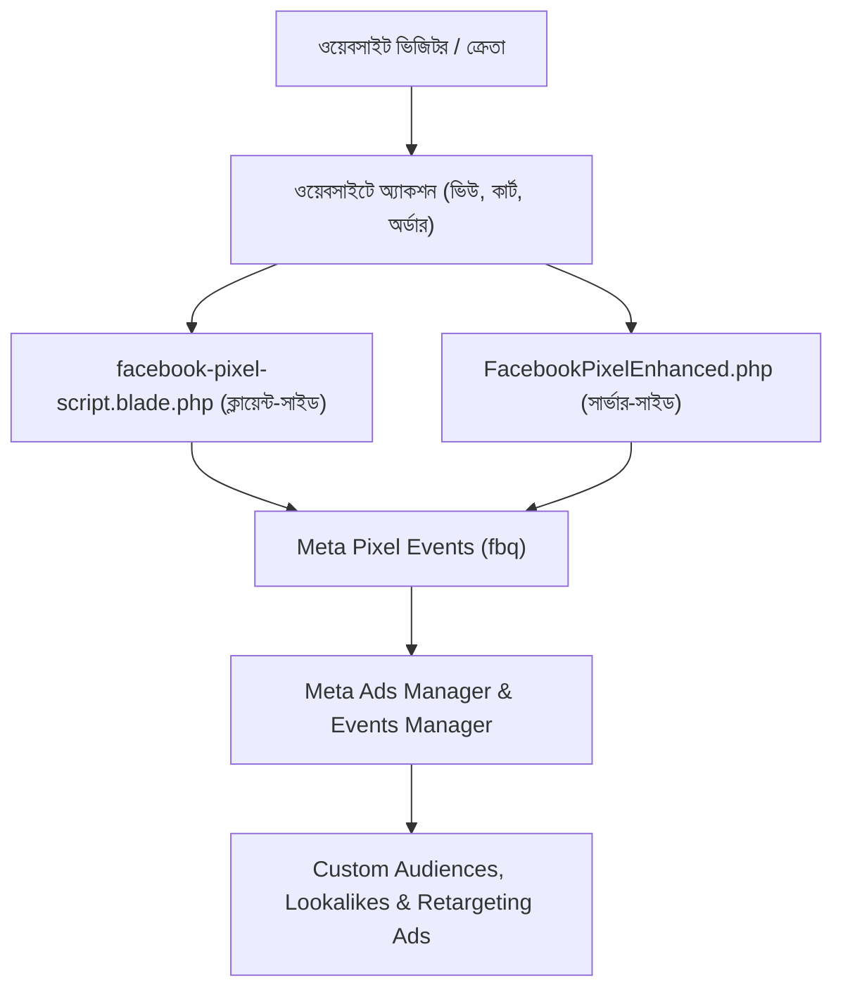

# Habitto BD - Meta (Facebook) Pixel ও ট্র্যাকিং ইভেন্ট ভেরিফিকেশন গাইড

**ওয়েবসাইট:** Habitto BD  
**ফ্রেমওয়ার্ক ও থিম:** Botble CMS on Laravel 12 & Ninico Theme  
**ট্র্যাকিং ইঞ্জিন:** `FacebookPixelEnhanced.php` (Server/Backend Event Engine) + `facebook-pixel-script.blade.php` (Client-side JS Realtime Tracker)  
**ডিফল্ট কারেন্সি:** Bangladeshi Taka (BDT ৳)  

---

## সূচিপত্র
1. [মেটা পিক্সেলের ভূমিকা ও Habitto BD-এর আর্কিটেকচার](#১-মেটা-পিক্সেলের-ভূমিকা-ও-habitto-bd-এর-আর্কিটেকচার)
2. [ধাপ ১: মেটা ইভেন্টস ম্যানেজার থেকে পিক্সেল আইডি সংগ্রহ](#ধাপ-১-মেটা-ইভেন্টস-ম্যানেজার-থেকে-পিক্সেল-আইডি-সংগ্রহ)
3. [ধাপ ২: Habitto অ্যাডমিন প্যানেলে পিক্সেল কনফিগারেশন](#ধাপ-২-habitto-অ্যাডমিন-প্যানেলে-পিক্সেল-কনফিগারেশন)
4. [ধাপ ৩: Habitto BD-তে ট্র্যাকিং ইভেন্ট ম্যাপিং তালিকা](#ধাপ-৩-habitto-bd-তে-ট্র্যাকিং-ইভেন্ট-ম্যাপিং-তালিকা)
5. [ধাপ ৪: লাইভ ইভেন্ট ভেরিফিকেশন ও টেস্টিং পদ্ধতি](#ধাপ-৪-লাইভ-ইভেন্ট-ভেরিফিকেশন-ও-টেস্টিং-পদ্ধতি)
   - পদ্ধতি ১: Meta Pixel Helper (গুগল ক্রোম এক্সটেনশন)
   - পদ্ধতি ২: ব্রাউজার কনসোল ডিবাগিং (Habitto Built-in Debug Mode)
   - পদ্ধতি ৩: Meta Events Manager - "Test Events" টুল
6. [ধাপ ৫: ডোমেন ভেরিফিকেশন ও ট্রাবলশুটিং](#ধাপ-৫-ডোমেন-ভেরিফিকেশন-ও-ট্রাবলশুটিং)

---

## ১. মেটা পিক্সেলের ভূমিকা ও Habitto BD-এর আর্কিটেকচার

ই-কমার্স স্টোরের সেলস বৃদ্ধি, ফেসবুক/ইনস্টাগ্রাম অ্যাড অপটিমাইজেশন এবং রিটার্ন অন অ্যাড স্পেন্ড (ROAS) ট্র্যাক করার জন্য মেটা পিক্সেল অপরিহার্য। 



### Habitto BD ট্র্যাকিং আর্কিটেকচারের সুবিধা:
* **নেটিভলি বিল্ট-ইন:** কোনো থার্ড-পার্টি প্লাগইন ছাড়াই ই-কমার্স কোরের সাথে যুক্ত।
* **ডুয়াল সোর্স সাপোর্ট:** ব্রাউজারে জাভাস্ক্রিপ্ট ইভেন্ট এবং সার্ভারে অর্ডার সম্পূর্ণ হওয়ার পর সার্ভার-সাইড ইভেন্ট উভয়ই হ্যান্ডেল করা হয়।
* **কারেন্সি সিঙ্ক:** স্বয়ংক্রিয়ভাবে স্টোরের ডিফল্ট কারেন্সি `BDT` মেটাতে পাঠিয়ে সঠিক বিক্রয়মূল্য নির্ধারণ করে।
* **বিল্ট-ইন কনসোল ডিবাগ মোড:** কোডে কোনো ত্রুটি আছে কিনা তা ব্রাউজার থেকেই রঙিন ব্যাজ আকারে পরীক্ষা করা যায়।

---

## ধাপ ১: মেটা ইভেন্টস ম্যানেজার থেকে পিক্সেল আইডি সংগ্রহ

১. আপনার ব্রাউজারে প্রবেশ করুন: **[Meta Events Manager](https://business.facebook.com/events_manager)**  
২. বাম পাশের সাইডবার থেকে সবুজ রঙের **`+` (Connect Data Sources)** আইকনে ক্লিক করুন।  
৩. ডেটা সোর্স অপশন থেকে **Web** নির্বাচন করে **Connect** বাটনে চাপ দিন।  
৪. আপনার ডেটাসেট বা পিক্সেলের একটি নাম লিখুন (যেমন: `Habitto BD Pixel`) এবং **Create** করুন।  
৫. সেটআপ উইজার্ডে কোড ম্যানুয়াল ইনস্টল বা পার্টনার ইন্টিগ্রেশনের বিকল্প এলে উইন্ডোটি ক্লোজ করুন।  
৬. এবার Events Manager-এর **Settings** ট্যাবে যান এবং নিচে স্ক্রোল করে **Dataset ID / Pixel ID** (১৫-১৬ ডিজিটের সংখ্যা, যেমন: `9876543210987654`) কপি করে রাখুন।

---

## ধাপ ২: Habitto অ্যাডমিন প্যানেলে পিক্সেল কনফিগারেশন

১. Habitto BD অ্যাডমিন প্যানেলে লগইন করুন।  
২. মেনু থেকে প্রবেশ করুন:  
   👉 **`Settings` ➔ `Common` ➔ `Website Tracking`**  
   *(অথবা `Ecommerce` ➔ `Settings` ➔ `Tracking`)*  
   *(সরাসরি লিংক: `http://localhost:8000/admin/settings/website-tracking`)*  

৩. পেজটিতে স্ক্রোল করে **Facebook Pixel** ব্লকে যান:
   * **Enable Facebook Pixel:** সুইচটি অন (**ON**) করুন।
   * **Facebook Pixel ID:** আপনার কপি করা পিক্সেল আইডিটি পেস্ট করুন (যেমন: `9876543210987654`)।
   * **Facebook Pixel Debug Mode:** টেস্টিং চলাকালীন এটি অন (**ON**) রাখুন।

৪. নিচে **Save Settings** বাটনে ক্লিক করে সেভ করুন।  
৫. **ক্যাশ ক্লিয়ার করুন:**  
   নতুন সেটিংস ফ্রন্টএন্ডে কার্যকর করতে `Administration` ➔ `Cache Management` ➔ **Clear Cache**-এ ক্লিক করুন।

---

## ধাপ ৩: Habitto BD-তে ট্র্যাকিং ইভেন্ট ম্যাপিং তালিকা

Habitto-এর কোডবেস বিশ্লেষণ করে নিশ্চিত করা হয়েছে যে নিচের স্ট্যান্ডার্ড ও কাস্টম ইভেন্টগুলো সম্পূর্ণ ডাটা সহ মেটাতে প্রেরিত হয়:

| ইভেন্টের নাম | কখন ফায়ার হয় | প্যারামিটার ও ডেটা পেলোড |
| :--- | :--- | :--- |
| **`PageView`** | ওয়েবসাইটের যেকোনো পেজ ভিজিট করলে। | URL, ব্রাউজার হেডার, টাইমস্ট্যাম্প। |
| **`ViewContent`** | কোনো নির্দিষ্ট পণ্যের পেজ (Product Details) খুললে। | `content_ids: ['54']`, `content_name: 'Premium Shirt'`, `content_type: 'product'`, `value: 1250`, `currency: 'BDT'`, `content_category: 'Shirts'` |
| **`ViewCategory`** | কোনো ক্যাটাগরি পেজে (যেমন: Men's Fashion) গেলে। | `content_category: 'Fashion'`, `content_ids: ['1', '2', '3']`, `content_type: 'product_group'` |
| **`Search`** | সার্চ বারে কোনো পণ্যের নাম লিখে খুঁজলে। | `search_string: 'polo shirt'`, `content_type: 'product'` |
| **`AddToCart`** | পণ্যের **"Add to Cart"** বাটনে চাপ দিলে। | `content_ids: ['54']`, `contents: [{id: '54', quantity: 1}]`, `value: 1250`, `currency: 'BDT'` |
| **`AddToWishlist`** | পণ্যে হার্ট (Wishlist) আইকনে ক্লিক করলে। | `content_ids`, `content_name`, `value`, `currency: 'BDT'` |
| **`InitiateCheckout`** | কার্ট থেকে চেকআউট পেজে (`/checkout`) প্রবেশ করলে। | কার্টের সব পণ্যের আইডি, পণ্যের সংখ্যা (`num_items`), মোট কার্ট ভ্যালু (`value`), `currency: 'BDT'` |
| **`AddPaymentInfo`** | চেকআউটে পেমেন্ট অপশন (COD/Bank/SSLCommerz) সিলেক্ট করলে। | `payment_type: 'cod'`, `value`, `currency: 'BDT'` |
| **`Purchase`** | অর্ডার নিশ্চিত হওয়ার পর থ্যাংক ইউ পেজ লোড হলে। | `order_id: '100002'`, `content_ids`, `contents`, `value: মোট টাকার অংক`, `num_items`, `currency: 'BDT'` |
| **`CompleteRegistration`** | নিউজলেটারে ইমেইল সাবস্ক্রাইব বা অ্যাকাউন্ট খুললে। | `status: true`, `content_name: 'Newsletter Subscription'`, `currency: 'BDT'` |
| **`Lead`** | কন্টাক্ট পেজ থেকে মেসেজ পাঠালে। | `content_name: 'Contact Form Submission'`, `content_category: 'Lead Generation'` |
| **`RemoveFromCart`** | কার্ট পেজ থেকে কোনো আইটেম মুছে ফেললে (Custom)। | `content_ids`, `contents`, `value`, `currency: 'BDT'` |
| **`AddToCompare`** | তুলনা করার জন্য Compare বাটনে ক্লিক করলে (Custom)। | `content_ids`, `content_name`, `value`, `currency: 'BDT'` |

---

## ধাপ ৪: লাইভ ইভেন্ট ভেরিফিকেশন ও টেস্টিং পদ্ধতি

পিক্সেল সক্রিয় করার পর নিচের ৩টি উপায়ে লাইভ ট্র্যাকিং যাচাই করা যায়:

### পদ্ধতি ১: Meta Pixel Helper (গুগল ক্রোম এক্সটেনশন)
১. ক্রোম ব্রাউজারে [Meta Pixel Helper Extension](https://chromewebstore.google.com/detail/meta-pixel-helper/fdgfkebogiimcoedlicjlajpkdmockpc) যুক্ত করুন।  
২. ওয়েবসাইট ওপেন করুন (`http://localhost:8000` বা আপনার ডোমেইন)।  
৩. ব্রাউজারের উপরে এক্সটেনশন আইকনটিতে নীল/সবুজ ব্যাজ এবং টিক চিহ্ন উঠবে।  
৪. এক্সটেনশনে ক্লিক করলে আপনার পিক্সেল আইডি এবং **`PageView`** ইভেন্ট দেখা যাবে।  
৫. যেকোনো পণ্যে ক্লিক করলে তাৎক্ষণিক **`ViewContent`** ইভেন্ট সবুজ টিক সহ পপআপে শো করবে।  
৬. **Add to Cart** চাপলে **`AddToCart`** ইভেন্ট ড্রপডাউনে পণ্যের আইডি ও মূল্য (BDT) প্রদর্শন করবে।

### পদ্ধতি ২: ব্রাউজার কনসোল ডিবাগিং (Habitto Built-in Debug Mode)
অ্যাডমিন প্যানেলে **Facebook Pixel Debug Mode** চালু থাকলে ব্রাউজারের কনসোল থেকে প্রতিটি ইভেন্টের বিস্তারিত যাচাই করা যায়:
১. ওয়েবসাইটে থাকা অবস্থায় কিবোর্ডের **`F12`** বাটন চাপুন (অথবা রাইট ক্লিক করে **Inspect** নির্বাচন করুন)।  
২. **Console** ট্যাবে ক্লিক করুন।  
৩. সাইট ব্রাউজ বা কার্টে পণ্য যোগ করলে কনসোলে নিচের মতো আকর্ষণীয় রঙিন মেসেজ প্রদর্শিত হবে:
   ```javascript
   // নীল ব্যাজ:
   Facebook Pixel Debug Mode Active
   
   // সবুজ ব্যাজ:
   FB Pixel Event [Client-Side] AddToCart {
       content_ids: ["54"],
       content_name: "Formal Cotton Shirt",
       content_type: "product",
       contents: [{ id: "54", quantity: 1 }],
       value: 1250,
       currency: "BDT"
   }
   ```
   *(যদি কনসোলে এই আউটপুট আসে, তার মানে হাবিত্তোর জাভাস্ক্রিপ্ট ইঞ্জিন সম্পূর্ণ ডাটা মেটাতে পাঠাতে প্রস্তুত)*।

### পদ্ধতি ৩: Meta Events Manager - "Test Events" টুল
১. [Meta Events Manager](https://business.facebook.com/events_manager)-এ যান।  
২. আপনার পিক্সেল নির্বাচন করে **Test Events** ট্যাবে ক্লিক করুন।  
৩. **Confirm your website's events are set up correctly** বক্সে আপনার ওয়েবসাইটের ইউআরএল দিন এবং **Open Website** বাটনে চাপুন।  
৪. ওয়েবসাইটটি নতুন উইন্ডোতে খুলবে। এবার সেখানে নিচের কাজগুলো ক্রমানুসারে করুন:
   - হোমপেজ ভিজিট করুন ➔ মেটা টেস্ট প্যানেলে **`PageView`** আসবে।
   - যেকোনো একটি পণ্যে ক্লিক করুন ➔ **`ViewContent`** আসবে।
   - পণ্যে **Add to Cart** চাপুন ➔ **`AddToCart`** আসবে।
   - চেকআউট পেজে যান ➔ **`InitiateCheckout`** আসবে।
   - ক্যাশ অন ডেলিভারি সিলেক্ট করে অর্ডার প্লেস করুন ➔ **`Purchase`** ইভেন্ট আসবে (অর্ডার ভ্যালু সহ)।
৫. মেটা ইভেন্টস ম্যানেজার স্ক্রিনে ফিরে আসলে লাইভ টাইমলাইনে সবকটি ইভেন্ট সবুজ সিগন্যাল সহ রিসিভ হওয়া দেখতে পাবেন।

---

## ধাপ ৫: ডোমেন ভেরিফিকেশন ও ট্রাবলশুটিং

### ডোমেন ভেরিফিকেশন (Meta Business Settings):
ফেসবুক অ্যাডের কাস্টম কনভার্সন অপটিমাইজেশন সচল রাখতে মেটাতে ডোমেন ভেরিফাই করা জরুরি:
1. Meta Business Suite ➔ **Business Settings** ➔ **Brand Safety** ➔ **Domains**-এ যান।
2. **Add Domain**-এ ক্লিক করে আপনার ডোমেন দিন (যেমন: `habittobd.com`)।
3. মেটা থেকে প্রদত্ত **HTML Meta-Tag** কপি করুন।
4. Habitto অ্যাডমিন প্যানেলে যান: `Settings` ➔ `Website Tracking`।
5. **Header tracking code** বক্সে মেটা-ট্যাগটি পেস্ট করে সেভ করুন।
6. মেটা বিজনেস ম্যানেজারে ফিরে এসে **Verify Domain** বাটনে ক্লিক করলেই সাথে সাথে ডোমেন ভেরিফাইড হয়ে যাবে।

### সাধারণ সমস্যা ও সমাধান (Troubleshooting):
* **পিক্সেল হেল্পারে ইভেন্ট দেখাচ্ছে না?**  
  ব্রাউজারে থাকা AdBlocker, uBlock Origin বা Brave Shield সাময়িকভাবে বন্ধ রাখুন, কারণ এগুলো ট্র্যাকিং স্ক্রিপ্ট ব্লক করে রাখে।
* **Purchase ইভেন্ট ডাবল ফায়ার হচ্ছে কি?**  
  না। Habitto-এর `facebook-pixel-script.blade.php`-তে `isEventTracked()` মেকানিজম রয়েছে, যা ২ সেকেন্ডের মধ্যে একই ইভেন্ট একাধিকবার ফায়ার হওয়া স্বয়ংক্রিয়ভাবে প্রতিহত করে।
* **লাইভ যাওয়ার পর করণীয়:**  
  টেস্টিং সফলভাবে সম্পন্ন হলে অ্যাডমিন প্যানেলের `Website Tracking` থেকে **Facebook Pixel Debug Mode** টগলটি বন্ধ (OFF) করে দিন।

---
*ডকুমেন্টটি Habitto BD-এর সোর্স কোড ও মেটা পিক্সেল এনহ্যান্সড ইঞ্জিনের সরাসরি মূল্যায়নের ভিত্তিতে প্রস্তুত।*
